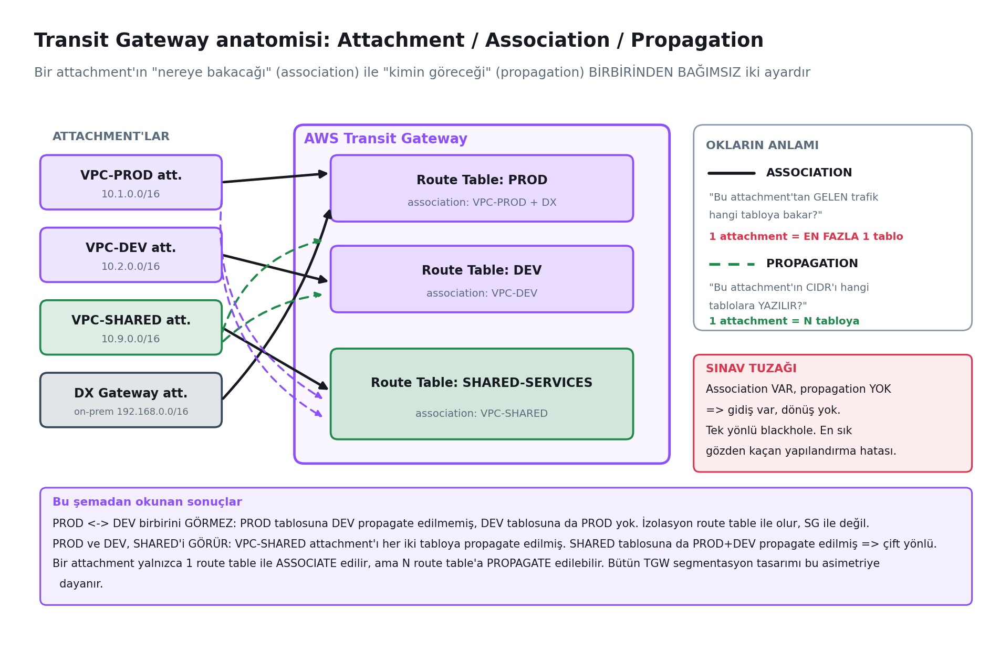
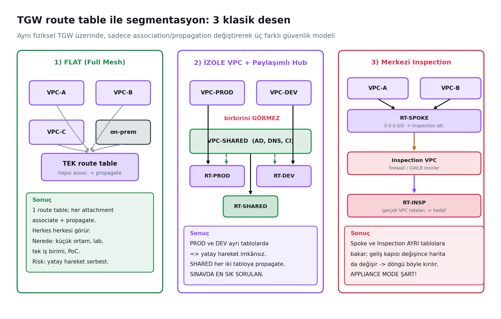
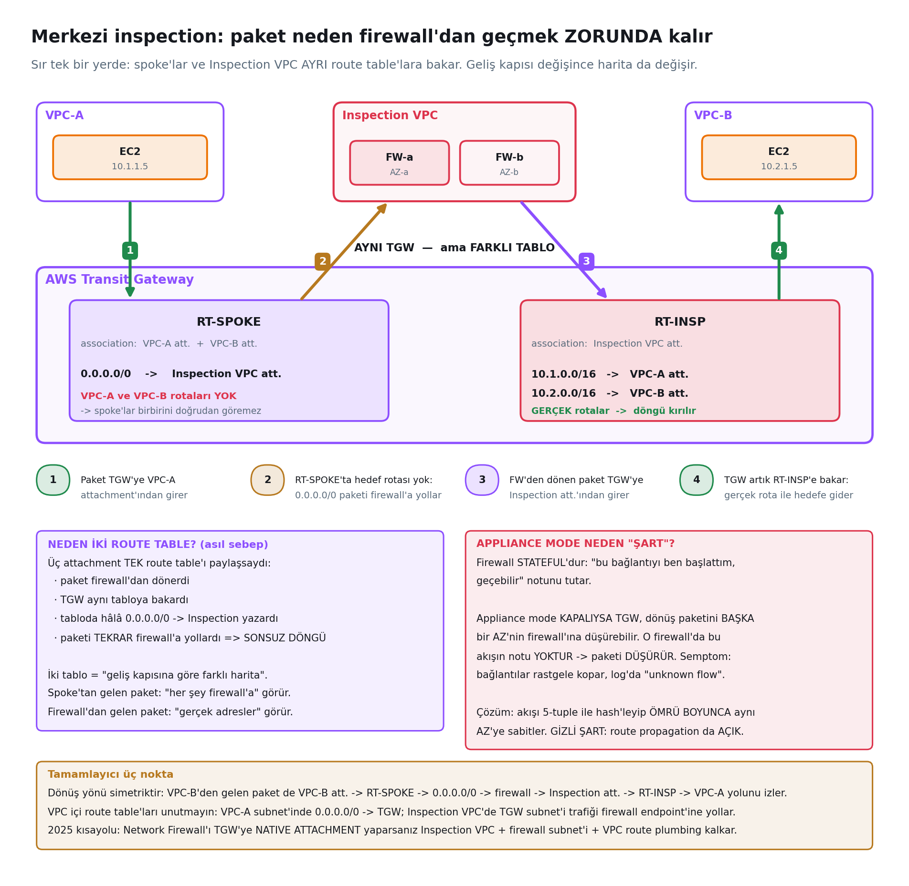
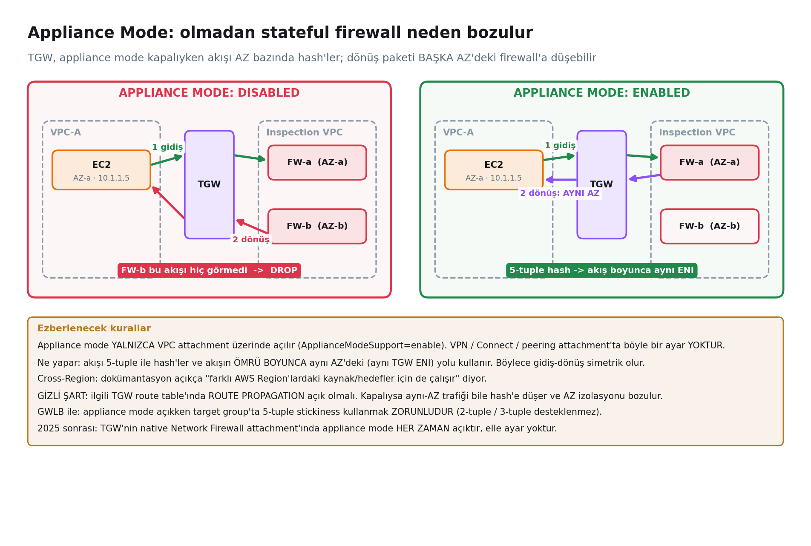
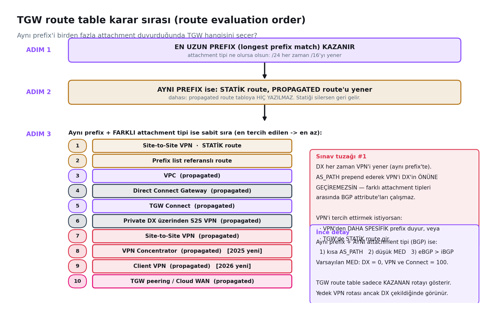
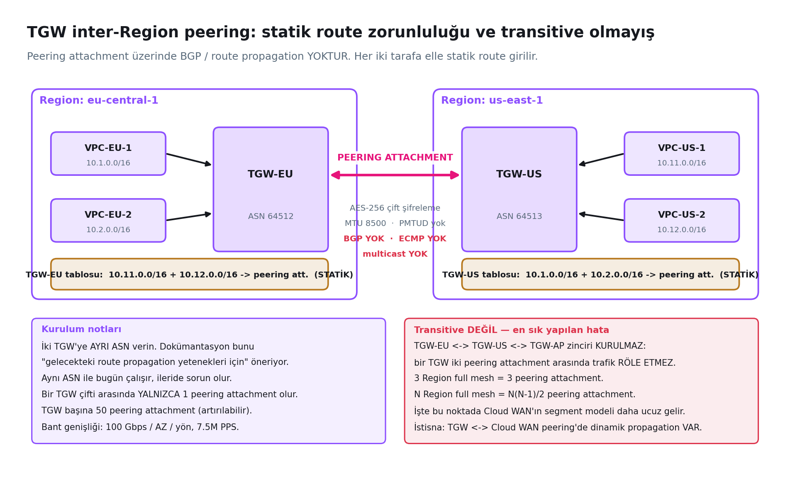
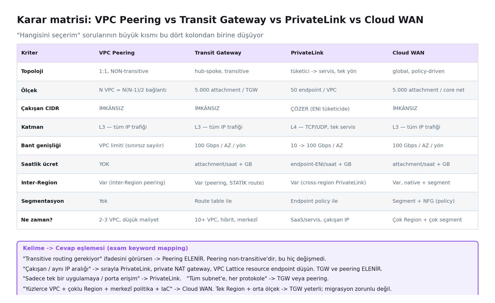

# Bölüm 1 — AWS Transit Gateway

> **Bu bölümün sınavdaki ağırlığı:** SAP-C02'nin ağ sorularının yaklaşık üçte biri doğrudan ya da dolaylı olarak TGW'ye dokunuyor. "50 VPC var, hepsi birbirini görsün ama prod ile dev konuşmasın" tipindeki sorular buradan çıkıyor.

---

## 1.1 TGW nedir, gerçekten ne yapar?

Teknik tanım: Transit Gateway, bir AWS Region'ı içinde çalışan **bölgesel (regional) bir sanal router**'dır. VPC'ler, VPN bağlantıları, Direct Connect Gateway'ler ve diğer TGW'ler ona **attachment** olarak bağlanır; TGW bu attachment'lar arasında **transitive** (geçişli) L3 yönlendirme yapar.

Buradaki kritik kelime **transitive**'dir. VPC Peering'de A↔B ve B↔C peering'i varsa A, C'yi göremez — çünkü peering geçişli değildir. TGW'de A, B ve C aynı TGW'ye bağlıysa (ve route table izin veriyorsa) A doğrudan C'ye gidebilir.

### Basit anlatım — Havalimanı aktarma merkezi

VPC Peering, iki şehir arasına çekilmiş **özel bir tren rayı** gibidir. İstanbul–Ankara rayı, İstanbul–İzmir rayı… 10 şehri birbirine bağlamak için 45 ray döşemeniz gerekir (N(N–1)/2). Üstelik Ankara'daki ray İzmir'e devam etmez; her şehir çifti için ayrı ray.

Transit Gateway ise bir **aktarma havalimanı**dır. Her şehirden havalimanına tek bir uçuş vardır (10 şehir = 10 uçuş). Bir şehirden diğerine gitmek istediğinizde havalimanında aktarma yaparsınız. Ve en önemlisi: havalimanı yönetimi **hangi yolcunun hangi kapıdan hangi uçuşa binebileceğine karar verir** — işte bu "route table" mekanizmasıdır.

---

## 1.2 Attachment, Association, Propagation — üçlemesi

Bu üç kelimeyi karıştırmak, TGW sorularında kaybetmenin bir numaralı sebebi. Şemaya dikkatli bakın:



### Attachment
TGW'ye bir şeyi bağlama eylemi. Tipleri:

| Attachment tipi | Neye bağlanır | Notlar |
|---|---|---|
| **VPC** | Aynı Region'daki bir VPC | AZ başına bir ENI oluşur; hangi subnet'lerde ENI olacağını sen seçersin |
| **VPN** | Site-to-Site VPN connection | 2 tünel; ECMP için BGP zorunlu |
| **Direct Connect Gateway** | DXGW üzerinden transit VIF | DXGW başına 6 TGW |
| **Peering** | Başka bir TGW (aynı veya farklı Region) | **Statik route zorunlu, BGP yok** |
| **Connect** | Bir VPC/DX attachment üzerinde GRE + BGP | SD-WAN appliance'ları için |
| **Network function** *(Haz 2025)* | AWS Network Firewall | Inspection VPC'yi tamamen ortadan kaldırır |
| **VPN Concentrator** *(Kas 2025)* | 100'e kadar düşük bantlı şube | Tek attachment'ta toplar |
| **Client VPN** *(Nis 2026)* | Client VPN endpoint | Hosting VPC gerekmez, **client IP korunur (SNAT yok)** |

### Association
**"Bu attachment'tan GELEN trafik hangi route table'a bakacak?"**

Bir attachment **en fazla bir** route table ile associate edilir. Bu, o attachment'ın "yönlendirme kararını nereden okuduğu"dur. Association bir attachment'ın *giriş* tarafıdır.

### Propagation
**"Bu attachment'ın arkasındaki CIDR'lar hangi route table'lara YAZILACAK?"**

Bir attachment **N tane** route table'a propagate edilebilir. Bu, "bu attachment'ın varlığından kimler haberdar olacak" sorusunun cevabıdır. Propagation bir attachment'ın *çıkış/duyuru* tarafıdır.

> ### Sınav tuzağı: tek yönlü blackhole
> A attachment'ı X tablosuyla associate edilmiş, B attachment'ı X tablosuna propagate edilmiş → **A, B'ye gidebilir**.
> Ama B'nin associate olduğu Y tablosuna A propagate edilmemişse → **B'den A'ya dönüş yok**.
> Sonuç: TCP handshake tamamlanmaz, "ping gitmiyor ama route var" durumu. Cevap her zaman "propagation'ı iki yönlü kontrol et"tir.

### Basit anlatım — Apartman yönetimi

Bir apartman düşün. Her daire bir VPC.

- **Attachment** = daireyi apartmanın elektrik/su tesisatına bağlamak.
- **Association** = o dairenin **hangi telefon rehberini** kullandığı. Her dairede sadece bir rehber var.
- **Propagation** = o dairenin numarasının **hangi rehberlere yazıldığı**. Numaran birden fazla rehbere yazılabilir.

3. kat, "Kat 3 rehberi"ni kullanıyor. 5. kattaki daire de kendi numarasını "Kat 3 rehberi"ne yazdırmışsa, 3. kat 5. katı arayabilir. Ama 5. katın kullandığı "Kat 5 rehberi"nde 3. katın numarası yoksa, 5. kat geri arayamaz. Telefon açılır ama karşı taraf kimin aradığını bilmediği için cevap veremez.

---

## 1.3 Segmentasyon desenleri

Route table'ın tek gerçek amacı **kimin kimi göreceğine karar vermek**tir. Güvenlik gruplarından *önce* gelen bir katmandır — SG'de izin verseniz bile route yoksa paket TGW'ye takılır.



### Desen 1: Flat (full mesh)
Tek route table, her attachment associate + propagate. Herkes herkesi görür. Lab, PoC, tek iş birimi için uygun. Kurumsal ortamda **yatay hareket (lateral movement)** riski nedeniyle tercih edilmez.

### Desen 2: İzole VPC'ler + paylaşımlı hizmetler (en çok sorulan)
```
RT-PROD   : association = VPC-PROD attachment
            propagation = VPC-PROD + VPC-SHARED + DX
RT-DEV    : association = VPC-DEV attachment
            propagation = VPC-DEV + VPC-SHARED
RT-SHARED : association = VPC-SHARED attachment
            propagation = VPC-PROD + VPC-DEV + VPC-SHARED + DX
```
Sonuç: PROD ve DEV **hiçbir koşulda** birbirini göremez, ama ikisi de SHARED'e (Active Directory, DNS, artifact repo) ulaşır. On-prem sadece PROD'u görür.

### Desen 3: Merkezi inspection

Amaç: **VPC-A'dan VPC-B'ye giden paket, önce firewall'dan geçmek ZORUNDA olsun.** Bu, TGW'de tek bir hileyle yapılır: **iki route table**.



**Paketin gerçek yolculuğu** (VPC-A'daki `10.1.1.5` → VPC-B'deki `10.2.1.5`):

| Adım | Ne olur |
|---|---|
| **1** | Paket TGW'ye **VPC-A attachment'ından** girer. Bu attachment **RT-SPOKE** ile associate edilmiştir → TGW kararı bu tablodan okur. |
| **2** | RT-SPOKE'ta VPC-B'nin rotası **YOKTUR**; sadece `0.0.0.0/0 → Inspection VPC attachment` vardır. Paket hedefe değil, **firewall'a** gider. |
| **3** | Firewall inceler, izin verir, TGW'ye geri gönderir. Paket bu kez **Inspection attachment'ından** girer — yani **RT-INSP** ile associate olan attachment'tan. |
| **4** | RT-INSP'te gerçek rotalar vardır: `10.2.0.0/16 → VPC-B attachment`. Paket hedefine gider. |

#### İki tablonun asıl sebebi: sonsuz döngüyü engellemek

Üç attachment da **tek** route table'ı paylaşsaydı:
1. Paket firewall'dan dönerdi
2. TGW **aynı** tabloya bakardı
3. Tabloda hâlâ `0.0.0.0/0 → Inspection` yazıyor olurdu
4. Paketi **tekrar firewall'a** gönderirdi → **sonsuz döngü**

İki route table, *"geliş kapısına göre farklı harita"* demektir. Spoke'tan gelen paket **"her şey firewall'a"** haritasını görür; firewall'dan gelen paket **"gerçek adresler"** haritasını görür. Döngü tam burada kırılır.

#### Unutulmaması gerekenler
- **VPC içi route table'ları da gerekir:** VPC-A'nın subnet route table'ında `0.0.0.0/0` (veya `10.0.0.0/8`) → TGW; Inspection VPC'de ise TGW subnet'i trafiği **firewall/GWLB endpoint'ine** yollamalı.
- **Dönüş yönü simetriktir:** VPC-B'den gelen paket de VPC-B att. → RT-SPOKE → `0.0.0.0/0` → firewall → Inspection att. → RT-INSP → VPC-A yolunu izler.
- **Bu desende appliance mode ZORUNLUDUR** — sebebini bir sonraki bölümde göreceksiniz.
- **2025 kısayolu:** Network Firewall'ı TGW'ye **native attachment** olarak bağlarsanız bu şemadaki Inspection VPC, firewall subnet'i ve VPC route table plumbing'i **tamamen ortadan kalkar** (bkz. 1.10).

### Blackhole route
Statik route oluştururken target olarak `blackhole` seçebilirsiniz. Eşleşen trafik **sessizce düşürülür**.

Neden faydalı: statik route propagated route'u ezdiği için, bir blackhole statik route'u **propagate edilmiş bir rotayı da bastırır**. Yani "şu prefix asla bu tablodan gitmesin" demenin en temiz yolu, o prefix için blackhole statik route'dur — propagation'ı tamamen kapatmaya gerek kalmaz.

Ayrıca: TGW Flow Logs'ta `packets-lost-blackhole` sayacı, blackhole'a düşen paketleri size doğrudan gösterir.

---

## 1.4 Appliance Mode — en çok yanlış bilinen özellik



### Problem
TGW, varsayılan davranışında trafiği **kaynak AZ'de tutmaya** çalışır (cross-AZ ücretini ve gecikmeyi azaltmak için). Ama hedef VPC birden fazla AZ'de attachment ENI'sine sahipse, TGW dönüş trafiğini **akış hash'ine göre** başka bir AZ'ye gönderebilir.

Stateless bir hedef için bu sorun değil. Ama hedef **stateful bir firewall** ise felaket:
1. Gidiş paketi AZ-a'daki FW-a'ya düşer → FW-a akışı state tablosuna yazar.
2. Dönüş paketi AZ-b'deki FW-b'ye düşer → FW-b bu akışı **hiç görmemiştir** → paket DROP.

Sonuç: bağlantılar rastgele kopar, `curl` bazen çalışır bazen çalışmaz. Debug etmesi cehennem.

### Çözüm
VPC attachment üzerinde `ApplianceModeSupport = enable`. Bu ayar TGW'ye "bu attachment'a giden akışları **5-tuple ile hash'le ve akışın ömrü boyunca aynı AZ'yi/ENI'yi kullan**" der. Gidiş ve dönüş simetrik olur.

### Ezberlenecek kurallar

| Kural | Detay |
|---|---|
| Nerede açılır | **YALNIZCA VPC attachment**. VPN, Connect, peering attachment'ında böyle bir ayar yok. |
| Cross-Region | Doküman açıkça "farklı Region'lardaki kaynak/hedefler için de çalışır" diyor. |
| Gizli ön koşul | İlgili TGW route table'ında **route propagation açık olmalı**. Kapalıysa aynı-AZ trafiği bile hash'e düşer ve AZ izolasyonu bozulur. |
| GWLB ile birlikte | Appliance mode açıkken GWLB target group'ta **5-tuple stickiness zorunlu**. 2-tuple ve 3-tuple desteklenmez. |
| Native NFW attachment | TGW'nin Network Firewall attachment'ında appliance mode **her zaman açık**, elle ayar yok. |

> **2026 notu — eski kaynakları düzeltin:** "Appliance mode, TGW peering attachment'ları üzerinde çalışmaz" ifadesi eski dokümanlardan geliyordu ve **güncel dokümantasyonda artık yok**. AWS Prescriptive Guidance, TGW-peering'li inspection mimarilerinde appliance mode kullanıyor. Sınavda bu iddiayı içeren bir seçenek görürseniz onu "kesin doğru" varsaymayın; senaryodaki diğer ipuçlarına bakın.

### Basit anlatım — Gümrük memuru

Havalimanı gümrüğünde iki memur var: Ahmet (A kapısı) ve Bora (B kapısı). Ahmet, bir yolcunun bavulunu açıp "tamam, bu adam temiz, çıkışta da geçebilir" diye not alıyor.

Yolcu dönerken B kapısına gelirse Bora'nın elinde hiçbir not yok. Bora, "ben bu adamı tanımıyorum" der ve içeri almaz. Appliance mode, "aynı yolcu hangi kapıdan girdiyse aynı kapıdan çıkacak" kuralını koymaktır.

---

## 1.5 Route evaluation order — TGW hangi rotayı seçer?



Sıra şu şekilde işler:

**Adım 1 — Longest prefix match.** Attachment tipi ne olursa olsun, `10.1.0.0/24` her zaman `10.1.0.0/16`'yı yener. Bu her şeyin önündedir.

**Adım 2 — Aynı prefix ise: statik > propagated.** Dahası: propagated route **tabloya hiç yazılmaz**. Konsolda göremezsiniz. Statik route'u sildiğinizde propagated route geri gelir.

**Adım 3 — Aynı prefix, farklı attachment tipi ise sabit sıra:**

| # | Attachment tipi |
|---|---|
| 1 | Site-to-Site VPN — **statik** route |
| 2 | Prefix-list referanslı route |
| 3 | VPC (propagated) |
| 4 | Direct Connect Gateway (propagated) |
| 5 | TGW Connect (propagated) |
| 6 | Private DX üzerinden S2S VPN (propagated) |
| 7 | Site-to-Site VPN (propagated) |
| 8 | VPN Concentrator (propagated) — *2025 eklendi* |
| 9 | Client VPN (propagated) — *2026 eklendi* |
| 10 | TGW peering / Cloud WAN (propagated) |

**Adım 4 — Aynı prefix, aynı attachment tipi (BGP) ise:** kısa AS_PATH → düşük MED → eBGP > iBGP. Varsayılan MED: DX = 0, VPN ve Connect = 100.

Bunun ötesinde AWS "tutarlı bir öncelik sırası garanti edemiyoruz" diyor.

> ### Sınav tuzağı #1 (klasik)
> "Direct Connect'i birincil, VPN'i yedek yaptım. VPN trafiğini birincil yapmak istiyorum, AS_PATH prepend uygulayacağım."
> **YANLIŞ.** DX ve VPN farklı attachment tipleridir; aralarındaki sıra **sabittir** ve BGP attribute'ları bu sırayı değiştiremez. Ayrıca farklı attachment tipleri arasında **ECMP de yapılmaz**.
> Doğru çözümler: (a) VPN'den daha spesifik prefix duyurmak, (b) TGW'de statik route girmek.

> ### Görüntü tuzağı
> TGW route table **sadece kazanan rotayı gösterir**. DX'in arkasında yedek bir VPN varsa, o VPN rotasını tabloda göremezsiniz — DX çekilince ortaya çıkar. "Route table'da VPN rotası yok, yedeklilik çalışmıyor" çıkarımı yanlıştır.

---

## 1.6 TGW Peering (inter-Region ve intra-Region)



| Özellik | Durum |
|---|---|
| Region | Inter-Region **ve** intra-Region |
| Adres ailesi | IPv4 + IPv6 |
| **Routing** | **Sadece statik route.** BGP yok, propagation yok. |
| **ECMP** | **Yok** (ne dinamik routing ne iki statik route) |
| **Multicast** | **Yok** |
| Şifreleme | Inter-Region trafiği **AES-256 ile çift şifrelenir** |
| Bant genişliği | 100 Gbps / AZ / yön, 7,5M PPS |
| MTU | 8500, **PMTUD yok** |
| Kota | TGW başına 50 peering (artırılabilir); aynı iki TGW arasında **yalnızca 1** peering |
| ASN | İki TGW'ye ayrı ASN verilmesi önerilir ("gelecekteki route propagation yetenekleri için") |

### Transitive değil

> **Hassasiyet notu:** AWS dokümantasyonu TGW peering için "transitive" kelimesini **kullanmıyor**. Alıntılanabilir ifadeler şunlar: *"transit gateway peering attachment'ları için **yalnızca statik route'lar desteklenir**"* ve FAQ'deki *"Transit Gateway'ler arasındaki peering attachment'ları **route propagation'ı desteklemez**."* Bu ikisi birlikte, pratikte transitive olmama sonucunu doğurur — her hop'ta elle statik route yazmanız gerekir. Sınavda "non-transitive" ifadesini gördüğünüzde bu mekanizmayı düşünün.

`TGW-EU ↔ TGW-US ↔ TGW-AP` zinciri **çalışmaz**. Bir TGW, iki peering attachment arasında trafik röle etmez. 3 Region full mesh = 3 peering; N Region = N(N–1)/2 peering. 5 Region'da 10 peering attachment, 10 çift statik route seti — işte Cloud WAN'ın satış argümanı tam burada başlar.

**İstisna:** TGW ↔ **Cloud WAN core network** peering'inde dinamik propagation **vardır** — buna *transit gateway route table announcement* deniyor (`announcementDirection: incoming|outgoing`). TGW↔TGW peering'de bu yok.

---

## 1.7 TGW Connect — SD-WAN appliance'ları için

Klasik yöntem: SD-WAN cihazını bir VPC'ye koy, TGW'ye VPN attachment ile bağla (IPsec üstünden IPsec, gereksiz şifreleme, 1,25 Gbps tavan).

TGW Connect: **GRE tüneli (veri düzlemi) + BGP (kontrol düzlemi)**.

| Özellik | Değer |
|---|---|
| Transport attachment | Mevcut bir **VPC** veya **Direct Connect** attachment'ı (VPN transport **yok**) |
| Protokol | GRE + BGP; her Connect peer'da **2 BGP oturumu** (kontrol düzlemi yedekliliği) |
| eBGP gereksinimi | `ebgp-multihop` **TTL = 2** |
| BGP adres ailesi | **BGP peering IPv4-only**; MP-BGP ile IPv6 *prefix* taşınır |
| Timer | keepalive 10 sn / hold 30 sn |
| Connect peer sayısı | Attachment başına **4** |
| Bant genişliği | GRE tünel başına **5 Gbps** / 300K PPS → attachment başına **20 Gbps** |
| Inside CIDR | `169.254.0.0/16`'dan **/29** (TGW başına tekil olmalı) |
| Desteklenmeyen | **BFD, BGP graceful restart, statik route, multicast** |
| ECMP | Aynı ya da farklı attachment'lardaki Connect peer'lar arasında **var** — ama appliance'lar aynı prefix'i **aynı AS_PATH ile** duyurmalı. Bir peer'ın iki BGP oturumu arasında ECMP **yok**. |

---

## 1.8 TGW Multicast — sorulursa "kısıtlar" sorulur

- **IGMPv2** (dinamik) veya API/CLI ile statik üyelik. **IGMPv3/SSM yok.**
- Multicast desteği **TGW oluşturulurken** açılmalı; sonradan açılamaz.
- Bir subnet **yalnızca bir** multicast domain'e ait olabilir.
- **DX, VPN, peering ve Connect attachment'larında multicast YOK** — sadece VPC attachment.
- Non-Nitro instance'lar: source/dest check kapatılmalı ve **gönderici olamazlar**.
- Paket **fragmentasyonu yok**; büyük paketler düşürülür.
- Akış başına 1 Gbps, AZ başına toplam 20 Gbps.
- IGMP QUERY 2 dakikada bir; **3 ardışık kaçırılan** sorgu üyeliği düşürür.
- **IPv6 sadece statik multicast'te var**, dinamik (IGMP) multicast'te yok.
- AWS'in kendi uyarısı: "yüksek frekanslı ticaret veya performans hassasiyeti olan uygulamalar için uygun olmayabilir."

---

## 1.9 Kotalar ve sayılar (2026)

| Kalem | Değer | Artırılabilir? |
|---|---|---|
| Hesap başına TGW | 5 | ✅ |
| TGW başına attachment | 5.000 | ✅ |
| **VPC başına TGW** | **5** | ❌ |
| TGW başına route table | 20 | ✅ |
| TGW başına CIDR block | 5 | ❌ |
| **TGW başına TOPLAM route (tüm tablolar birlikte)** | **10.000** | ✅ (SA/TAM ile) |
| Bir prefix için tek attachment'a statik route | 1 | ❌ |
| Peering attachment / TGW | 50 | ✅ |
| Aynı iki TGW arasında peering | 1 | ❌ |
| Connect peer / Connect attachment | 4 | ❌ |
| VPN Concentrator / TGW | 5 | — |
| VPN connection / Concentrator | 100 | — |

### Bant genişliği (AZ başına, yön başına)

| Attachment | Bant genişliği | PPS |
|---|---|---|
| VPC | **100 Gbps** | 7.500.000 |
| DX Gateway **veya peering** | **100 Gbps** | 7.500.000 |
| Connect peer (tek GRE tünel) | 5 Gbps | 300.000 |
| Connect attachment (4 peer) | 20 Gbps toplam | — |
| VPN tüneli — standard | 1,25 Gbps | 140.000 |
| VPN tüneli — **large (LBT)** | **5 Gbps** | 400.000 |
| VPN Concentrator tüneli | 100 Mbps | 10.000 |

> **DÜZELTME — eski kaynaklar burada yanılıyor:** VPC / DX / peering attachment bant genişliği artık **50 Gbps burst** değil, **100 Gbps / AZ / yön**'dür.

### MTU
- **8500 bayt:** VPC, Direct Connect, Connect ve **peering** attachment'ları (intra-Region, inter-Region, Cloud WAN peering dahil).
- **1500 bayt:** Site-to-Site VPN (TGW kota sayfasına göre).
- TGW **MSS clamping** uygular (RFC 879).
- **PMTUD sadece VPC ve Connect attachment'ında var.** VPN, DX ve peering'de yok.
- Site-to-Site VPN kılavuzu ayrıca max MTU **1446** / max MSS **1406** diyor — bu, IPsec sonrası kullanılabilir payload MTU'sudur. İki sayı çelişmiyor, farklı noktaları ölçüyor.

### TGW route table gösterimi
Route table **yalnızca kazanan rotayı** listeler. Bir prefix için hem DX hem VPN varsa, VPN rotası ancak DX çekildiğinde görünür.

---

## 1.10 2025–2026'da eklenen TGW özellikleri (sınavda yeni yeni görülüyor)

### Network function attachment (Haz 2025) — oyun değiştirici
TGW artık **doğrudan AWS Network Firewall'a** attach oluyor. AWS altyapıyı kendisi sağlıyor:
- **Inspection VPC yok**, firewall subnet'i yok, firewall endpoint'i yok, VPC route table plumbing'i yok.
- Attachment **Network Firewall tarafından** oluşturulur, TGW konsolunda "Network function" tipinde görünür.
- **Appliance mode her zaman açık.**
- Kısıtlar: TGW farklı hesaptaysa RAM ile paylaşılmalı; her iki hesap da firewall'u silebilir; TGW sahibi firewall detaylarını sınırlı görür; `HOME_NET`/`EXTERNAL_NET` referansları policy varsayılanlarından farklı değerlerle yapılandırılmalı; firewall, paylaşılan TGW'nin **etkin olduğu bir AZ'de** olmalı; trafik **TGW route table** ile yönlendirilir, VPC route table ile değil.

### TGW Encryption Support (Kas 2025)
VPC↔VPC trafiği için **transit halinde şifrelemeyi zorunlu** kılar.
- **Uyumlu:** VPC, Direct Connect, VPN attachment'ları.
- **Uyumsuz (etkinleştirmeden önce var olmamalı):** Connect, **peering**, Network Firewall, VPN Concentrator, Client VPN attachment'ları; **security group referencing**; **multicast**.
- TGW oluşturulurken ayarlanamaz — sadece `modify-transit-gateway` ile.
- **Etkinleştirme 14 güne kadar sürebilir.** Geçiş kesintisiz. `use1-az3`'te desteklenmiyor.

### Flexible Cost Allocation (Kas 2025)
Varsayılan **gönderen-öder** modelini değiştirir. **Metering policy** ile en fazla **50 sıralı kural** yazıp veri işleme ücretini kaynak attachment sahibine (varsayılan), hedef attachment sahibine veya **TGW sahibine** yükleyebilirsiniz. Attachment tipine/ID'sine, CIDR'a, port aralığına, protokole göre eşleşir.
- TGW başına **1 policy**; sadece TGW sahibi ayarlar; attachment sahipleri override edemez.
- **Yeniden dağıtılamayanlar:** attachment saatlik ücretleri, multicast veri işleme. Network Firewall'un düşürdüğü paketler her koşulda gönderene yazılır.

### Client VPN native attachment (Nis 2026)
Client VPN endpoint'i **hosting VPC olmadan** doğrudan TGW'ye bağlanır ve **orijinal client IP'sini korur (SNAT yok)**. Rotalar otomatik eklenmez — elle yapılandırılır. Client CIDR **/12–/22** olmalı ve TGW CIDR block'larıyla çakışmamalı. **Security group referencing bu modda yok.**

### Security group referencing across TGW (Eyl 2024)
Bir VPC'nin security group'unda **başka bir VPC'nin SG'sini referans** verebilme. **TGW'de ve VPC attachment'ında ayrı ayrı** açılmalı. **Sadece inbound kurallar.** Ek ücret yok.
Çalışmadığı yerler: **TGW peering üzerinden yok** (iki VPC aynı TGW'de olmalı), `use1-az3`'te yok, **PrivateLink endpoint'leri için yok**, ve **GWLB / Network Firewall inspection yolundan geçen trafikte çalışmaz**.

### Amazon VPC Route Server (GA Nis 2025) — TGW özelliği değil, VPC özelliği
Sanal appliance'lardan **BGP ile rota alır ve VPC route table'larını dinamik olarak güncelleyebilir**. Eskiden bunun için custom failover script'leri veya overlay router'lar yazılıyordu. Aldığı rotaları standart BGP attribute'larına göre filtreleyebilir. Sınavda "VPC route table'ını appliance'ın sağlık durumuna göre otomatik değiştirmek istiyorum" senaryosunun yeni cevabı budur.

---

## 1.11 TGW mi Cloud WAN mı?

| Kriter | Transit Gateway | Cloud WAN |
|---|---|---|
| Kapsam | **Bölgesel** (Region) | **Global** |
| Yönetim modeli | Attachment + route table (imperatif) | **Versiyonlanan JSON core network policy** (deklaratif) |
| Segmentasyon | Route table | **Segment** (max 40) + attachment policy (tag bazlı) |
| Inter-Region | Peering + **statik route** | Native, dinamik |
| Direct Connect | Transit VIF → DXGW → TGW | **Native DXGW attachment** (Kas 2024), allowed-prefix listesi yok |
| Servis zinciri (inspection) | Route table ile elle | **Network Function Group + send-via / send-to** |
| Tunnel-less Connect | ❌ | ✅ (100 Gbps/AZ) |
| Routing politikası | BGP attribute'ları sınırlı | **Cloud WAN Routing Policy** (Kas 2025): route filtreleme, summarization, BGP attribute manipülasyonu |

### Cloud WAN Network Function Group (NFG) — servis zinciri
- NFG, inspection appliance'larının bulunduğu attachment kümesi; attachment policy'de **tag key-value** ile eşlenir.
- **Region başına NFG'de en fazla 1 attachment.**
- Desteklenen NFG attachment tipleri: Connect, DX Gateway, **Transit Gateway Route Table**, VPC, VPN.
- **`send-via`** = east-west. Modlar: **single hop** (tek ara attachment) ve **dual hop** (hem kaynak hem hedef core network edge'de inspection; iki Region'da da inspection attachment gerekir).
- **`send-to`** = north-south (internet veya on-prem).
- **Isolated mode zorunludur** — aynı segment içindeki attachment'lar arası inspection için.
- **Inspection VPC'de appliance mode açık olmalı.**
- Bir attachment ya segment'te ya NFG'de olur, **ikisinde birden olmaz**.
- Dual-hop kullanılan bir NFG, single-hop veya send-to için **yeniden kullanılamaz**.
- Core network policy'deki statik rotalar NFG route table'larına **otomatik yayılmaz**.

**Karar cümlesi:** Tek Region + orta ölçek → TGW yeterli. Çoklu Region + çok segment + IaC ile politika yönetimi + servis zinciri → Cloud WAN. AWS'in kendi ifadesi: *"istemediğiniz sürece Transit Gateway'den Cloud WAN'a geçmek zorunda değilsiniz."*

---

## 1.12 Karar matrisi



---

## 1.13 Bölüm soruları

### Soru 1
Bir şirketin `us-east-1`'de 40 VPC'si var. Prod ve non-prod VPC'ler birbirini **hiçbir koşulda** görmemeli, ancak her ikisi de shared-services VPC'sindeki Active Directory'ye erişmeli. On-prem veri merkezi Direct Connect ile bağlı ve **yalnızca prod** VPC'lere erişmeli. En az operasyonel yükle çözüm nedir?

- **A.** Her VPC çifti arasında VPC peering kur, route table'ları elle yönet.
- **B.** Tek bir TGW route table kullan, izolasyonu security group'larla sağla.
- **C.** TGW'de üç route table oluştur: RT-PROD (prod + shared + DX propagate), RT-NONPROD (nonprod + shared propagate), RT-SHARED (hepsi propagate). Her VPC'yi ilgili tabloyla associate et.
- **D.** İki ayrı TGW kur (prod ve non-prod), aralarında peering yap.

<details>
<summary><b>Cevap ve analiz</b></summary>

**Doğru cevap: C**

- **A yanlış:** 40 VPC için peering = 780 bağlantı. "En az operasyonel yük" şartını ihlal eder. Ayrıca peering transitive değil, shared-services erişimi için her VPC'den ayrı peering gerekir.
- **B yanlış:** Bu sorunun kalbi burada. Security group **route yokluğunu telafi edemez**, ama daha önemlisi: tek route table'da tüm CIDR'lar birbirini görür. SG ile izolasyon **40 VPC × N instance** için sürdürülemez ve bir SG hatası tüm izolasyonu düşürür. Sınav "izolasyon route table ile mi SG ile mi?" ayrımını sürekli test eder — **cevap her zaman route table**'dır (SG bir *ek* katmandır, izolasyonun *temeli* değil).
- **C doğru:** Klasik "isolated VPCs with shared services" deseni. Association tek yönlü (giriş), propagation çok yönlü (duyuru) olduğu için tam olarak istenen asimetriyi kurar. DX attachment'ını sadece RT-PROD'a propagate ederek on-prem'in yalnızca prod'u görmesi sağlanır.
- **D yanlış:** İki TGW peering ile bağlanınca zaten prod↔nonprod yolu açılır (statik route girmezsen açılmaz ama o zaman iki TGW'nin anlamı kalmaz). Ayrıca iki TGW = iki attachment ücreti + statik route yönetimi = daha fazla operasyonel yük.
</details>

---

### Soru 2
Bir mimar, merkezi inspection VPC'sinde üçüncü parti stateful firewall çalıştırıyor. Firewall'lar üç AZ'ye dağıtılmış. Kullanıcılar bağlantıların **rastgele koptuğunu** bildiriyor; firewall loglarında "unknown flow" hataları var. VPC route table'ları ve TGW route table'ları doğru yapılandırılmış. Sorun ne?

- **A.** GWLB target group'ta cross-zone load balancing kapalı.
- **B.** Inspection VPC attachment'ında appliance mode etkin değil.
- **C.** TGW route table'da blackhole route var.
- **D.** Firewall instance'larında source/destination check açık.

<details>
<summary><b>Cevap ve analiz</b></summary>

**Doğru cevap: B**

- **"Rastgele kopma" + "unknown flow"** ikilisi appliance mode'un imza belirtisidir. Gidiş bir AZ'deki firewall'a, dönüş başka AZ'deki firewall'a düşüyor; ikinci firewall akışı state tablosunda bulamıyor.
- **A** cross-zone kapalıysa trafik AZ içinde kalır — bu appliance mode problemini *azaltır*, yaratmaz. Yanlış yön.
- **C** blackhole route rastgele değil, **deterministik** kopma yaratır: o prefix hep düşer. "Rastgele" kelimesi C'yi eler.
- **D** source/dest check açıksa firewall **hiç** trafik geçirmez, rastgele değil sürekli kopar. Ayrıca bu GWLB/GENEVE tabanlı modern kurulumlarda geçerli bir konu değil.

**Ek olarak hatırla:** appliance mode'un gizli ön koşulu, o TGW route table'ında **route propagation'ın açık** olmasıdır. Appliance mode açık ama propagation kapalıysa aynı-AZ trafiği bile hash'e düşer.
</details>

---

### Soru 3
`eu-west-1`, `us-east-1` ve `ap-southeast-1`'de birer TGW var. Üç Region'daki tüm VPC'ler birbirini görmeli. Ekip `eu-west-1 ↔ us-east-1` ve `us-east-1 ↔ ap-southeast-1` peering'lerini kurdu ve statik route'ları girdi. Ancak `eu-west-1`'deki VPC'ler `ap-southeast-1`'e ulaşamıyor. Neden ve en verimli çözüm nedir?

- **A.** `us-east-1` TGW'sinde route propagation kapalı; açılması gerekir.
- **B.** TGW peering transitive değildir; `eu-west-1 ↔ ap-southeast-1` peering'i de kurulmalı.
- **C.** Peering attachment'larda BGP etkinleştirilmelidir.
- **D.** Üç TGW aynı ASN'yi kullanıyor; ASN'ler farklılaştırılmalı.

<details>
<summary><b>Cevap ve analiz</b></summary>

**Doğru cevap: B**

- Bir TGW, **iki peering attachment arasında trafik röle etmez**. `us-east-1` TGW'si `eu-west-1`'den gelen paketi `ap-southeast-1` peering'ine yönlendirmez. 3 Region full mesh = **3 peering attachment**.
- **A yanlış:** Peering attachment'larda route propagation diye bir şey yok — peering **sadece statik route** kullanır. Propagation'ı açmak/kapatmak bu senaryoda anlamsız.
- **C yanlış:** TGW↔TGW peering'de BGP **yoktur** ve etkinleştirilemez. (İstisna: TGW ↔ Cloud WAN core network peering'de dinamik propagation vardır.)
- **D yanlış:** Ayrı ASN **önerilir** ("gelecekteki route propagation yetenekleri için") ama aynı ASN bugün bu semptoma yol açmaz.

**Mimari çıkarım (sınavda ikinci soru olarak gelir):** N Region için N(N–1)/2 peering + her Region'da N–1 statik route seti demek, 5 Region'da 10 peering ve ciddi operasyonel yük demektir. Bu ölçekte doğru cevap **AWS Cloud WAN**'a geçmektir — segment tabanlı politika, dinamik inter-Region routing.
</details>

---

### Soru 4
Bir finans şirketi, TGW üzerinden geçen VPC↔VPC trafiğinin **şifreli** olmasını zorunlu kılan yeni bir uyumluluk kuralı aldı. Mevcut TGW'de VPC attachment'ları, bir DX Gateway attachment'ı ve **iki inter-Region peering attachment'ı** var. Ekip `modify-transit-gateway` ile encryption support'u etkinleştirmeye çalışıyor ancak işlem başarısız oluyor. Neden?

- **A.** Encryption support yalnızca TGW oluşturulurken etkinleştirilebilir.
- **B.** DX Gateway attachment'ları encryption support ile uyumsuzdur.
- **C.** Peering attachment'ları encryption support ile uyumsuzdur ve önce kaldırılmalıdır.
- **D.** Encryption support için TGW'ye bir CIDR block atanmalıdır.

<details>
<summary><b>Cevap ve analiz</b></summary>

**Doğru cevap: C**

TGW Encryption Support (Kas 2025) ile **uyumsuz** olan ve etkinleştirmeden önce var olmaması gereken attachment/özellikler:
**Connect attachment, peering attachment, Network Firewall attachment, VPN Concentrator attachment, Client VPN attachment, security group referencing, multicast.**

- **A yanlış:** Tam tersi — encryption support TGW **oluşturulurken ayarlanamaz**, sadece `modify-transit-gateway` ile açılır.
- **B yanlış:** VPC, **Direct Connect** ve VPN attachment'ları uyumludur.
- **D yanlış:** CIDR block ataması **private IP VPN over DX** için gereklidir, encryption support için değil.

**Ek detay:** Etkinleştirme (`enabling → enabled`) **14 güne kadar** sürebilir, geçiş kesintisizdir ve `use1-az3` AZ'sinde desteklenmez. Inter-Region peering trafiğinin zaten AES-256 ile çift şifrelendiğini de hatırlayın — bu özellik peering'i değil, **VPC↔VPC** yolunu hedefliyor.
</details>

---

### Soru 5
Bir SaaS sağlayıcısı, TGW üzerinden 12 farklı müşteri hesabına hizmet veriyor. Veri işleme ücretleri şu anda tamamen **gönderen** attachment sahibine yazıldığı için sağlayıcının kendi hesabında birikiyor. Sağlayıcı, veri işleme ücretinin **hedef** attachment sahibine yazılmasını istiyor. En doğru yaklaşım?

- **A.** Her müşteri için ayrı TGW oluştur ve müşteri hesabında barındır.
- **B.** TGW'de bir metering policy tanımla ve kuralları hedef attachment sahibine yazacak şekilde ayarla.
- **C.** AWS Cost Explorer'da cost allocation tag'leri kullanarak ücretleri yeniden dağıt.
- **D.** TGW'yi RAM ile paylaş; paylaşılan TGW'lerde ücret otomatik olarak tüketiciye yazılır.

<details>
<summary><b>Cevap ve analiz</b></summary>

**Doğru cevap: B**

TGW **Flexible Cost Allocation** (Kas 2025) tam bu problem için var. **Metering policy** ile en fazla **50 sıralı kural** yazılır; her kural attachment tipi/ID'si, CIDR, port aralığı ve protokole göre eşleşir ve ücreti **kaynak attachment sahibi (varsayılan), hedef attachment sahibi veya TGW sahibine** yükler.

- **A yanlış:** 12 TGW = 12× attachment saatlik ücreti + operasyonel kâbus. Aşırı mühendislik.
- **C yanlış:** Cost Explorer bir **raporlama** aracıdır; faturanın hangi hesaba yazıldığını **değiştirmez**.
- **D yanlış:** RAM paylaşımı attachment ücretini attachment sahibine yazar, ama **veri işleme ücreti varsayılan olarak gönderene** yazılır. Otomatik bir tüketiciye-yazma davranışı yoktur.

**Sınırlar (soru bunları da sorabilir):** TGW başına **1 policy**, sadece TGW sahibi ayarlar, attachment sahipleri override edemez. **Attachment saatlik ücretleri ve multicast veri işleme yeniden dağıtılamaz.** Network Firewall'un düşürdüğü paketler her zaman gönderene yazılır. Değişiklik bir sonraki fatura saatinin sonunda devreye girer.
</details>

---

## 1.14 Bu bölümün 60 saniyelik özeti

1. **Association = giriş (1 tablo), Propagation = duyuru (N tablo).** Tek yönlü yapılandırma = tek yönlü blackhole.
2. **İzolasyon route table ile yapılır**, security group ile değil.
3. **Appliance mode sadece VPC attachment'ında**, stateful inspection için zorunlu, gizli şartı route propagation'ın açık olması.
4. **Route sırası:** longest prefix → statik > propagated → sabit attachment tipi sırası → BGP attribute'ları. DX her zaman VPN'i yener ve bu **BGP ile değiştirilemez**.
5. **TGW peering: statik route, BGP yok, ECMP yok, multicast yok, transitive değil.**
6. **100 Gbps/AZ/yön** (VPC, DX, peering). MTU 8500 (VPN'de 1500).
7. **TGW başına toplam 10.000 route** — route table başına değil.
8. **2025-2026:** native Network Firewall attachment (inspection VPC'yi bitirdi), encryption support, flexible cost allocation, Client VPN native attachment, VPC Route Server.

---

[← Ana sayfa](00-BASLA-BURADAN.md) · [Sonraki bölüm: Direct Connect →](02-direct-connect.md)
