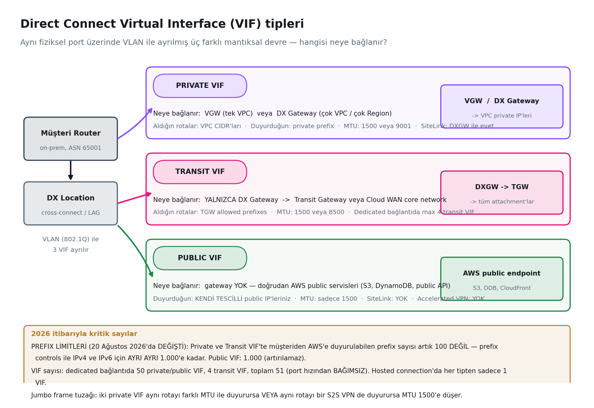
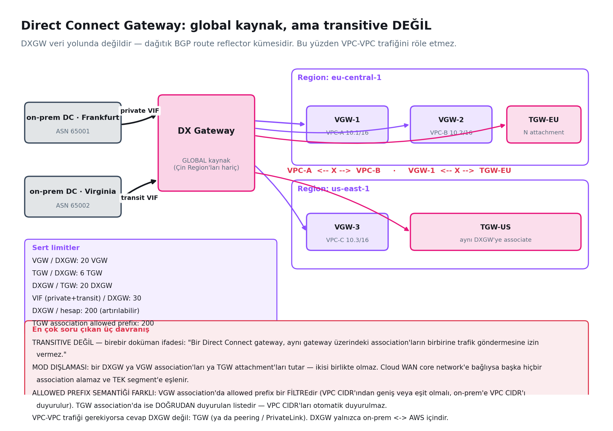
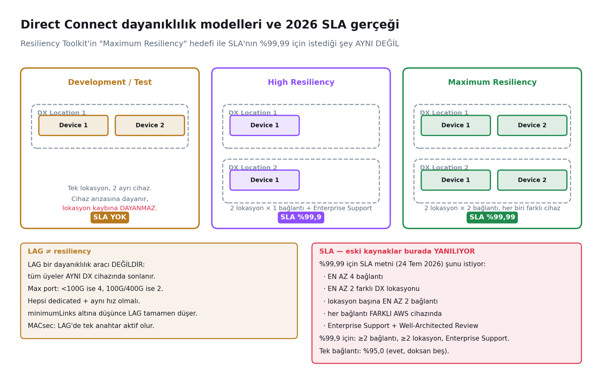
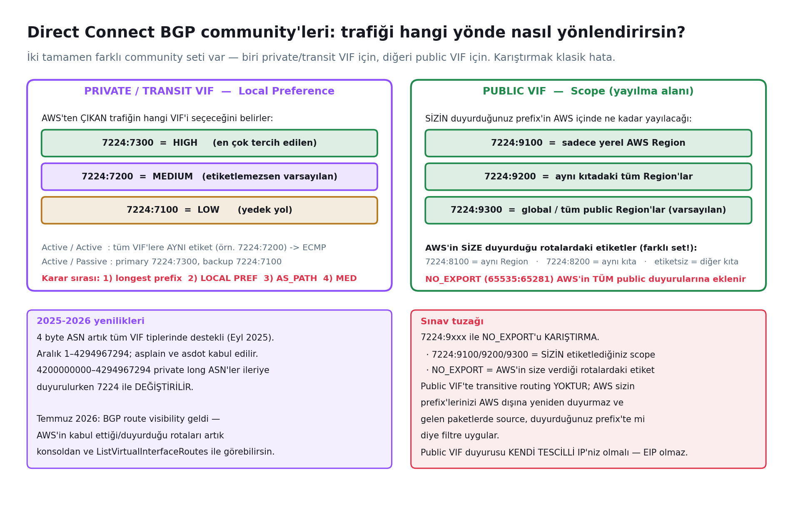
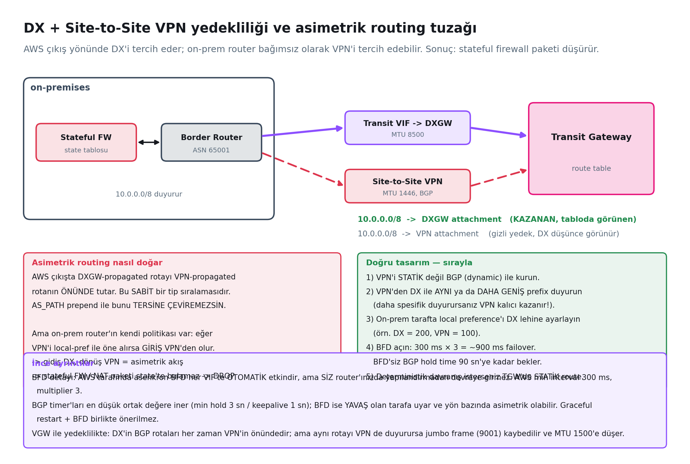
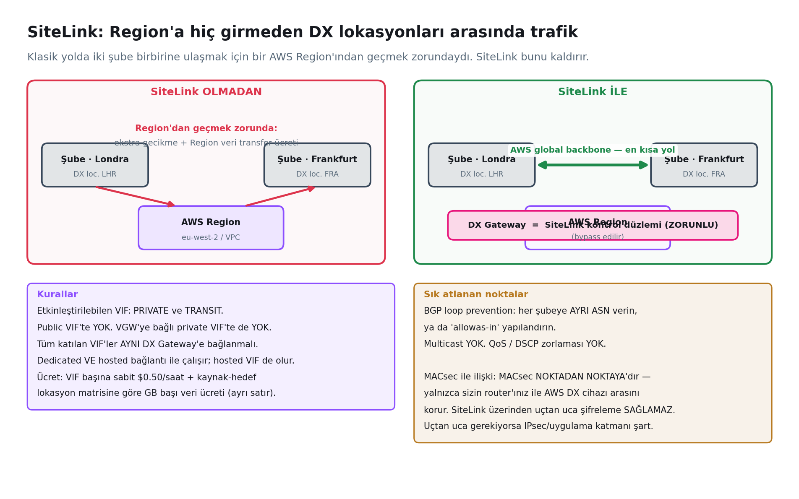

# Bölüm 2 — AWS Direct Connect

> **Bu bölümün sınavdaki ağırlığı:** Hibrit mimari sorularının belkemiği. VIF tipleri, DXGW'nin transitive olmayışı, DX+VPN failover ve resiliency/SLA hesabı en sık test edilen dört konu.

---

## 2.1 Fiziksel katman: bağlantı tipleri ve hızlar

Direct Connect, bir **DX lokasyonundaki** (genellikle Equinix, CoreSite gibi bir colocation) AWS router'ı ile sizin router'ınız arasına çekilen **fiziksel bir fiber**dir. İnternetten geçmez.

### Dedicated connection (doğrudan AWS'ten)
Port hızları: **1, 10, 100, 400 Gbps** — dördü de GA.

| Hız | Optik |
|---|---|
| 1 Gbps | 1000BASE-LX (1310 nm) |
| 10 Gbps | 10GBASE-LR (1310 nm) |
| 100 Gbps | 100GBASE-LR4 |
| **400 Gbps** | 400GBASE-LR4 — Tem 2024'te çıktı, hâlâ **"seçili lokasyonlar"** |

**Port hızı sonradan değiştirilemez.** Yeni bağlantı sipariş etmek zorundasınız.

### Hosted connection (AWS Direct Connect Partner üzerinden)
**11 hız:** 50, 100, 200, 300, 400, 500 Mbps, 1, 2, 5, 10, **25 Gbps**.
- **400 Gbps hosted connection yoktur.**
- 25 Gbps sadece seçili partner'larda.
- Hosted connection'da **her tipten yalnızca 1 VIF** oluşturabilirsiniz.

### Basit anlatım — Kiralık hat vs otoyol
İnternet üzerinden VPN, **otoyolda araba sürmek** gibidir: yol ücretsiz/ucuz ama trafik ne zaman sıkışır bilemezsiniz. Direct Connect, **kendi özel demiryolunuzu döşemek**tir: pahalı, kurulumu haftalar/aylar alır, ama kapasite ve gecikme öngörülebilir. **Hosted connection** ise başkasının döşediği demiryolunda bir vagon kiralamaktır — daha hızlı ve ucuz başlar, ama esnekliğiniz kısıtlıdır (tek VIF, MACsec yok).

---

## 2.2 Virtual Interface (VIF) tipleri — en çok soru çıkan konu

Bir fiziksel port, VLAN (802.1Q) etiketleriyle birden fazla mantıksal devreye bölünür. Her mantıksal devre bir **VIF**'tir.

| | **Private VIF** | **Public VIF** | **Transit VIF** |
|---|---|---|---|
| **Neye bağlanır** | VGW **veya** DXGW | Gateway YOK — doğrudan AWS public endpoint'leri | **YALNIZCA DXGW** |
| **Ne erişirsin** | Bir VPC (VGW ile) veya çok VPC/çok Region (DXGW ile) | Tüm AWS public servisleri + CloudFront/Route 53 on-net prefix'leri | DXGW'ye bağlı TGW'ler veya Cloud WAN core network |
| **Sen ne duyurursun** | Private IPv4/IPv6 | **Kendi tescilli public IP'leriniz** (EIP olmaz, Amazon havuzu BYOIP olmaz) | On-prem rotalarınız |
| **Sen ne alırsın** | VPC CIDR'ları / DXGW allowed prefix seti | AWS public prefix'leri (**hepsi NO_EXPORT etiketli**) | TGW allowed prefix'leri / Cloud WAN segment rotaları |
| **Jumbo frame** | ✅ 1500 veya **9001** | ❌ sadece 1500 | ✅ 1500 veya **8500** |
| **SiteLink** | ✅ (yalnızca DXGW'ye bağlıysa) | ❌ | ✅ |
| **Accelerated VPN** | — | ❌ **desteklenmez** | — |

### Prefix limitleri — 2026'da DEĞİŞTİ

| VIF tipi | Müşteriden AWS'e duyurulabilen prefix |
|---|---|
| **Private VIF** | Varsayılan **100**, prefix controls ile **IPv4 ve IPv6 için ayrı ayrı 1.000'e kadar** |
| **Transit VIF** | Aynı: varsayılan 100, **1.000'e kadar** |
| **Public VIF** | **1.000** (artırılamaz), minimum 1 prefix duyurulmalı |
| SiteLink | 1.000'e kadar (prefix controls ile) |
| Cloud WAN DXGW attachment → on-prem | **5.000** |

> **BÜYÜK DÜZELTME:** 20 Ağustos 2026'da AWS **inbound prefix controls**'ü duyurdu. Private/transit VIF'te eski sert **100** limiti kalktı; artık VIF başına tahsis edilebilen **1.000 IPv4 + 1.000 IPv6** var. Dedicated ve hosted bağlantılarda geçerli, ek ücret yok. Piyasadaki tüm SAP-C02 kurslarında hâlâ "100" yazıyor. Sınav güncellenene kadar **her iki sayıyı da bilin** ve seçenekler arasında "prefix limitine takılıyor, TGW'ye geçmeli / summarization yapmalı" tipinde bir ifade görürseniz senaryodaki tarihe dikkat edin.

### VIF sayısı limitleri

| Kalem | Değer | Artırılabilir? |
|---|---|---|
| Dedicated connection başına private **veya** public VIF | 50 | ❌ |
| Dedicated connection başına **transit VIF** | **4** | ❌ |
| Dedicated connection başına toplam VIF | **51** | ❌ |
| **Hosted** connection başına VIF (herhangi tip) | **1** | ❌ |
| LAG başına VIF | 51 | ❌ |

> **Önemli:** VIF kotası **port hızına bağlı DEĞİLDİR.** 1 Gbps bir dedicated bağlantı da, 400 Gbps bir dedicated bağlantı da 51 VIF alır. Her hosted connection ise hızı ne olursa olsun 1 VIF alır.

### Jumbo frame tuzağı
- İki private VIF **aynı rotayı farklı MTU** ile duyurursa → **1500 kullanılır**.
- Aynı rotayı bir **Site-to-Site VPN** de duyurursa → **1500 kullanılır**.
- Jumbo frame yalnızca DX üzerinden **propagate edilen** rotalar ve TGW üzerinden **statik** rotalar için geçerlidir.
- 8500/9001'i etkinleştirmek fiziksel bağlantıyı güncelleyebilir → o porttaki **tüm VIF'ler 30 saniyeye kadar kesilir**.
- Hosted VIF'te jumbo, ancak **üst hosted connection'da açıksa** açılabilir.
- **AWS Local Zones: max MTU 1468** (Los Angeles hariç).

---

## 2.3 Direct Connect Gateway (DXGW)

### Ne olduğu
DXGW **global bir kaynaktır** — bir DXGW ile dünyadaki herhangi bir Region'a bağlanabilirsiniz (GovCloud dahil, **Çin Region'ları hariç**). Teknik olarak **veri yolunda olmayan, dağıtık bir BGP route reflector kümesi**dir. Yani paket DXGW'den "geçmez"; DXGW sadece rota bilgisini yönetir.

### Kotalar

| Kalem | Değer | Artırılabilir? |
|---|---|---|
| Hesap başına DXGW | 200 | ✅ |
| **DXGW başına VGW** | **20** | ❌ |
| **DXGW başına Transit Gateway** | **6** | ❌ |
| Bir TGW'ye bağlanabilen DXGW | 20 | ❌ |
| DXGW başına VIF (private **veya** transit) | 30 | ❌ |
| TGW association başına allowed prefix | **200** (IPv4+IPv6 toplamı) | ✅ (SA/TAM) |

### Transitive DEĞİL — birebir doküman ifadesi
> *"A Direct Connect gateway does not allow gateway associations that are on the same Direct Connect gateway to send traffic to each other."*

Yani `VPC-A (VGW-1) ↔ DXGW ↔ VPC-B (VGW-2)` yolu **çalışmaz**. VPC↔VPC gerekiyorsa cevap DXGW değil; TGW, peering veya PrivateLink'tir.

**Tek istisna (Kas 2021):** Aynı VIF üzerinde, aynı DXGW'ye associate edilmiş iki VPC'nin VGW'lerini kapsayan bir **supernet** duyurulduğunda.

### Mod dışlaması
- Bir DXGW, **VGW association'ları** ile **TGW attachment'larını aynı anda tutamaz**. Zaten VGW'ye associate ise veya bir private VIF'e bağlıysa TGW'ye attach edilemez.
- Bir DXGW **Cloud WAN core network**'e bağlıysa başka hiçbir association tipini alamaz ve **tek bir core network / tek bir segment**'e eşlenir. Cloud WAN DXGW attachment'larında **allowed-prefix listesi yoktur** — segment'in tamamı duyurulur.

### Allowed prefixes — semantiği association tipine göre DEĞİŞİR (kritik ayrım)

**VGW association'da allowed prefix bir FİLTREdir:**
- Allowed prefix, VPC CIDR'ına **eşit veya ondan daha geniş** olmalı.
- On-prem'e duyurulan şey **VPC CIDR'ıdır**, allowed prefix değil.
- Örnek: VPC `10.0.0.0/16`, allowed prefix `10.0.0.0/24` → **hiçbir şey duyurulmaz**. Allowed prefix `10.0.0.0/15` → `10.0.0.0/16` duyurulur.

**TGW association'da allowed prefix DOĞRUDAN duyurulan listedir:**
- Yazdığınız prefix'ler aynen on-prem'e duyurulur.
- **VPC CIDR'ları otomatik duyurulmaz** — listeye elle yazmak zorundasınız.
- Aynı DXGW'yi paylaşan birden fazla TGW varsa **çakışan prefix'ler reddedilir**.
- `/30` point-to-point aralıkları TGW'ye propagate edilmez.

> Bu ayrım sınavda "on-prem VPC'leri göremiyor, ne eksik?" sorusunun cevabıdır: TGW association'da allowed prefix listesine VPC CIDR'larını yazmayı unutmuşlardır.

---

## 2.4 LAG (Link Aggregation Group)

| Kural | Değer |
|---|---|
| Max port | Port hızı **< 100G** ise **4**; **100G veya 400G** ise **2** |
| Bağlantı tipi | **Sadece dedicated** (hosted connection LAG'e giremez) |
| Bant genişliği | Tüm üyeler **aynı hız** olmalı |
| Konum | Tüm üyeler **aynı DX endpoint/cihazında** sonlanmalı |
| Protokol | LACP |
| `minimumLinks` | Varsayılan **0**; operasyonel link sayısı bunun altına düşerse **LAG tamamen düşer** (hayatta kalanları aşırı yüklememek için, kasıtlı) |
| Region başına LAG | 10 (artırılabilir) |
| LAG başına VIF | 51 |

### LAG bir dayanıklılık aracı DEĞİLDİR
Tüm üyeler aynı cihazda sonlandığı için **cihaz arızası LAG'ın tamamını düşürür**. LAG bant genişliği toplama aracıdır, resiliency aracı değil.

### MACsec + LAG etkileşimi
- Tüm üyeler MACsec-yetenekli ve aynı bant genişliğinde olmalı.
- **Tüm LAG linkleri boyunca aynı anda YALNIZCA BİR MACsec anahtarı aktiftir.** Birden fazla anahtar sadece rotasyon için tutulur.
- Mevcut bağlantılardan LAG oluşturmak, onların MACsec anahtarlarını **ayırır** ve LAG'ın anahtarını uygular.
- LAG'a bağlantı eklemek, o bağlantının anahtarlarını LAG'ın anahtarıyla **değiştirir**.

---

## 2.5 Dayanıklılık modelleri ve SLA — eski kaynaklar burada yanılıyor

### Resiliency Toolkit (konsoldaki sihirbaz)

| Model | Gereksinim | Hedef |
|---|---|---|
| **Maximum Resiliency** | Birden fazla lokasyonda, **ayrı cihazlarda** sonlanan ayrı bağlantılar | %99,99 |
| **High Resiliency** | **Çoklu lokasyona iki tek bağlantı** | %99,9 |
| **Development and Test** | **Tek lokasyonda** ayrı cihazlarda ayrı bağlantılar | SLA yok |
| Classic | Toolkit dışı tek bağlantı | — |

### Gerçek SLA metni (24 Temmuz 2026 güncellemesi)

| SLA tanımı | Aylık uptime | Gereksinim |
|---|---|---|
| **Multi-Site Redundant** | **%99,99** | **≥4 bağlantı**, **≥2 farklı DX lokasyonu**, **lokasyon başına ≥2 bağlantı**, her bağlantı **farklı AWS cihazında**, **+ Enterprise Support + tamamlanmış Well-Architected Review** |
| **Multi-Site Non-Redundant** | **%99,9** | ≥2 bağlantı, ≥2 farklı lokasyon, **+ Enterprise Support** |
| **Single Connection** | **%95,0** | Hesabınız altındaki bir dedicated bağlantı |

- **"Unavailable" tanımı:** ilgili endpoint'e/endpoint'ten veri gönderip alamama, **en az 120 ardışık saniye**.
- Service credit'ler: redundant/non-redundant → %10 (99,0–eşik altı), %25 (95,0–99,0), %100 (<95,0). Tek bağlantı → %10 (92,5–95,0), %25 (90,0–92,5), %100 (<90,0).

> **Sınav için:** "%99,99 istiyorum, en az kaç bağlantı?" sorusunun cevabı **4**'tür (2 lokasyon × 2 bağlantı) ve **Enterprise Support + Well-Architected Review** de gerekir. Eski kaynaklar "2 lokasyon, 2 bağlantı" diyor — bu artık %99,9 seviyesidir.

---

## 2.6 BGP ile trafik yönlendirme

### AWS'ten ÇIKAN trafik için değerlendirme sırası (private ve transit VIF)
1. **Longest prefix match** (her zaman ilk)
2. **Local preference BGP community'leri** — *AS_PATH'ten ÖNCE*
3. **AS_PATH uzunluğu**
4. **MED** (en düşük öncelik; AWS güvenmemenizi öneriyor)
5. **ECMP** — prefix, prefix uzunluğu, AS_PATH uzunluğu ve attribute'lar eşleşiyorsa birden fazla private/transit VIF arasında (AS_PATH'teki ASN'lerin *aynı* olması gerekmez; farklı colo'lar arasında da çalışır)

### Local preference community'leri (private / transit VIF)
| Community | Anlam |
|---|---|
| **7224:7300** | HIGH — en çok tercih edilen |
| **7224:7200** | MEDIUM — etiketlemezsen varsayılan (aynı Region'daki DX lokasyonları için) |
| **7224:7100** | LOW — yedek |

Karşılıklı dışlayıcıdır (birini seçersiniz).
- **Active/Active:** tüm VIF'lere aynı etiket → ECMP; biri düşerse yük kalanlara dağılır.
- **Active/Passive:** primary'ye `7224:7300`, backup'a `7224:7100`.

### Public VIF community'leri — TAMAMEN FARKLI SET

**Sizin etiketlediğiniz (scope) community'ler** — prefix'inizin AWS içinde ne kadar yayılacağını sınırlar:
| Community | Anlam |
|---|---|
| **7224:9100** | Yalnızca yerel AWS Region |
| **7224:9200** | Aynı kıtadaki tüm Region'lar |
| **7224:9300** | Global / tüm public Region'lar (**etiketlemezseniz varsayılan**) |

`7224:1`–`7224:65535` aralığı Direct Connect tarafından rezerve edilmiştir.

**AWS'in SİZE duyurduğu rotalardaki community'ler:**
| Community | Anlam |
|---|---|
| **7224:8100** | DX PoP'unuzla aynı Region'dan gelen rotalar |
| **7224:8200** | Aynı kıtadan gelen rotalar |
| *(etiketsiz)* | Diğer kıtalardan |

**NO_EXPORT ayrı bir şeydir:** well-known community `65535:65281`. AWS, public VIF'te size duyurduğu **her prefix'e** bunu ekler — böylece o rotalar sizin ağınızın içinde kalır. **7224:9xxx ile karıştırmayın.** AWS ayrıca public prefix'leri **minimum 3 AS_PATH uzunluğuyla** duyurur, sizin public VIF prefix'lerinizi AWS dışına yeniden duyurmaz, public VIF üzerinde **transitive routing desteklenmez** ve gelen paketlerde kaynak IP'nin duyurduğunuz prefix içinde olup olmadığını **filtreler**.

### 4-byte ASN desteği (Eyl 2025)
- Tüm VIF tiplerinde, tüm Region'larda.
- Aralık **1–4294967294**; **asplain** (`4200000000`) ve **asdot** (`64086.59904`) kabul edilir, asplain olarak gösterilir.
- **Private long ASN'ler (4200000000–4294967294) ileriye duyurulurken 7224 ile DEĞİŞTİRİLİR.**

---

## 2.7 DX + VPN yedekliliği ve asimetrik routing

### AWS tarafındaki sabit tercih sırası

**VGW route table sırası (en çok → en az tercih edilen):**
1. **Direct Connect'ten gelen BGP rotaları**
2. Site-to-Site VPN için elle eklenmiş statik rotalar
3. Site-to-Site VPN'den gelen BGP rotaları
4. Sonra AS_PATH, sonra MED

Longest prefix match hepsinden önce gelir. Ve **VPC local route'u, daha spesifik olsa bile herhangi bir propagated route'u yener.**

**TGW route table sırası:** Bölüm 1.5'teki 10 basamaklı listeye bakın. Özet: **DXGW-propagated, VPN-propagated'ın önündedir.**

### Kritik sınav noktası
> DX ve VPN **farklı attachment tipleri** olduğu için aralarındaki sıra **sabittir**. VPN üzerinde **AS_PATH prepend yapmak, aynı prefix için VPN'i DX'in önüne geçirmez**. Ve farklı attachment tipleri arasında **asla ECMP yapılmaz**.
> VPN'i tercih ettirmek istiyorsanız: **daha spesifik prefix duyurun** veya **statik route** girin.

### Asimetrik routing nasıl doğar ve nasıl önlenir

**Problem:** AWS, prefix uzunlukları eşit olduğunda **çıkışta DX'i** tercih eder. Sizin on-prem router'ınız ise bağımsız politikasıyla **girişte VPN'i** tercih edebilir. Sonuç: trafik bir yoldan girer, başka yoldan çıkar. Aradaki **stateful firewall veya NAT** akışı state tablosunda bulamaz ve **dönüş trafiğini düşürür**.

**Çözüm sırası:**
1. VPN'i **statik değil BGP (dynamic)** routing ile kurun.
2. VPN'den DX ile **aynı ya da daha geniş** prefix duyurun. Daha spesifik duyurursanız VPN **kalıcı olarak** kazanır ve DX boşta kalır.
3. **On-prem tarafta** local preference'ı DX lehine ayarlayın (örn. DX = 200, VPN = 100). Giriş yönünü ancak siz kontrol edebilirsiniz.
4. **BFD açın** (aşağıda).
5. Deterministik davranış gerekiyorsa TGW'de **statik route** kullanın.

### BFD (Bidirectional Forwarding Detection)
| Parametre | Değer |
|---|---|
| AWS liveness detection min interval | **300 ms** |
| AWS multiplier | **3** → ~**900 ms** algılama |
| BGP varsayılanı (BFD'siz) | hold **90 sn** / keepalive **30 sn** |
| BGP minimumları | hold **3 sn** / keepalive **1 sn** |
| BGP paket TTL | **1** (multihop BGP yok) |

- **Asenkron BFD, her Direct Connect VIF'inde AWS tarafında OTOMATİK etkindir** — ama **siz router'ınızda yapılandırmadan devreye girmez.**
- BGP timer'ları en düşük ortak değere iner; **BFD interval'ları ise yavaş olan tarafa uyar** ve yön bazında **asimetrik olabilir**.
- AWS **graceful restart ile BFD'yi birlikte yapılandırmamanızı** öneriyor.
- BFD'yi ne zaman kullanın: yedek bir yol olduğu her durumda. Özellikle araya giren bir sağlayıcı cihazı, upstream arıza sonrası fiziksel linki "up" tuttuğunda BGP hold time'ı beklemek 90 saniyelik kesinti demektir.

### Basit anlatım — İki yol, bir bekçi
Eve gidiş için iki yol var: hızlı otoban (DX) ve yavaş sahil yolu (VPN). Sen (AWS) her zaman otobanı seçiyorsun. Ama eşin (on-prem router) sana gelirken sahil yolunu tercih ediyor. Kapıda oturan bekçi (stateful firewall) "sen otobandan çıktın, sahil yolundan dönen bu kişi kim?" der ve kapıyı açmaz.

Çözüm: ikinize de aynı yol tercihini yazdırmak (local preference). BFD ise "otoban kapandı" haberini 90 saniye sonra değil, 1 saniyede almak.

---

## 2.8 MACsec — L2 şifreleme

| Konu | Detay |
|---|---|
| **Nerede var** | **10, 100, 400 Gbps DEDICATED** bağlantılarda, seçili PoP'larda |
| **Nerede YOK** | **1 Gbps'te yok. HOSTED connection'da yok** — doküman: "MACsec iki spesifik cihaz arasında L2'de çalışır ve hosted connection'da desteklenmez" |
| Partner interconnect | Tem 2025'ten beri partner'ın kendi interconnect'inde 10G/100G MACsec var (100+ PoP) — ama bu MACsec'i *müşterinin* hosted connection özelliği yapmaz |
| **CKN/CAK** | Pre-shared çift, **hexadecimal, tam 64 karakter**, **sadece AES 256-bit**, **sadece static CAK modu** (dinamik CAK / EAP'li MKA yok). Hitless rotasyon için **3 çifte kadar** saklanabilir |
| **Cipher suite** | 10G → GCM-AES-256 **veya** GCM-AES-XPN-256; **100G ve 400G → GCM-AES-XPN-256 (XPN zorunlu)** |
| SCI | **Her zaman açık, kapatılamaz.** Dot1q tag offset (VLAN etiketini açıkta bırakma) **desteklenmez** |
| **Şifreleme modları** | `no_encrypt` (kapalı), **`should_encrypt`** (MACsec müzakeresi başarısızsa **şifresiz devam eder** — erişilebilirlik odaklı, MACsec açılan yeni bağlantılarda varsayılan), **`must_encrypt`** (başarısızsa **tüm trafiği düşürür** — güvenlik odaklı, erişilebilirlik riski) |
| Ücret | **Ek ücret yok** |

### En kritik nokta: MACsec uçtan uca DEĞİLDİR
> *"MACsec provides point-to-point security on Ethernet links; therefore it does not provide end-to-end encryption across multiple sequential Ethernet or other network segments."*

MACsec **sadece sizin router'ınız ile AWS'in DX router'ı arasındaki linki** korur. Ondan sonrası (AWS backbone) MACsec ile korunmaz. **SiteLink trafiğini uçtan uca şifrelemez.**

> **Sınav ayrımı:**
> - "DX üzerinden şifreleme istiyorum, **hosted connection** kullanıyorum" → MACsec **değil**. Cevap: **private IP VPN over DX** (transit VIF üstünden IPsec) veya public VIF üstünden klasik VPN.
> - "DX üzerinden şifreleme + **AWS public servislerine de erişim**" → public VIF + klasik Site-to-Site VPN. (Accelerated VPN public VIF ile **çalışmaz**.)
> - "10 Gbps dedicated, sadece fiziksel linkte line-rate şifreleme yeterli" → **MACsec**.
> - "Uçtan uca, tüm AWS backbone boyunca şifreli olsun" → **IPsec** (private IP VPN) veya uygulama katmanı TLS.

---

## 2.9 SiteLink — Region'ı bypass etmek

**Ne yapar:** İki veya daha fazla DX lokasyonu arasındaki trafiği, **bir AWS Region'ından geçmeden**, doğrudan AWS global backbone üzerinden en kısa yoldan taşır.

| Kural | Detay |
|---|---|
| Desteklenen VIF | **Private ve transit VIF** |
| Desteklenmeyen | **Public VIF**; ayrıca **VGW'ye bağlı private VIF** |
| **DXGW zorunlu** | Tüm katılan VIF'ler **aynı DX Gateway**'e bağlanmalı; DXGW kontrol düzlemidir |
| Bağlantı tipi | Dedicated **ve** hosted; **hosted VIF** de olur |
| Ücret | **VIF başına sabit $0,50/saat** (tüm lokasyon, hız ve bağlantı tipleri için aynı) **+** kaynak-hedef lokasyon matrisine göre GB başı veri ücreti (~$0,0200/GB Avrupa→Avrupa … ~$0,1923/GB Endonezya→Afrika). **Ayrı fatura satırı** olarak görünür |
| BGP | Loop prevention için **şube başına tekil ASN** ya da `allowas-in` |
| Yok | **Multicast yok. QoS/DSCP zorlaması yok.** |

### Basit anlatım — Şirket içi kurye ağı
İki şubeniz var: Londra ve Frankfurt. Klasik yapıda bir belge göndermek için önce merkeze (AWS Region) gidiyor, orada işlenip diğer şubeye yollanıyor — hem gecikme hem merkez işlem ücreti.

SiteLink, "iki şube arasında **doğrudan** kurye hattı" kurmaktır. Merkez hâlâ kurye ağının **adres defterini** tutuyor (DXGW = kontrol düzlemi), ama paket merkeze uğramıyor.

---

## 2.10 2025–2026 Direct Connect değişiklikleri

| Tarih | Değişiklik |
|---|---|
| **20 Ağu 2026** | **Inbound prefix controls.** Private/transit VIF prefix limiti sert **100**'den **1.000 IPv4 + 1.000 IPv6**'ya. Dedicated ve hosted'da, ek ücretsiz. **Eski materyaldeki en büyük düzeltme.** |
| **30 Tem 2026** | **BGP route visibility.** AWS'in sizden **kabul ettiği** ve size **duyurduğu** rotaları prefix, adres ailesi, AS_PATH, community, kurulum zamanı ile görebilme. Konsol + **`ListVirtualInterfaceRoutes`** API. |
| **24 Tem 2026** | **SLA dokümanı güncellendi** (yukarıdaki tablo). |
| **1 Haz 2026** | **VIF Rate Limiters.** VIF başına bant genişliği şekillendirme, **sadece dedicated** bağlantılarda. Dedicated bağlantı başına **10 rate limiter** (Service Quotas ile artırılabilir), **minimum 50 Mbps**, max = bağlantı/LAG kapasitesi. Tüm VIF tiplerinde, **oversubscription'a izin verilir**. Egress her zaman uygulanır; ingress için on-prem policer gerekir. Yeni CloudWatch kullanım-% ve düşen-paket metrikleri. |
| **31 Mar 2026** | **CloudFormation desteği** — connection, VIF, DXGW, LAG, BGP peering. |
| **30 Mar 2026** | **CloudWatch BGP metrikleri:** `VirtualInterfaceBgpStatus`, `VirtualInterfaceBgpPrefixesAccepted`, `VirtualInterfaceBgpPrefixesAdvertised`. |
| **12 Eyl 2025** | **4-byte ASN** tüm VIF tiplerinde. |
| **28 Tem 2025** | MACsec, **partner-owned interconnect**'lere yayıldı (10G/100G, 100+ PoP). |
| Süregelen | **DXGW ↔ Cloud WAN core network** association (transit VIF ile), **5.000 prefix** limiti, allowed-prefix listesi **yok**, DXGW tek core network / tek segment'e özel. |

---

## 2.11 Bölüm soruları

### Soru 1
Bir şirket, `eu-central-1` ve `us-east-1`'deki toplam 8 VPC'ye on-prem veri merkezinden erişmek istiyor. Tek bir 10 Gbps dedicated Direct Connect bağlantısı var. Her VPC'de ayrı bir VGW mevcut. En az yapılandırma ile tüm VPC'lere erişim nasıl sağlanır?

- **A.** Her VPC için ayrı bir private VIF oluştur ve ilgili VGW'ye bağla.
- **B.** Bir DX Gateway oluştur, tek bir private VIF ile DXGW'ye bağlan, 8 VGW'yi DXGW'ye associate et.
- **C.** Bir transit VIF oluştur ve doğrudan 8 VGW'ye bağla.
- **D.** Her Region'da bir TGW oluştur, TGW'leri peering ile bağla, tek private VIF kullan.

<b>Cevap ve analiz</b>

**Doğru cevap: B**

- **B doğru:** DXGW **global** bir kaynaktır ve **20 VGW** association destekler. Tek private VIF → tek DXGW → 8 VGW. En az VIF, en az yapılandırma. Cross-Region erişim DXGW'nin temel değer önerisidir.
- **A yanlış:** Çalışır ama 8 VIF gerektirir; "en az yapılandırma" şartını ihlal eder. Ayrıca private VIF tek bir VGW'ye bağlanır ve VGW bölgeseldir — cross-Region için her Region'a ayrı VIF hattı gerekir ki bu tek bağlantıyla mümkün olsa da yönetimi ağırdır.
- **C yanlış:** **Transit VIF yalnızca DXGW'ye bağlanır** ve DXGW'den TGW'ye/Cloud WAN'a gider. VGW'ye transit VIF bağlanmaz.
- **D yanlış:** Çalışır ama gereksiz karmaşık: 2 TGW + peering + statik route + **TGW ile private VIF kullanılmaz** (transit VIF gerekir). Aşırı mühendislik.

**Dikkat:** Bu senaryoda VPC'ler birbirini **görmeyecek** — DXGW transitive değildir. Eğer soru "VPC'ler de birbirini görsün" derse cevap TGW + transit VIF olur.

---

### Soru 2
Bir mimar, on-prem'den AWS'e 350 adet prefix duyurmak istiyor. Mevcut yapı: 1 dedicated bağlantı, 1 transit VIF, DXGW → TGW. Ekip BGP oturumunun kurulduğunu ama prefix'lerin bir kısmının kabul edilmediğini görüyor. 2026 itibarıyla en doğru ilk aksiyon nedir?

- **A.** Prefix'leri summarize ederek 100'ün altına indir.
- **B.** İkinci bir transit VIF ekle ve prefix'leri böl.
- **C.** VIF üzerinde inbound prefix control ile prefix tahsisini artır (1.000'e kadar).
- **D.** Transit VIF'i private VIF'e dönüştür; private VIF'in limiti daha yüksektir.

<b>Cevap ve analiz</b>

**Doğru cevap: C**

20 Ağustos 2026'da gelen **inbound prefix controls** ile private ve transit VIF'te müşteriden duyurulan prefix limiti **varsayılan 100**'den **IPv4 ve IPv6 için ayrı ayrı 1.000'e kadar** çıkarılabilir hale geldi.

- **A yanlış (artık):** 2026 öncesinde bu **doğru cevaptı** ve piyasadaki kursların hâlâ verdiği cevap budur. Summarization hâlâ iyi bir pratiktir, ama artık *zorunlu ilk aksiyon* değil.
- **B yanlış:** İkinci transit VIF eklemek prefix'leri bölmek için mantıklı gibi görünse de aynı DXGW'ye iki transit VIF'in aynı prefix'leri farklı şekilde duyurması yönetimsel karmaşa yaratır; dahası dedicated bağlantı başına **4 transit VIF** limiti var. Prefix control varken gereksiz.
- **D yanlış:** Private ve transit VIF'in prefix limiti **aynıdır** (varsayılan 100, 1.000'e kadar). Ayrıca private VIF TGW'ye bağlanmaz — mimariyi kırar.

**Sınav stratejisi:** Prefix limiti soruları geçiş döneminde. Senaryoda tarih verilmişse ona göre karar verin; verilmemişse ve seçenekler arasında hem "summarize et" hem "prefix control ile artır" varsa, **daha az invaziv olan prefix control'ü** seçin.

---

### Soru 3
Bir şirket Direct Connect'i birincil, Site-to-Site VPN'i yedek olarak kullanıyor. Her ikisi de aynı TGW'ye bağlı ve on-prem `10.0.0.0/8`'i her iki yoldan da BGP ile duyuruyor. Ekip, DX kesildiğinde failover'ın **90 saniyeye kadar** sürdüğünü ölçtü ve bunu 1 saniyenin altına indirmek istiyor. Ayrıca on-prem stateful firewall'da ara ara "invalid state" düşüşleri görülüyor. İki problemi çözen kombinasyon nedir? (İki cevap seçin)

- **A.** VPN üzerinde AS_PATH prepend uygulayarak DX'i tercih ettir.
- **B.** Direct Connect VIF'inde BFD'yi on-prem router üzerinde yapılandır.
- **C.** On-prem router'da DX için local preference'ı VPN'den yüksek ayarla.
- **D.** TGW'de VPN attachment'ı için statik blackhole route ekle.
- **E.** VPN'den `10.0.0.0/16` gibi daha spesifik bir prefix duyur.

<b>Cevap ve analiz</b>

**Doğru cevaplar: B ve C**

**B — failover süresini çözer.** BGP varsayılan hold time'ı **90 saniye**dir. AWS tarafında asenkron BFD **her VIF'te otomatik etkindir** ama siz router'ınızda yapılandırmadan çalışmaz. Yapılandırıldığında AWS'in min interval 300 ms × multiplier 3 = **~900 ms** algılama süresi devreye girer.

**C — asimetrik routing'i çözer.** "Invalid state" düşüşleri, gidiş DX'ten çıkarken dönüşün VPN'den girmesinin klasik belirtisidir. AWS çıkışta DX'i zaten tercih eder; **giriş yönünü ancak on-prem router'ın local preference'ı belirler.**

- **A yanlış:** AWS zaten DX'i tercih ediyor; AS_PATH prepend **farklı attachment tipleri arasındaki sabit sırayı değiştirmez**. Hiçbir şey çözmez.
- **D yanlış:** VPN'e blackhole route koymak yedekliliği **tamamen ortadan kaldırır** — DX düştüğünde trafik hiç akmaz.
- **E yanlış ve tehlikeli:** VPN'den daha spesifik prefix duyurmak, **longest prefix match** nedeniyle VPN'i **kalıcı olarak kazandırır**. DX boşta kalır, hem pahalı hattı harcarsınız hem asimetri artar. Doğru pratik: VPN'den **aynı ya da daha geniş** prefix duyurmak.

---

### Soru 4
Bir denetim raporu, on-prem ile AWS arasındaki Direct Connect trafiğinin şifrelenmesini zorunlu kılıyor. Mevcut yapı: bir AWS Partner'dan alınmış **1 Gbps hosted connection**, bir transit VIF, DXGW → TGW. Ek olarak, tünel uç noktalarının **public IP kullanmaması** isteniyor. En uygun çözüm nedir?

- **A.** Hosted connection üzerinde MACsec'i `must_encrypt` modunda etkinleştir.
- **B.** 10 Gbps dedicated bağlantıya geç ve MACsec kullan.
- **C.** TGW'ye private IP CIDR block ata ve transit VIF üzerinden private IP Site-to-Site VPN kur.
- **D.** Public VIF ekle ve accelerated Site-to-Site VPN kur.

<b>Cevap ve analiz</b>

**Doğru cevap: C**

**Private IP VPN over Direct Connect** tam bu senaryo için var. Üç bileşen zorunlu: **TGW (private IP CIDR atanmış) + DX Gateway + transit VIF**. Tünel uç noktaları hem TGW hem CGW tarafında **RFC1918/RFC6598 private IP**'lerdir. VGW desteklenmez.

- **A yanlış:** **MACsec hosted connection'da desteklenmez.** Doküman açık: MACsec iki spesifik cihaz arasında L2'de çalışır.
- **B yanlış:** Teknik olarak mümkün ama (i) 1 Gbps → 10 Gbps dedicated geçişi büyük bir maliyet/zaman yatırımı, (ii) MACsec **noktadan noktaya**dır ve uçtan uca şifreleme sağlamaz, (iii) "public IP kullanmama" şartını **adreslemez** (MACsec'in adreslemeyle ilgisi yok, ama soru bunu ayrı bir şart olarak koymuş ve C ikisini birlikte çözüyor).
- **D yanlış:** Public VIF üstünden VPN tünel uç noktaları **public IP** kullanır — şartı ihlal eder. Ayrıca **accelerated VPN, Direct Connect public VIF ile kullanılamaz.**

**Bonus fayda (sınav bunu ayrı soru yapar):** Private IP VPN, DX'in kendi route ölçeğini de aşar — **5.000 çıkış / 1.000 giriş** rota, yalnız DX'te bu 200/100'dür. Ayrıca VPN attachment'ı ile alttaki DX attachment'ını farklı TGW route table'larına bağlayarak **aynı DX üzerinden hem şifreli hem şifresiz** trafiği eş zamanlı taşıyabilirsiniz.

---

### Soru 5
Bir şirket %99,99 Direct Connect SLA'sı hedefliyor. Şu anda **iki farklı DX lokasyonunda birer 10 Gbps dedicated bağlantısı** ve Business Support planı var. SLA hedefine ulaşmak için ne gerekir? (İki cevap seçin)

- **A.** Her lokasyona ikinci bir bağlantı ekleyerek toplamı 4'e çıkarmak, her bağlantı farklı AWS cihazında olacak şekilde.
- **B.** İki bağlantıyı bir LAG içinde birleştirmek.
- **C.** Enterprise Support planına geçmek ve Well-Architected Review tamamlamak.
- **D.** Üçüncü bir DX lokasyonu eklemek.
- **E.** Her bağlantı üzerinde MACsec'i etkinleştirmek.

<b>Cevap ve analiz</b>

**Doğru cevaplar: A ve C**

24 Temmuz 2026 SLA metni **Multi-Site Redundant Deployment (%99,99)** için şunları istiyor:
- **en az 4 bağlantı**
- **en az 2 farklı DX lokasyonu**
- **lokasyon başına en az 2 bağlantı**
- **her bağlantı farklı bir AWS cihazında**
- **Enterprise Support planı**
- **tamamlanmış Well-Architected Review**

Mevcut yapı (2 lokasyon × 1 bağlantı + Business Support) **Multi-Site Non-Redundant = %99,9** seviyesindedir.

- **B yanlış ve zararlı:** LAG üyeleri **aynı DX cihazında sonlanmak zorundadır**. İki farklı lokasyondaki bağlantıları LAG'a koyamazsınız; koyabilseydiniz bile lokasyon çeşitliliğini kaybederdiniz. **LAG bir resiliency aracı değildir.**
- **D yanlış:** SLA 2 lokasyon istiyor, 3 değil. Eksik olan **lokasyon başına ikinci bağlantı**.
- **E yanlış:** MACsec şifreleme özelliğidir; SLA/erişilebilirlikle ilgisi yoktur.

---

## 2.12 Bu bölümün 60 saniyelik özeti

1. **VIF eşlemesi:** Private VIF → VGW veya DXGW. Public VIF → gateway yok, AWS public servisleri. **Transit VIF → yalnızca DXGW → TGW/Cloud WAN.**
2. **MTU:** private 9001, transit 8500, public 1500. Aynı rotayı VPN de duyurursa 1500'e düşer.
3. **Prefix (2026):** private/transit **1.000'e kadar** (eskiden 100), public **1.000 sabit**.
4. **VIF sayısı:** dedicated 50 + 4 transit = 51, **port hızından bağımsız**. Hosted = 1.
5. **DXGW global ama transitive değil.** 20 VGW / 6 TGW / 30 VIF. TGW association'da allowed prefix **doğrudan duyurulan listedir**, VGW'de **filtredir**.
6. **LAG resiliency değildir** — aynı cihazda sonlanır. Max 4 (<100G) / 2 (100G,400G).
7. **%99,99 SLA = 4 bağlantı + 2 lokasyon + lokasyon başına 2 + farklı cihaz + Enterprise Support + WA Review.**
8. **DX her zaman VPN'i yener; BGP attribute'ları bunu değiştirmez.** Asimetri çözümü: on-prem local preference + BFD + aynı/daha geniş prefix.
9. **MACsec = 10/100/400G dedicated, noktadan noktaya, hosted'da YOK.** Uçtan uca şifreleme için private IP VPN.
10. **SiteLink** = DX lokasyonları arası, Region bypass, private/transit VIF, DXGW zorunlu, VIF başına $0,50/saat.

---

[← Bölüm 1: Transit Gateway](01-transit-gateway.md) · [Sonraki bölüm: Site-to-Site VPN →](03-site-to-site-vpn.md)
