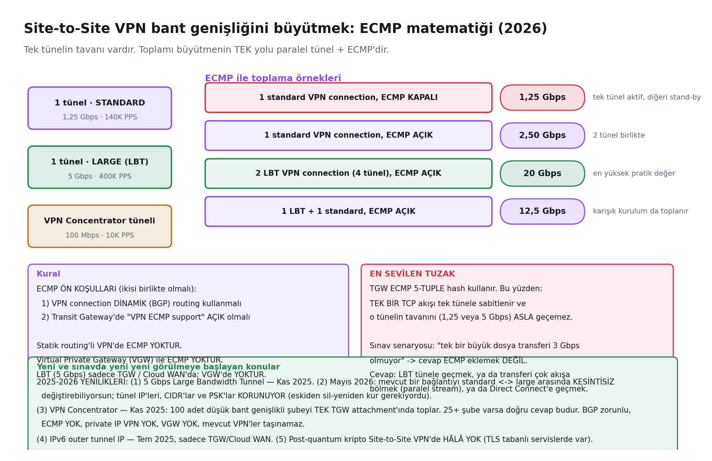
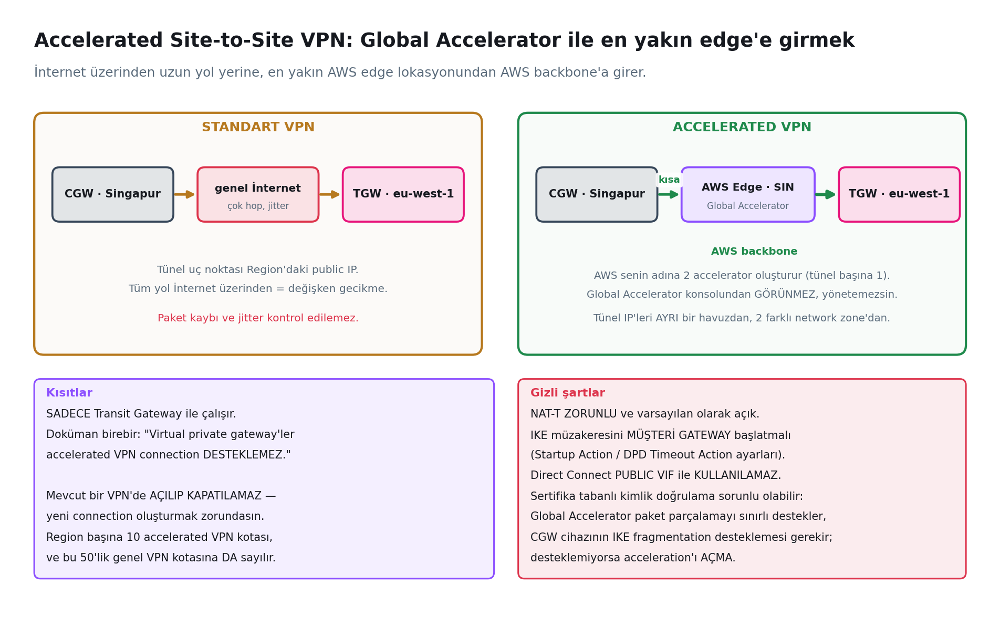
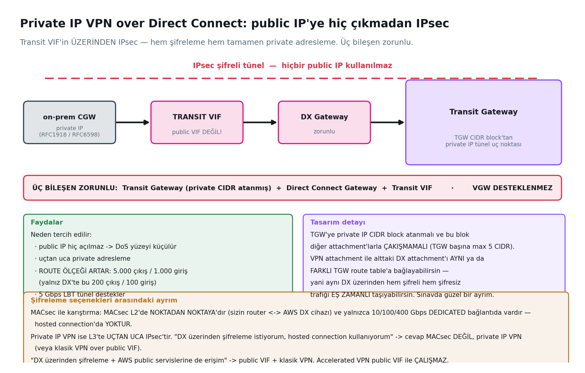

# Bölüm 3 — Site-to-Site VPN

> **Bu bölümün sınavdaki ağırlığı:** Genellikle "DX var ama yedek lazım", "bant genişliği yetmiyor", "yüzlerce şube var" senaryolarında çıkar. 2025'te gelen **5 Gbps tünel** ve **VPN Concentrator** oyunu değiştirdi — eski kaynakların en çok eskidiği alan.

---

## 3.1 Temel anatomi

Bir Site-to-Site VPN connection **iki IPsec tünelinden** oluşur. AWS bunu iki farklı AZ'deki iki farklı endpoint'te sonlandırır — yani tünel yedekliliği AWS tarafında **varsayılan olarak vardır**, siz sadece on-prem cihazınızda ikinci tüneli yapılandırmayı unutuyorsunuz.

Bileşenler:
- **Customer Gateway (CGW):** on-prem cihazınızı AWS'e tanımlayan mantıksal kaynak (IP + ASN veya sertifika).
- **Virtual Private Gateway (VGW)** veya **Transit Gateway:** AWS tarafındaki sonlandırma noktası.
- **VPN connection:** ikisi arasındaki tünel çifti.

### Basit anlatım — Zırhlı araç
Direct Connect kendi demiryolunuzsa, Site-to-Site VPN **kamuya açık otoyolda giden zırhlı bir araç**tır. Yol herkesin (İnternet), ama içindeki yük şifreli. Ve önemlisi: her sefere **iki zırhlı araç** (iki tünel) çıkarıyorsunuz; biri arızalanırsa diğeri devam ediyor. Ama şoför (on-prem router) ikinci aracı hiç kullanmayı öğrenmemişse, birinci araç bozulduğunda yük yolda kalıyor.

---

## 3.2 Bant genişliği ve ECMP — 2026 matematiği

### Tünel başına tavanlar

| Tünel tipi | Bant genişliği | PPS | Nerede |
|---|---|---|---|
| **Standard** | **1,25 Gbps** | 140.000 | Her yerde |
| **Large Bandwidth Tunnel (LBT)** | **5 Gbps** | 400.000 | **Yalnızca TGW ve Cloud WAN**; VGW'de YOK |
| **VPN Concentrator tüneli** | 100 Mbps | 10.000 | Concentrator attachment'ı |

### ECMP ön koşulları — ikisi birlikte olmalı
1. VPN connection **dinamik (BGP)** routing kullanmalı.
2. **Transit Gateway'de "VPN ECMP support" açık** olmalı.

**Statik routing'li VPN'de ECMP YOKTUR. VGW ile ECMP YOKTUR.**

### Toplama örnekleri

| Kurulum | Toplam |
|---|---|
| 1 standard connection, ECMP kapalı | 1,25 Gbps (tek tünel aktif) |
| 1 standard connection, ECMP açık | **2,5 Gbps** |
| 1 LBT connection, ECMP açık | **10 Gbps** |
| 2 LBT connection (4 tünel), ECMP açık | **20 Gbps** |
| 1 LBT + 1 standard, ECMP açık | **12,5 Gbps** |

> ### En sevilen tuzak: tek akış tavanı
> TGW ECMP **5-tuple hash** kullanır. Bu yüzden **tek bir TCP/UDP akışı tek tünele sabitlenir** ve o tünelin tavanını (1,25 veya 5 Gbps) **asla geçemez**.
>
> Senaryo: *"Tek bir büyük veritabanı replikasyon akışı 3 Gbps'e çıkmıyor, ECMP açık ve 4 tünelim var."*
> **Yanlış cevap:** daha fazla tünel eklemek. Hiçbir şey değişmez.
> **Doğru cevaplar:** (a) LBT tünele geçmek (5 Gbps), (b) transferi çoklu paralel akışa bölmek, (c) Direct Connect'e geçmek.

### Route limitleri

| Yön | TGW | VGW |
|---|---|---|
| CGW'den içeri (dinamik) | 1.000 | 100 |
| CGW'ye dışarı | 5.000 | 1.000 |
| Statik route (içeri) | — | 100 |

### Kotalar (Region başına)
50 CGW · 5 VGW · **50 VPN connection** · VGW başına 10 · **10 accelerated VPN** · 10 unassociated · **50 LBT connection** · 50 VPN Concentrator · TGW/Cloud WAN başına **5 concentrator** · concentrator başına **100 uzak site**.
Accelerated ve unassociated bağlantılar **50'lik genel kotaya da sayılır**.

> **Not:** AWS **ECMP path sayısı için yayınlanmış bir kota vermiyor.** Eski bloglardaki "TGW ile 50 Gbps'e kadar ölçeklenir" ifadesi 5 Gbps tünellerden önceki bir tahmindir, resmi kota değildir. Sınavda kesin bir "maksimum ECMP path sayısı" sayısı sorulursa, seçenekler arasında en makul olanı seçin; AWS bunu yayınlamıyor.

---

## 3.3 Tünel yapılandırma seçenekleri (detay tablosu)

Bu tablo "hangi algoritma destekleniyor" tipi sorular için:

| Ayar | Değerler / Varsayılan |
|---|---|
| **IKE sürümü** | **ikev1 ve ikev2, ikisi de destekli, ikisi de varsayılan açık** |
| Phase 1 & 2 şifreleme | AES128, AES256, AES128-GCM-16, AES256-GCM-16 |
| Phase 1 & 2 integrity | SHA1, SHA2-256, SHA2-384, SHA2-512 |
| DH group — Phase 1 | 2, 14–24 |
| DH group — Phase 2 | 2, 5, 14–24 |
| Phase 1 lifetime | 900–28.800 sn (varsayılan **28.800**) |
| Phase 2 lifetime | 900–3.600 sn (varsayılan **3.600**), Phase 1'den küçük olmalı |
| Rekey margin | 60 sn – Phase 2 lifetime'ın yarısı (varsayılan **270 sn**) |
| Rekey fuzz | %0–100 (varsayılan **100**) |
| Replay window | 64–2.048 paket (varsayılan **1.024**) |
| DPD timeout | ≥30 sn (varsayılan **40**) |
| **DPD timeout action** | `clear` (varsayılan), `none`, `restart` |
| **Startup action** | `add` (varsayılan — **CGW başlatır**) veya `start` (**AWS başlatır**) |
| Inside tunnel CIDR — IPv4 | `169.254.0.0/16`'dan **/30** |
| Inside tunnel CIDR — IPv6 | `fd00::/8`'den **/126** |
| **PSK** | 8–64 karakter, **`0` ile başlayamaz**, alfanümerik + `.` ve `_`. **AWS Secrets Manager'da saklanabilir.** |
| **Outside tunnel IP tipi** | `PublicIpv4` (varsayılan), `PrivateIpv4`, **`Ipv6`** |
| VPN log formatı | `json` veya `text` |

Rezerve inside CIDR'lar: `169.254.0.0/30`, `.1.0/30`, `.2.0/30`, `.3.0/30`, `.4.0/30`, `.5.0/30`, `169.254.169.252/30`.

### Tunnel Endpoint Lifecycle Control (ELC)
AWS zaman zaman VPN tünel endpoint'lerini bakım için değiştirir. Varsayılan olarak bunu size sormadan yapar.

ELC ile:
- **Tünel bazında** opt-in yaparsınız (API varsayılanı **kapalı**).
- AWS sizi **AWS Health** üzerinden bilgilendirir.
- `get-vpn-tunnel-replacement-status` ile "pending maintenance", "maintenance auto applied after", "last maintenance applied" bilgilerini görürsünüz.
- Değişimi **kendi bakım pencerenizde** kabul edersiniz; AWS son tarihten kısa süre sonra otomatik uygular.
- **Kritik güncellemeler yine de anında uygulanabilir.**

Oluşturma anında veya sonradan tünel seçeneklerini değiştirerek açılabilir.

---

## 3.4 Accelerated Site-to-Site VPN

**Ne yapar:** AWS Global Accelerator kullanarak trafiğinizi **CGW'ye en yakın AWS edge lokasyonundan** AWS global ağına sokar. İnternet üzerindeki hop sayısı azalır, jitter düşer.

| Kısıt | Detay |
|---|---|
| **Gateway** | **YALNIZCA Transit Gateway.** Doküman birebir: *"Virtual private gateways do not support accelerated VPN connections."* |
| Accelerator yönetimi | AWS **sizin adınıza tünel başına 1 accelerator** oluşturur (toplam 2). Global Accelerator konsolundan/API'sinden **görünmez ve yönetilemez.** |
| Tünel IP'leri | **Ayrı bir IP havuzundan**, **iki farklı network zone**'dan seçilir |
| **Sonradan açılamaz** | Mevcut bir VPN connection'da açıp kapatamazsınız — **yeni connection** oluşturmalısınız |
| **NAT-T** | **Zorunlu** ve varsayılan olarak açık |
| **IKE başlatma** | **CGW başlatmalı** (`Startup Action` / `DPD Timeout Action` ile yönetilir) |
| **Direct Connect public VIF** | **Kullanılamaz** |
| Sertifika kimlik doğrulama | Global Accelerator paket parçalamayı sınırlı desteklediği için **sorunlu olabilir**. CGW cihazı **IKE fragmentation** desteklemiyorsa acceleration'ı **açmayın**. |
| Kota | Region başına 10; genel 50'lik VPN kotasına da sayılır |

### Basit anlatım — Havalimanı transferi
Standart VPN, Singapur'daki şubenizden Frankfurt'a giderken **tüm yolu şehir içi trafikte** gitmek gibidir. Accelerated VPN, "en yakın havalimanına (edge) 10 dakikada git, sonra AWS'in kendi uçağıyla (backbone) uç" demektir. Şehir içi kısım kısalır, geri kalanı kontrollü.

---

## 3.5 Private IP VPN over Direct Connect

**Üç bileşen zorunlu:**
1. **Transit Gateway** — ve ona bir **private IP CIDR block** atanmış olmalı (TGW başına max 5 CIDR, diğer attachment'larla çakışmamalı)
2. **Direct Connect Gateway**
3. **Direct Connect TRANSIT VIF**

**VGW desteklenmez. Public VIF kullanılmaz.**

Her iki taraftaki tünel uç noktaları **RFC1918 veya RFC6598** private IP olmalı.

### Ne kazandırır
- Transit VIF üzerinde **IPsec şifreleme** — public IP hiç açılmaz, DoS yüzeyi küçülür.
- Uçtan uca private adresleme; AWS public servislerine erişim açmadan private bağlantı.
- **Route ölçeği artar:** **5.000 çıkış / 1.000 giriş** rota. Yalnız Direct Connect'te bu **200 çıkış / 100 giriş**tir.
- **5 Gbps LBT tünel destekler.**
- VPN attachment'ı ile alttaki DX attachment'ını **aynı ya da farklı** TGW route table'larına bağlayabilirsiniz → **aynı DX üzerinden hem şifreli hem şifresiz trafiği eş zamanlı** taşıyabilirsiniz.

### Şifreleme seçenekleri karar tablosu

| Senaryo | Doğru cevap |
|---|---|
| 10/100/400G **dedicated** DX, sadece fiziksel link şifrelemesi yeterli | **MACsec** |
| **Hosted connection**, DX üzerinden şifreleme şart | **Private IP VPN over DX** (MACsec hosted'da YOK) |
| DX üzerinden şifreleme + tünel uç noktaları private olmalı | **Private IP VPN over DX** |
| DX üzerinden şifreleme + AWS **public servislerine** de erişim | **Public VIF + klasik S2S VPN** (accelerated VPN public VIF ile çalışmaz) |
| Uçtan uca, tüm backbone boyunca şifreli | **IPsec (private IP VPN)** veya uygulama katmanı TLS |
| VPC↔VPC TGW trafiği şifreli olmalı | **TGW Encryption Support** (Kas 2025) |

---

## 3.6 VPN CloudHub — eski ama hâlâ sorulabilir

**Ne yapar:** Tek bir **VGW**'yi hub yaparak **birden fazla VPN sitesinin birbirleriyle** konuşmasını sağlar (sadece VPC ile değil).

| Kural | Detay |
|---|---|
| Gateway | **VGW tabanlı** (TGW öncesi klasik desen) |
| ASN | **Her CGW tekil BGP ASN kullanmalı** |
| Routing | **Dinamik (BGP) zorunlu** |
| Prefix | Site prefix'leri **çakışmamalı** |
| VPC | **VPC gerekmez** — VPC'siz de çalışır |
| Direct Connect | DX bağlantıları da CloudHub'a katılabilir |
| Ücret | VGW'ye bağlı her VPN için connection-saat; site→VGW verisi ücretsiz; **VGW'den başka bir siteye röle edilen veri standart data transfer ücretine tabi** |

**Ne zaman:** Çok sayıda şube, düşük maliyet, şubeler arası erişim AWS üzerinden, VGW topolojisi. **Yeni tasarımlarda TGW (ve artık VPN Concentrator) bunun yerine geçer.**

---

## 3.7 Customer Gateway seçenekleri

| Ayar | Detay |
|---|---|
| **BGP ASN — public aralık** | **1–4.294.967.295**, rezerve istisnalar: **7224 (tüm Region'lar)**, **9059 (eu-west-1)**, **10124 (ap-northeast-1)**, **17943 (ap-southeast-1)** |
| **BGP ASN — private aralıklar** | **64.512–65.534** ve **4.200.000.000–4.294.967.294** |
| Varsayılan ASN | **64512** |
| ASN tekrar kullanımı | Genel bir yasak dokümante edilmemiş; **CloudHub açıkça CGW başına tekil ASN ister**. TGW'de ayrı VPN connection'larda aynı ASN pratikte kullanılır. |
| **Sertifika tabanlı kimlik doğrulama** | **AWS Private CA** ile. ACM'de bir **subordinate CA** tarafından üretilmiş private certificate'ın ARN'ini verirsiniz; sertifika CGW'den **önce** oluşturulmalı. **Private certificate + public VPN kullanıldığında CGW outside IP adresi GEREKMEZ** — statik public IP'si olmayan CGW'leri bu şekilde desteklersiniz. |
| IPv4 outside adresi | **Statik** olmalı. NAT arkasındaysa NAT cihazının adresini verin ve **UDP 500 + UDP 4500** (NAT-T) açın |
| IPv6 outside adresi | İnternet-routable olmalı; **yalnızca TGW veya Cloud WAN üzerindeki VPN'lerde** desteklenir (VGW'de değil). CGW cihazı IPv6 endpoint'li IPsec tüneli desteklemeli |

---

## 3.8 2025–2026 yenilikleri — eski kaynakların en çok eskidiği yer

### 5 Gbps Large Bandwidth Tunnel (12 Kas 2025)
Standart 1,25 Gbps'in 4 katı, 400.000 PPS. **TGW VPN (private IP VPN dahil) ve Cloud WAN VPN'de var; VGW'de YOK.** Region başına 50 LBT connection kotası.

### Bant genişliğini yerinde değiştirme (6 May 2026)
Mevcut bir bağlantıyı **standard (1,25 Gbps) ↔ large (5 Gbps)** arasında **kesintisiz** değiştirebilirsiniz. **Tünel IP'leri, CIDR block'lar, PSK'lar ve tüm ayarlar korunur.** Eskiden sil-yeniden kur gerekiyordu ve bu tünel IP'lerini değiştirip on-prem tarafta yeniden yapılandırma zorunluluğu doğuruyordu. 25+ Region'da.

### VPN Concentrator (19 Kas 2025) — yeni doğru cevap
**Ne yapar:** **100'e kadar düşük bant genişlikli (<100 Mbps) uzak siteyi TEK bir TGW attachment'ında** toplar. Eskiden site başına bir VPN connection ve TGW attachment ücreti gerekiyordu.

| Özellik | Detay |
|---|---|
| Konumlandırma | **25+ site** için önerilir |
| Endpoint | İki endpoint otomatik provision edilir (AZ başına 1) |
| Routing | **Yalnızca BGP** (statik yok) |
| Tünel bant genişliği | **100 Mbps / 10.000 PPS** (site başına — yüksek bantlı şubeler için UYGUN DEĞİL) |
| Toplam kapasite | Concentrator başına **~5 Gbps** agregat |
| **Kısıtlar** | **ECMP yok · private IP VPN yok · VGW sonlandırma yok · dual-stack yok · MEVCUT VPN'ler taşınamaz (sadece yeni connection)** |
| Kota | TGW/Cloud WAN başına 5 concentrator, concentrator başına 100 site |
| Region | Tüm ticari + GovCloud (US) |

> **Sınav senaryosu:** *"400 perakende şubemiz var, her biri 20-50 Mbps kullanıyor. Şu anda her şube için ayrı VPN connection ve bu TGW attachment maliyetini ve yönetimini katlıyor. En verimli çözüm?"*
> **Eski cevap:** Transit Gateway + VPN, ya da SD-WAN + TGW Connect.
> **2026 cevabı:** **VPN Concentrator** (4 concentrator × 100 site = 400 site, 4 attachment).

### IPv6 outer tunnel IP (Tem 2025)
Sadece TGW/Cloud WAN attachment'larında. **IPv6 VPN'lerin throughput, PPS, MTU ve route limitleri IPv4 ile AYNIDIR** — performans farkı yok.

### Post-quantum kriptografi
**Site-to-Site VPN'de HÂLÂ YOK.** Tünel seçenekleri yalnızca klasik AES/SHA2/DH grupları listeliyor; ML-KEM veya hibrit PQ key exchange yok. AWS'in 2025–2026 PQ çalışmaları **TLS tabanlı servisleri** (KMS, ACM, Secrets Manager, Payments Cryptography) kapsıyor, IPsec'i kapsamıyor.

---

## 3.9 Bölüm soruları

### Soru 1
Bir şirketin on-prem veri merkezi ile AWS arasında Site-to-Site VPN var (TGW'ye bağlı, BGP, TGW'de ECMP açık, 2 tünel). Toplam throughput ölçümü 2,4 Gbps civarında tavan yapıyor. Ekip 8 Gbps'e çıkmak istiyor. En az değişiklikle nasıl yapılır?

- **A.** İki ek VPN connection oluştur (toplam 4 connection / 8 tünel).
- **B.** Mevcut connection'ı large bandwidth tunnel'a çevir ve ikinci bir LBT connection ekle.
- **C.** Accelerated VPN'e geç.
- **D.** VGW'ye geçip CloudHub kullan.

<b>Cevap ve analiz</b>

**Doğru cevap: B**

Mevcut durum: 2 standard tünel × 1,25 = **2,5 Gbps** (ölçüm 2,4 ile uyumlu). Hedef 8 Gbps.

- **B doğru ve en az değişiklik:** Mayıs 2026'dan beri mevcut bağlantıyı **kesintisiz** LBT'ye çevirebiliyorsunuz — **tünel IP'leri, CIDR'lar ve PSK'lar korunuyor**, yani on-prem tarafta yeniden yapılandırma gerekmiyor. Bu tek başına 2 × 5 = **10 Gbps** verir; soru 8 Gbps istediği için tek connection'ın LBT'ye çevrilmesi bile yeterli olabilir, ikinci LBT ile 20 Gbps'e kadar başlık kalır.
- **A çalışır ama fazla iş:** 2 yeni connection = 4 yeni tünel = on-prem'de 4 yeni IPsec yapılandırması. 4 connection × 2 tünel × 1,25 = 10 Gbps. Hedefe ulaşır ama "en az değişiklik" B'dir.
- **C yanlış:** Accelerated VPN **gecikme ve jitter**'ı iyileştirir, **tünel bant genişliğini artırmaz** (hâlâ 1,25 Gbps/tünel). Ayrıca mevcut connection'da açılamaz, yeni connection gerektirir.
- **D yanlış:** CloudHub bir **şubeler-arası** desenidir, bant genişliği çözümü değil. Ayrıca **VGW'de LBT ve ECMP yoktur** — throughput'u düşürürsünüz.

**Dikkat:** Eğer soru "**tek bir** replikasyon akışı 8 Gbps olsun" derse hiçbir ECMP kombinasyonu yetmez (5-tuple hash tek akışı tek tünele sabitler) — cevap **Direct Connect** olur.

---

### Soru 2
Bir perakende şirketinin **350 mağazası** var, her biri ortalama 30 Mbps kullanıyor. Şu anda her mağaza için ayrı bir Site-to-Site VPN connection var ve TGW attachment maliyeti ile yapılandırma yönetimi sürdürülemez hale geldi. Merkezi yönetim ve maliyet azaltımı için 2026'da en uygun çözüm nedir?

- **A.** Mağazaları gruplara bölüp her grup için bir TGW oluştur.
- **B.** AWS Site-to-Site VPN Concentrator kullan.
- **C.** Her mağazaya SD-WAN appliance koy ve TGW Connect ile bağla.
- **D.** VPN CloudHub kullan.

<b>Cevap ve analiz</b>

**Doğru cevap: B**

**VPN Concentrator** (Kas 2025) tam bu problem için tasarlandı: **100'e kadar düşük bant genişlikli (<100 Mbps) siteyi TEK bir TGW attachment'ında** toplar. AWS bunu açıkça **25+ site** için konumlandırıyor. 350 mağaza = **4 concentrator** (TGW başına 5 concentrator kotası içinde) = **4 attachment**, 350 değil.

- **A yanlış:** Attachment sayısını azaltmaz, sadece TGW sayısını artırır. Maliyet ve karmaşıklık artar.
- **C yanlış (bu senaryo için):** TGW Connect **SD-WAN appliance'ları** içindir ve GRE tünel başına 5 Gbps sağlar — 30 Mbps'lik mağazalar için aşırı. Ayrıca 350 mağazaya donanım/lisans yatırımı gerekir; attachment başına max 4 Connect peer olduğu için ölçek de uymaz.
- **D yanlış:** CloudHub **VGW tabanlıdır**, şubeler-arası erişim için tasarlanmıştır ve attachment maliyetini/yönetimini çözmez. Ayrıca her CGW için **tekil ASN** ister — 350 tekil ASN yönetmek başlı başına bir problem.

**Concentrator'ın kabul etmen gereken kısıtları (soru bunu tersine çevirebilir):** **ECMP yok, private IP VPN yok, VGW sonlandırma yok, dual-stack yok, mevcut VPN'ler taşınamaz.** Eğer senaryoda "mevcut VPN bağlantılarını kesinti olmadan taşımak" şartı varsa, concentrator **doğru cevap olmaz** — yeni connection kurmak zorunludur.

---

### Soru 3
Bir şirket, `ap-southeast-1`'deki bir şubeden `eu-west-1`'deki TGW'ye Site-to-Site VPN kuruyor. Uygulama gecikmeye çok duyarlı ve ölçümler yüksek jitter gösteriyor. Ekip accelerated VPN'i değerlendiriyor. Hangi iki ifade doğrudur? (İki cevap seçin)

- **A.** Accelerated VPN mevcut VPN connection üzerinde bir ayar değiştirilerek etkinleştirilebilir.
- **B.** Accelerated VPN yalnızca Transit Gateway ile kullanılabilir; VGW desteklemez.
- **C.** NAT-T zorunludur ve varsayılan olarak etkindir.
- **D.** Accelerated VPN tünel bant genişliğini 1,25 Gbps'ten 5 Gbps'e çıkarır.
- **E.** Global Accelerator konsolundan accelerator'ları görüntüleyip yapılandırabilirsiniz.

<b>Cevap ve analiz</b>

**Doğru cevaplar: B ve C**

- **B doğru:** Doküman birebir: *"Virtual private gateways do not support accelerated VPN connections."*
- **C doğru:** NAT-T zorunlu ve varsayılan açık.
- **A yanlış:** Accelerated VPN **mevcut bir connection'da açılıp kapatılamaz** — yeni connection oluşturmak zorunludur.
- **D yanlış:** Bant genişliğini **değiştirmez**. 5 Gbps ayrı bir özelliktir (LBT). Accelerated VPN gecikme/jitter iyileştirir.
- **E yanlış:** AWS accelerator'ları sizin adınıza oluşturur (tünel başına 1) ve bunlar **Global Accelerator konsolundan/API'sinden görünmez ve yönetilemez.**

**Ek gizli şart (dördüncü seçenek olarak gelebilir):** CGW cihazı **IKE fragmentation** desteklemiyorsa acceleration'ı açmayın — Global Accelerator paket parçalamayı sınırlı destekler ve **sertifika tabanlı kimlik doğrulama** bu yüzden sorunlu olabilir. Ayrıca accelerated VPN **Direct Connect public VIF ile kullanılamaz**.

---

### Soru 4
Bir şirket Direct Connect üzerinden AWS'e bağlı ve denetim gereği tüm trafiğin şifreli olmasını istiyor. Ayrıca on-prem cihazlarının **statik public IP adresi yok** (dinamik IP alan bir hat). Aşağıdakilerden hangileri bu senaryoyu adresler? (İki cevap seçin)

- **A.** Customer Gateway'i AWS Private CA ile üretilmiş bir private certificate ile yapılandır; bu durumda outside IP adresi gerekmez.
- **B.** Customer Gateway'i `0.0.0.0/0` outside IP adresi ile yapılandır.
- **C.** TGW'ye private IP CIDR block ata ve transit VIF üzerinden private IP VPN kur.
- **D.** MACsec'i `must_encrypt` modunda etkinleştir.
- **E.** Accelerated VPN kullan; dinamik IP'yi otomatik olarak takip eder.

<b>Cevap ve analiz</b>

**Doğru cevaplar: A ve C**

- **A doğru:** Doküman: private certificate + public VPN kullanıldığında **CGW outside IP adresi gerekmez**. Statik public IP'si olmayan cihazları desteklemenin resmi yolu budur. Sertifika ACM'de bir **subordinate CA** tarafından üretilmeli ve CGW'den **önce** oluşturulmalı.
- **C doğru:** Trafiği şifreler **ve** tünel uç noktalarını private IP'ye taşır — dinamik public IP problemi tamamen ortadan kalkar çünkü public IP hiç kullanılmaz. Üç bileşen: TGW (private CIDR) + DXGW + transit VIF.
- **B yanlış:** CGW'nin IPv4 outside adresi **statik** olmak zorundadır; `0.0.0.0/0` geçerli bir CGW adresi değildir.
- **D yanlış:** MACsec bağlantı tipine bağlıdır (10/100/400G **dedicated**, hosted'da yok) ve **noktadan noktaya**dır — "tüm trafik şifreli" şartını uçtan uca karşılamaz. Ayrıca dinamik IP problemine hiç dokunmaz.
- **E yanlış:** Accelerated VPN dinamik IP takibi yapmaz; ayrıca **DX public VIF ile kullanılamaz** ve IKE'yi CGW başlatmak zorundadır.

---

### Soru 5
Bir mimar, kritik bir VPN bağlantısında AWS'in planlı bakım kaynaklı tünel endpoint değişimlerinin uygulama kesintisine yol açtığını fark ediyor. Bakımı kendi bakım penceresine almak istiyor. Ne yapmalı?

- **A.** Her iki tünel için Tunnel Endpoint Lifecycle Control'ü etkinleştirmeli ve AWS Health bildirimlerini izlemeli.
- **B.** VPN connection'ı silip yeniden oluşturmalı; yeni bağlantılar bakımdan etkilenmez.
- **C.** DPD timeout action'ı `restart` yapmalı.
- **D.** Startup action'ı `start` yaparak AWS'in IKE'yi başlatmasını sağlamalı.

<b>Cevap ve analiz</b>

**Doğru cevap: A**

**Tunnel Endpoint Lifecycle Control (ELC)** tam bunun için var:
- **Tünel bazında** opt-in edilir (API varsayılanı **kapalı** — yani bu özelliği bilmeyen herkes AWS'in takvimine tabidir).
- AWS **AWS Health** üzerinden bildirir.
- `get-vpn-tunnel-replacement-status` ile bekleyen bakımı, otomatik uygulanma tarihini ve son uygulanan bakımı görürsünüz.
- Değişimi kendi pencerenizde kabul edersiniz; AWS son tarihten kısa süre sonra otomatik uygular.

**İki tünel için ayrı ayrı** açmak önemli — "her iki tünel" ifadesi cevabı doğrulayan detay.

- **B yanlış:** Yeni bağlantılar da bakıma tabidir; ayrıca silme/yeniden oluşturma tünel IP'lerini değiştirir ve on-prem yeniden yapılandırma gerektirir.
- **C yanlış:** DPD timeout action tünel **canlılık algılama** davranışını yönetir (`clear`/`none`/`restart`), planlı bakımla ilgisi yok.
- **D yanlış:** Startup action IKE müzakeresini kimin başlatacağını belirler; bakım penceresini kontrol etmez.

**Uyarı (soru bunu ekleyebilir):** ELC açıksa bile **kritik güvenlik güncellemeleri anında uygulanabilir.** ELC tüm bakımları erteleyebileceğiniz garantisi vermez.

---

## 3.10 Bu bölümün 60 saniyelik özeti

1. **Tünel tavanları:** standard **1,25 Gbps**, **LBT 5 Gbps** (TGW/Cloud WAN only, VGW'de yok), concentrator **100 Mbps**.
2. **ECMP iki şart:** BGP + TGW'de "VPN ECMP support" açık. **Statik routing'de ve VGW'de ECMP yok.**
3. **Tek akış tek tünele sabitlenir** (5-tuple hash) — daha fazla tünel tek akışı hızlandırmaz.
4. **Accelerated VPN:** sadece TGW, sonradan açılamaz, NAT-T zorunlu, IKE'yi CGW başlatır, **DX public VIF ile çalışmaz**.
5. **Private IP VPN:** TGW (private CIDR) + DXGW + **transit VIF**. VGW yok. Route ölçeği **5.000/1.000** (yalnız DX'te 200/100).
6. **CloudHub:** VGW tabanlı, şubeler-arası, **CGW başına tekil ASN**, BGP zorunlu, prefix'ler çakışmamalı.
7. **CGW:** IPv4 outside adresi statik olmalı; **private certificate ile outside IP gerekmez**. Private ASN: 64512–65534 ve 4200000000–4294967294. **7224 rezerve.**
8. **2025-2026:** LBT (5 Gbps), kesintisiz bant genişliği değişimi, **VPN Concentrator (100 site / 1 attachment)**, IPv6 outer tunnel IP. **Post-quantum kripto YOK.**

---

[← Bölüm 2: Direct Connect](02-direct-connect.md) · [Sonraki bölüm: PrivateLink ve VPC Endpoints →](04-privatelink-vpc-endpoints.md)
