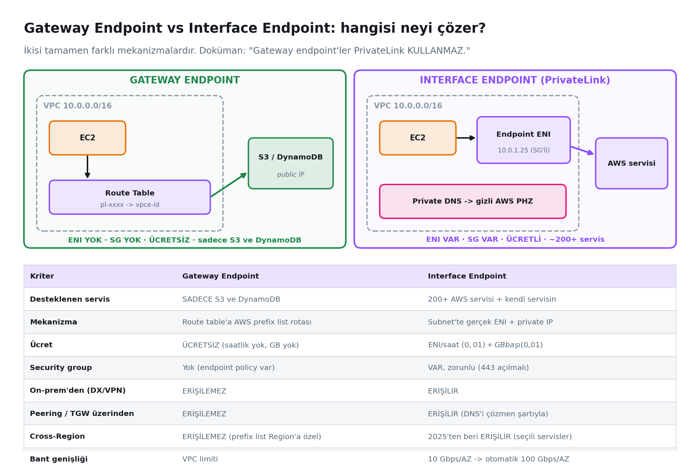
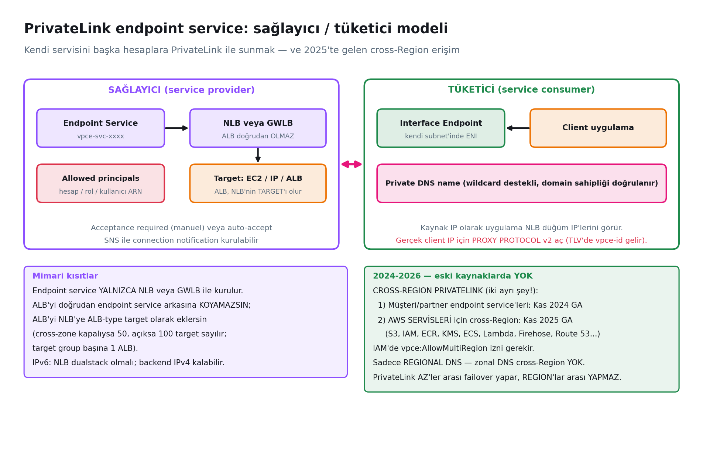
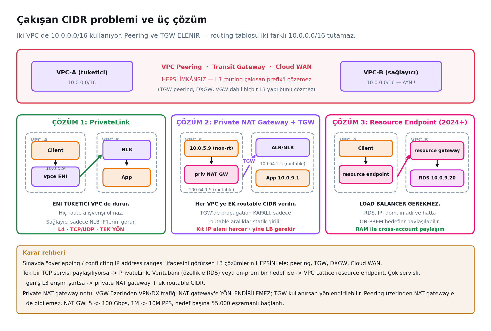

# Bölüm 4 — AWS PrivateLink ve VPC Endpoints

> **Bu bölümün sınavdaki ağırlığı:** "Çakışan CIDR", "on-prem'den S3'e private erişim", "SaaS servisimi müşterilere sunmak", "internete çıkmadan AWS API'sine erişim" senaryolarının tamamı burada. Ayrıca 2024-2025'te gelen **resource endpoint** ve **cross-Region PrivateLink** hiçbir eski kaynakta yok.

---

## 4.1 Üç farklı endpoint tipi



### Gateway endpoint
> Doküman şaşırtıcı bir cümleyle başlıyor: *"Gateway endpoint'ler, diğer VPC endpoint tiplerinin aksine **AWS PrivateLink kullanmaz**."*

| Özellik | Detay |
|---|---|
| **Desteklenen servis** | **YALNIZCA Amazon S3 ve Amazon DynamoDB.** Başka hiçbir servis yok. |
| Mekanizma | Seçtiğiniz route table'lara AWS otomatik olarak `destination = <AWS-managed prefix list ID>` → `target = <gateway_endpoint_id>` rotası ekler. Bu rotaları **değiştiremez/silemezsiniz**. |
| Route önceliği | Longest prefix match uygulanır: prefix-list rotası `0.0.0.0/0 → IGW`'yi **yener**; ama servis için yazılmış açık bir CIDR rotası prefix-list rotasını **yener**. |
| **Ücret** | **YOK.** Saatlik ücret yok, GB ücreti yok. |
| ENI / SG | **Yok.** VPC'nizde private IP oluşmaz; servisin public IP'lerini kullanır. |
| Endpoint policy | Var, ama `Principal` **`*` olmak zorunda**; kısıtlama `aws:PrincipalArn` ile yapılır. |

**Erişilemediği yerler (birebir doküman):**
> *"Endpoint connections cannot be extended out of a VPC. Resources on the other side of a VPN connection, VPC peering connection, transit gateway, or Direct Connect connection in your VPC cannot use a gateway endpoint..."*

Yani: **on-prem'den YOK, peering üzerinden YOK, TGW üzerinden YOK, başka Region'dan YOK.** Prefix list Region'a özeldir; farklı Region'daki S3'e giden trafik **IGW'ye** gider.

### Interface endpoint (gerçek PrivateLink)

| Özellik | Detay |
|---|---|
| Desteklenen servis | 200+ AWS servisi + kendi/partner endpoint service'leri |
| Mekanizma | Seçtiğiniz subnet'lerde **gerçek ENI + private IP** |
| DNS adları | Regional: `endpoint_id.service_id.region.vpce.amazonaws.com` · Zonal: `endpoint_id-az_name.service_id.region.vpce.amazonaws.com` |
| **Private DNS açık** | AWS **gizli, yönetilen bir private hosted zone** oluşturur; servisin varsayılan (public) regional adını endpoint ENI'lerine yönlendirir. VPC'de `enableDnsSupport` **ve** `enableDnsHostnames` **ikisi de true** olmalı |
| Private DNS kapalı | Endpoint'e özel regional/zonal adları kullanmanız gerekir. Bu adlar **public olarak çözülebilir ama private IP döner** — yani VPC yolu yoksa işe yaramaz |
| Security group | **Zorunlu.** Belirtmezseniz default VPC SG bağlanır. AWS servis endpoint'leri için **inbound 443** açılmalı |
| Endpoint policy | Endpoint başına tek policy, varsayılan tam erişim. **Her servis policy desteklemez** — desteklemiyorsa tam erişim geçerli olur. Max **20.480 karakter** |
| **Bant genişliği** | **AZ başına varsayılan 10 Gbps, otomatik olarak 100 Gbps'e ölçeklenir.** Toplam max = AZ sayısı × 100 Gbps |
| MTU | **8.500 bayt** (daha büyük paketler düşürülür). **PMTUD desteklenmez** (ICMP Type 3 Code 4 üretilmez); **MSS clamping** uygulanır |
| IP tipi | IPv4 / IPv6 / Dualstack; ayrıca ayrı bir "DNS record IP type" ayarı |
| Ping | **Ping'e yanıt vermez.** Test için `nc` veya `nmap` kullanın |
| Shared subnet | Paylaşılan subnet'lerde endpoint **oluşturulamaz/değiştirilemez/silinemez** |

> **DÜZELTME:** Eski kaynaklardaki "10 Gbps, 40 Gbps'e burst eder" ifadesi **eskimiştir**. Güncel doküman: **AZ başına 10 Gbps varsayılan, otomatik 100 Gbps'e ölçeklenir.**

**Ücret (us-east-1):** endpoint-ENI başına **$0,01/saat** (yani AZ başına) + veri işleme **$0,01/GB** (ilk 1 PB), $0,006/GB (sonraki 4 PB), $0,004/GB (5 PB üstü) — Region'daki tüm interface endpoint'ler için kademeli.

### Gateway Load Balancer endpoint (GWLBE)
Bölüm 7'de detaylı anlatılıyor. Kısaca: DNS ile değil, **route table target'ı** olarak kullanılır; **bir AZ'ye bağlıdır ve subnet'i sonradan değiştirilemez**; bant genişliği aynı şekilde 10 → 100 Gbps/AZ.

### Basit anlatım — Üç farklı kapı
- **Gateway endpoint** = binanın arka duvarına açılan **hizmet kapısı**. Sadece iki tedarikçi (S3, DynamoDB) bu kapıyı kullanabilir, ücretsizdir, ama **sadece bina içinden** kullanılabilir. Yandaki binadan (peering) veya sokaktan (on-prem) bu kapıya ulaşamazsınız.
- **Interface endpoint** = binanızın içine kurulmuş bir **şube ofisi**. Kendi adresi (private IP) ve kendi güvenlik görevlisi (SG) var. Ücretli, ama yandaki binadan ve sokaktan da erişilebilir.
- **GWLBE** = koridora yerleştirilmiş bir **X-ray cihazı**. Adresi yok; trafiği "buradan geçmek zorundasın" diye yönlendiriyorsunuz (route table).

---

## 4.2 S3'ün özel durumu — çift endpoint deseni

AWS'in kendi karşılaştırma tablosu:

| | Gateway endpoint | Interface endpoint |
|---|---|---|
| Kullanılan IP | S3'ün **public** IP'leri | VPC'nizin **private** IP'leri |
| DNS | **Aynı S3 DNS adları** | **Endpoint'e özel S3 DNS adları gerekir** |
| On-prem erişimi | ❌ | ✅ |
| Başka Region (peering/TGW) | ❌ | ✅ |
| Ücret | **Ücretsiz** | Ücretli |

Endpoint'e özel S3 adları: `bucket|accesspoint|control.vpce-xxxx-yyyy.s3.<region>.vpce.amazonaws.com`

Private DNS açıkken şu regional adlar private çözülür: `s3.<region>.amazonaws.com`, `s3-control.<region>.amazonaws.com`, `s3-accesspoint.<region>.amazonaws.com`.

### Maliyet tuzağı ve çözümü
> Doküman birebir: *"Eğer S3 için interface endpoint'te private DNS'i yapılandırırsanız ama **sadece inbound Resolver endpoint için private DNS**'i yapılandırmazsanız, hem on-prem ağınızdan hem VPC'nizden gelen istekler S3'e erişmek için interface endpoint'i kullanır. Dolayısıyla VPC'den gelen trafik için de — ücretsiz gateway endpoint yerine — interface endpoint ücreti ödersiniz."*

**Çözüm S3'e özeldir:** *"Private DNS'i yalnızca inbound Resolver endpoint için, sadece Amazon S3 interface endpoint'lerinde yapılandırabilirsiniz."* (Konsolda: **"Enable private DNS only for inbound endpoint"**.)

**Optimal desen:**
1. VPC içi S3 trafiği için **gateway endpoint** (ücretsiz).
2. On-prem S3 erişimi için **interface endpoint**, private DNS'i **yalnızca inbound Resolver endpoint** için etkin.
3. Sonuç: hem on-prem erişimi var, hem VPC trafiği ücretsiz kanaldan gidiyor.

> Bu, sınavda "maliyeti en aza indirerek on-prem'den S3'e private erişim" sorusunun tam cevabıdır.

---

## 4.3 Endpoint service — kendi servisini sunmak



### Load balancer gereksinimi
> Doküman birebir: *"Endpoint services require either a Network Load Balancer or a Gateway Load Balancer."*

**ALB doğrudan bir endpoint service'i besleyemez** (Ağustos 2026 itibarıyla hâlâ). Tek yol: **ALB'yi NLB'ye ALB-type target olarak eklemek** (Eyl 2021'den beri mümkün).
- ALB-as-target, cross-zone kapalıysa **50 target**, açıksa **100 target** sayılır.
- **Target group başına 1 ALB.**

### Kaynak IP davranışı
> *"...uygulamaya verilen kaynak IP adresleri, servis tüketicilerinin IP adresleri değil, **load balancer düğümlerinin private IP adresleridir**. Load balancer'da proxy protocol'ü etkinleştirirseniz, servis tüketicilerinin adreslerini ve interface endpoint ID'lerini **proxy protocol header**'ından alabilirsiniz."*

**Proxy Protocol v2** custom TLV'si **VPC endpoint ID**'sini taşır. Dualstack kullanıyorsanız parser'ınız IPv6'yı da işlemeli.

**Ayrıca:** NLB client IP preservation, trafik bir **GWLB endpoint'inden** geçiyorsa — target'lar aynı VPC'de olsa bile — **desteklenmez**.

### Erişim kontrolü
- **Acceptance required** (manuel onay) veya **auto-accept**.
- **Allowed principals:** `arn:aws:iam::<acct>:root`, `.../role/<name>`, `.../user/<name>` veya `*`.
- **İzinleri kaldırmak, mevcut kabul edilmiş bağlantıları KOPARMAZ.**
- SNS ile **connection notification** kurulabilir.

### Private DNS name
- Wildcard destekler (`*.myexampleservice.com`).
- Sağlayıcı **domain sahipliğini kanıtlamak** zorundadır; durum `verified` değilse **yeni** bağlantı istekleri reddedilir (mevcutlar etkilenmez).

### IPv6
> *"Servis sağlayıcılar, backend sunucuları yalnızca IPv4 desteklese bile servis endpoint'lerini tüketicilere IPv4, IPv6 veya her ikisi üzerinden sunabilir."*

Şart: **NLB'nin dualstack IP address type'ında olması.** Target'ların IPv6 desteklemesi gerekmez.

### Cross-Region PrivateLink — iki ayrı şey (2024-2025)

**1) Müşteri/partner endpoint service'leri cross-Region: Kas 2024 GA**
Sağlayıcı `Service Regions` belirler; tüketici "Enable Cross Region endpoint" işaretler ve `Service Region` seçer.

**2) AWS SERVİSLERİ için cross-Region interface endpoint: 19 Kas 2025 GA** ← eski kaynaklarda kesinlikle yok
Desteklenen servisler: **S3, IAM, ECR (api + dkr), KMS (+kms-fips), ECS, Lambda, Data Firehose, Managed Service for Apache Flink (+fips), Route 53**.
```
aws ec2 create-vpc-endpoint --region us-east-1 --service-region us-west-2 ...
```

**Cross-Region kısıtları (birebir doküman):**
- IAM'de **`vpce:AllowMultiRegion`** izni gerekir; condition key'ler: `ec2:VpceSupportedRegion` (sağlayıcı), `ec2:VpceServiceRegion` (tüketici).
- Opt-in Region'lar için her iki taraf da opt-in olmalı; host Region desteklenen Region'lardan çıkarılamaz.
- Sağlayıcılar **≥2 AZ** kullanmalı; tüketici-sağlayıcı arasında **AZ hizalaması gerekmez**.
- **Desteklenmeyen AZ'ler:** `use1-az3`, `usw1-az2`, `apne1-az3`, `apne2-az2`, `apne2-az4`.
- *"PrivateLink, Availability Zone'lar arasında failover'ı yönetir. **Region'lar arasında failover'ı YÖNETMEZ.**"*
- **TCP idle timeout için özel değer yapılandırılmış NLB'lerde desteklenmez.**
- **UDP fragmentation ile desteklenmez.**
- **Yalnızca interface endpoint** — gateway ve GWLB tipleri desteklenmez.
- **Zonal DNS cross-Region desteklenmez** (yalnızca regional DNS).
- Faturalama: normal PrivateLink saatlik + GB başı + **standart EC2 inter-Region data transfer** + **sağlayıcı, VPCE bağlı her uzak Region için $0,05/saat** öder.

---

## 4.4 VPC Lattice tabanlı endpoint'ler (Aralık 2024 GA) — yeni cevaplar

Bu üçlü, 2024 re:Invent'te GA oldu ve **pre-2025 hiçbir çalışma materyalinde yok**. PrivateLink'in "load balancer zorunluluğu" kısıtını kaldırır.

### Resource gateway
> *"Bir kaynağın paylaşıldığı VPC'ye giriş noktası"* — birden fazla AZ'ye yayılır, **load balancing YAPMAZ**. Kaynak sağlayıcı oluşturur. Trafik, resource gateway'in IP'sinden geliyormuş gibi görünür.

- IP tipleri: IPv4 (tüm subnet'lerde IPv4 olmalı), IPv6 (subnet'ler IPv6-only olmalı), Dualstack.
- **ENI başına IPv4 adresi: 1–62 arası yapılandırılabilir, varsayılan 16, bir kez ayarlandıktan sonra DEĞİŞTİRİLEMEZ.** IPv6 için ENI başına **/80**.
- Shared subnet'lerde oluşturulamaz.
- Resource endpoint ile resource gateway arasında **en az 1 AZ örtüşmesi** olmalı.

### Resource configuration
Tipler: `SINGLE`, `GROUP`, `CHILD`, `ARN`.
- Target'lar: `10.0.0.0/8`, `100.64.0.0/10`, `172.16.0.0/12`, `192.168.0.0/16`'dan private IPv4; VPC'den IPv6. **Public IP desteklenmez.**
- Herhangi bir domain adı (private DNS/PHZ için resource gateway `DNS Resolution = IN_VPC` olmalı).
- **`ARN` tipi: "Yalnızca Amazon RDS veritabanları desteklenir."**
- **AWS RAM** ile cross-account paylaşılır.

### Resource endpoint — sınavda en çok işe yarayacak olan
> Doküman birebir: *"Bir resource endpoint, başka bir VPC'deki **veya ON-PREMISES bir ortamdaki** private subnet'te bulunabilecek bir veritabanı, EC2 instance, uygulama endpoint'i, domain-name target'ı veya IP adresi gibi kaynaklara private ve güvenli erişim sağlar. **Resource endpoint'ler load balancer GEREKTİRMEZ.**"*

Ve: *"Bu DNS adlarını, resource endpoint'in bulunduğu VPC'ye **VPN veya Direct Connect** ile erişiminiz olduğu sürece **on-premises'ten** kaynağa erişmek için kullanabilirsiniz."*

Varsayılan DNS adı: `endpoint_id.rcfgId.randomHash.vpc-lattice-rsc.<region>.on.aws`

### Service network endpoint
> *"Bir service network'e ilişkilendirilmiş **birden çok kaynağa ve servise** private ve güvenli erişim için tek bir service-network endpoint."*

Neden var: **VPC başına yalnızca 1 service network doğrudan ilişkilendirilebilir.** Service-network endpoint'ler, birden fazlasına erişmenin yoludur.

**Ücret:** resource endpoint **kaynak başına $0,02/saat** + interface endpoint ile aynı GB kademeleri; resource gateway VPC Lattice fiyatlandırmasından.

---

## 4.5 Çakışan CIDR problemi — üç çözüm



### Neden L3 çözümleri elenir
Bir route table iki farklı `10.0.0.0/16` tutamaz. Bu yüzden **VPC peering, Transit Gateway, DXGW, VGW ve Cloud WAN — hepsi elenir.** Bu, sınavda ezberlenmesi gereken bir eleme kuralıdır.

AWS whitepaper'ının kendi ifadesi:
> *"...tüketici ve servis sağlayıcı VPC'leri **çakışan IP adres aralıklarına sahip olabilir**"* ve *"Bu, iki VPC'deki client ve server'ların çakışan IP adresleri olduğunda da iyi bir seçenektir çünkü AWS PrivateLink, servis sağlayıcı VPC'si ile IP çakışması olmayacak şekilde **client VPC'si içindeki ENI'leri kullanır**."*
> Ayrıca: *"VPC peering ve Transit Gateway'i, VPC'ler arasında **layer-3 IP bağlantısı** kurmak istediğinizde kullanın."*

### Çözüm 1: PrivateLink (client/server için tercih edilen)
Endpoint ENI'leri **tüketici VPC'nin kendi subnet'lerinden** IP alır. Hiç route alışverişi olmaz. Sağlayıcı yalnızca NLB düğüm IP'lerini görür.

**Kısıtlar:** TCP/UDP only, **tek yönlü** (tüketici → sağlayıcı), NLB/GWLB (veya resource gateway) gerekir, GB başı ücret.

### Çözüm 2: Private NAT gateway + TGW (geniş L3 erişim gerekiyorsa)
Her VPC'ye mevcut çakışan (**non-routable**) CIDR'ının yanına küçük bir **routable** (global tekil, örn. `100.64.x.0/24`) CIDR eklenir.

Akış:
1. Tüketici instance, non-routable subnet'te → route table onu **routable subnet'teki private NAT gateway**'e yönlendirir.
2. NAT gateway kaynağı routable bir IP'ye **SNAT** eder.
3. TGW trafiği taşır — **route propagation KAPALI**, yalnızca routable aralıklar için **statik route**.
4. Hedef VPC, kendi **routable subnet'indeki ALB/NLB**'de sonlandırır.
5. Dönüş trafiği NAT GW IP'sine gelir ve un-NAT edilir.

**Kısıtlar:** yalnızca **kaynak** çakışmasını çözer — hedefte hâlâ bir load balancer (veya DNAT) gerekir, dolayısıyla pratikte de tek yönlüdür. VPC başına kıt routable IP alanı harcar.

**NAT gateway sayıları (2026):**
- **5 Gbps baseline → otomatik 100 Gbps** *(eski kaynaklar: 45 Gbps)*
- **1M PPS baseline → otomatik 10M PPS** *(eski kaynaklar: 4M)*
- **Tekil hedef başına (hedef IP + hedef port + protokol) 55.000 eşzamanlı bağlantı**, NAT GW IPv4 adresi başına
- NAT GW başına **8 IPv4 adresi** (1 primary + 7 secondary)
- Kaynak port aralığı 1024–65535, MTU 8500

**Kritik doküman ifadesi:**
> *"Virtual private gateway kullanarak Site-to-Site VPN veya Direct Connect'ten bir NAT gateway'e trafik yönlendiremezsiniz. **Bunun yerine transit gateway kullanırsanız** yönlendirebilirsiniz."*

Ayrıca **VPC peering üzerinden de** bir NAT gateway'e gidilemez.

### Çözüm 3: Resource endpoint (2024+, özellikle veritabanı için)
Load balancer gerekmez. AWS'in kendi blog ifadesi: *"Tüketiciler ve kaynaklar çakışan CIDR'lara sahip VPC'lerde bulunduğunda, aralarındaki doğrudan iletişim zorlaşır"* → resource configuration + resource endpoint IP routing çakışmasını ortadan kaldırır.

**Özellikle:** cross-VPC/cross-account **RDS**, veya **on-prem bir IP/hostname**.

### Karar cümlesi
| Senaryo | Cevap |
|---|---|
| Tek bir TCP servisi paylaşılıyor | **PrivateLink (interface endpoint + NLB)** |
| Veritabanı (özellikle RDS) veya on-prem hedef | **VPC Lattice resource endpoint** |
| Çok servisli, geniş L3 erişim şart | **Private NAT gateway + ek routable CIDR + TGW** |
| Trafik inspection cihazına yönlendirilecek | **GWLB endpoint** |

---

## 4.6 Merkezî interface endpoint deseni

Her VPC'ye ayrı interface endpoint koymak pahalı (endpoint-ENI/saat × AZ × VPC). Merkezî desen:

1. **Hub VPC'de** endpoint'i oluştur, **private DNS'i KAPAT**.
2. Servis adıyla bir **private hosted zone** aç ve endpoint'e **ALIAS** kaydı yaz. (`dkr.ecr` için **wildcard `*` alias** gerekir.)
3. PHZ'yi **Route 53 Profile** ile (veya RAM + PHZ association ile) spoke'lara dağıt.
4. On-prem, **inbound Resolver endpoint**'e conditional forward eder.

**Dokümante edilmiş ödünleşim:** tek endpoint policy → **daha büyük blast radius** ve **20.480 karakter** policy tavanı. Ayrıca zonal servislerde **cross-AZ veri transfer ücretine** dikkat.

> **2025 güncellemesi:** Route 53 Profiles artık **interface VPC endpoint'leri doğrudan tutabiliyor** (Nis 2025). AWS'in blog yazısı, eski elle-PHZ+alias desenini **"artık önerilmiyor"** diye niteliyor. Detay Bölüm 5'te.

---

## 4.7 Kotalar (güncel)

| Kota | Varsayılan | Artırılabilir? |
|---|---|---|
| **Interface + GWLB endpoint / VPC (BİRLİKTE)** | **50** | ✅ (L-29B6F2EB) |
| Gateway endpoint / Region | 20 (VPC başına 255'e kadar) | ✅ |
| Resource VPC endpoint / VPC | 200 | ✅ |
| Service network VPC endpoint / VPC | 50 | ✅ |
| Endpoint policy karakter sayısı | **20.480** | ❌ |
| Endpoint başına bant genişliği / AZ | **10 → 100 Gbps** | Support |
| Endpoint MTU | **8.500** | ❌ |

**NLB tarafı:** NLB başına **3.000 target** (ama **cross-zone açıksa 500**); **AZ başına 500 target**; target group başına 1.000 target (Region); **ALB-type target group başına 1 ALB**; NLB başına 50 listener.

**Dikkat — doküman tutarsızlıkları:**
- AWS General Reference, resource ve service-network endpoint'leri VPC başına **500** derken PrivateLink kota sayfası **200** ve **50** diyor.
- VPC Lattice kota sayfası resource gateway'i VPC başına **500** derken resource-gateway doküman sayfası **max 100** diyor.
- **Endpoint service / hesap-Region, endpoint service başına bağlantı sayısı ve allowed principal sayısı artık yayınlanmıyor.** Eski "255" figürünü kullanmayın.

---

## 4.8 Bölüm soruları

### Soru 1
Bir şirket, on-prem veri merkezinden S3'e **private** erişim istiyor. Aynı zamanda VPC içindeki EC2 instance'larının S3 trafiği için **ek ücret ödemek istemiyor**. Direct Connect mevcut. En maliyet-etkin çözüm nedir?

- **A.** Yalnızca gateway endpoint oluştur; Direct Connect üzerinden erişilebilir.
- **B.** Yalnızca interface endpoint oluştur, private DNS'i etkinleştir.
- **C.** Gateway endpoint + interface endpoint oluştur; interface endpoint'te "private DNS only for inbound endpoint" seçeneğini etkinleştir.
- **D.** S3 bucket'ı public yap ve bucket policy ile on-prem IP aralığını kısıtla.

<details>
<summary><b>Cevap ve analiz</b></summary>

**Doğru cevap: C**

Bu, S3'e özgü bir optimizasyon ve sınavın favori sorusu.

- **A yanlış:** Gateway endpoint **on-prem'den erişilemez.** Doküman açık: VPN, peering, TGW veya Direct Connect'in diğer tarafındaki kaynaklar gateway endpoint kullanamaz.
- **B yanlış — ve maliyet tuzağının tam kendisi:** Interface endpoint on-prem erişimini sağlar, ama private DNS normal şekilde açıldığında **VPC içindeki EC2'ler de** S3'ün regional adını çözerken interface endpoint'e yönlenir. Sonuç: ücretsiz gateway endpoint yerine **VPC içi trafik için de GB başı ücret** ödersiniz. Doküman bu senaryoyu birebir uyarı olarak veriyor.
- **C doğru:** VPC içi trafik ücretsiz **gateway endpoint**'ten gider; on-prem trafiği **interface endpoint**'ten gelir. "Private DNS only for inbound endpoint" ayarı — ki **yalnızca S3 interface endpoint'lerinde mevcuttur** — private DNS'i sadece inbound Resolver endpoint yolundan gelen sorgular için etkinleştirir.
- **D yanlış:** "Private erişim" şartını ihlal eder; trafik internetten geçer.
</details>

---

### Soru 2
Bir SaaS sağlayıcısı, uygulamasını müşterilerine PrivateLink ile sunmak istiyor. Uygulama bir **Application Load Balancer** arkasında çalışıyor ve HTTP host-based routing kullanıyor. Ayrıca uygulamanın **gerçek client IP adreslerini** loglaması gerekiyor. Hangi kombinasyon doğrudur? (İki cevap seçin)

- **A.** ALB'yi doğrudan bir endpoint service'e bağla.
- **B.** Bir NLB oluştur, ALB'yi NLB'ye ALB-type target olarak ekle, endpoint service'i NLB ile oluştur.
- **C.** NLB'de proxy protocol v2'yi etkinleştir; header'daki custom TLV'den VPC endpoint ID'sini ve client adresini oku.
- **D.** NLB'de client IP preservation'ı etkinleştir.
- **E.** ALB'nin `X-Forwarded-For` header'ını kullan; PrivateLink bunu otomatik doldurur.

<details>
<summary><b>Cevap ve analiz</b></summary>

**Doğru cevaplar: B ve C**

- **B doğru:** Doküman birebir: *"Endpoint services require either a Network Load Balancer or a Gateway Load Balancer."* **ALB doğrudan endpoint service'i besleyemez** (Ağu 2026 itibarıyla hâlâ). Tek yol ALB'yi NLB'ye **ALB-type target** olarak eklemek. Bu şekilde ALB'nin host-based routing yeteneği de korunur.
- **C doğru:** Doküman: uygulamaya verilen kaynak IP'ler **load balancer düğümlerinin private IP'leridir**, tüketicinin IP'si değil. Gerçek client bilgisi için **proxy protocol** açılır ve custom TLV'de **VPC endpoint ID** gelir.
- **A yanlış:** Yukarıdaki gerekçe.
- **D yanlış (bu bağlamda):** NLB client IP preservation, PrivateLink endpoint service akışında tüketicinin gerçek IP'sini vermez — endpoint ENI'si zaten bir NAT noktası gibi davranır. Ayrıca trafik bir **GWLB endpoint'inden** geçiyorsa client IP preservation **hiç desteklenmez**.
- **E yanlış:** `X-Forwarded-For`'u ALB kendi client'ından (yani NLB düğümü) doldurur; PrivateLink tüketicisinin IP'sini oraya yazan bir mekanizma yoktur.
</details>

---

### Soru 3
İki farklı iş biriminin VPC'si de `10.0.0.0/16` kullanıyor. Birim A'nın uygulaması, Birim B'nin VPC'sindeki bir **Amazon RDS** örneğine erişmek zorunda. IP aralıklarını değiştirmek mümkün değil. 2026'da en az bileşenle çözüm nedir?

- **A.** İki VPC arasında VPC peering kur ve route table'ları yapılandır.
- **B.** Her iki VPC'yi TGW'ye bağla ve statik route gir.
- **C.** Birim B'de bir NLB kur, RDS'i target yap, endpoint service oluştur; Birim A'da interface endpoint aç.
- **D.** Birim B'de bir resource gateway ve `ARN` tipinde resource configuration (RDS) oluştur, RAM ile paylaş; Birim A'da resource endpoint aç.

<details>
<summary><b>Cevap ve analiz</b></summary>

**Doğru cevap: D**

- **A ve B yanlış:** Çakışan CIDR'da **hiçbir L3 çözümü çalışmaz** — bir route table iki farklı `10.0.0.0/16` tutamaz. Peering, TGW, DXGW, Cloud WAN hepsi elenir.
- **C çalışır ama daha fazla bileşen gerektirir:** NLB kurulumu, target group yönetimi, health check, NLB saatlik ücreti + LCU. RDS failover'da target'ın IP'si değişebileceği için IP-target yönetimi ek iş demektir.
- **D doğru ve "en az bileşen":** VPC Lattice **resource configuration**'ın `ARN` tipi **açıkça Amazon RDS veritabanlarını** destekler. **Resource endpoint load balancer GEREKTİRMEZ.** RAM ile cross-account paylaşılır. Endpoint ENI'si tüketici VPC'sinin kendi IP alanında olduğu için çakışma sorunu ortadan kalkar.

**Hatırla:** resource gateway load balancing **yapmaz** ve resource endpoint ile resource gateway arasında **en az 1 AZ örtüşmesi** gerekir. Ayrıca resource configuration target'ları yalnızca private IP aralıklarından olabilir — **public IP desteklenmez**.
</details>

---

### Soru 4
Bir mimar, `us-east-1`'deki bir VPC'den `us-west-2`'deki S3'e **private** erişim istiyor. Hangi ifade 2026 itibarıyla doğrudur?

- **A.** `us-east-1`'de bir gateway endpoint oluşturulup route table'a `us-west-2` S3 prefix list'i eklenebilir.
- **B.** Cross-Region interface endpoint oluşturulabilir; `vpce:AllowMultiRegion` IAM izni gerekir ve yalnızca regional DNS desteklenir.
- **C.** Bunun tek yolu iki Region arasında VPC peering kurup `us-west-2`'de bir gateway endpoint kullanmaktır.
- **D.** PrivateLink cross-Region erişimi desteklemez; trafik NAT gateway üzerinden internete çıkmak zorundadır.

<details>
<summary><b>Cevap ve analiz</b></summary>

**Doğru cevap: B**

**AWS servisleri için cross-Region interface endpoint** 19 Kasım 2025'te GA oldu ve desteklenen servisler arasında **S3 var** (ayrıca IAM, ECR api+dkr, KMS, ECS, Lambda, Data Firehose, MSK-Flink, Route 53).

```
aws ec2 create-vpc-endpoint --region us-east-1 --service-region us-west-2 ...
```

Kısıtlar: **`vpce:AllowMultiRegion`** IAM izni, **yalnızca regional DNS** (zonal DNS cross-Region yok), **yalnızca interface endpoint** (gateway ve GWLB tipleri yok), desteklenmeyen AZ'ler (`use1-az3`, `usw1-az2`, `apne1-az3`, `apne2-az2`, `apne2-az4`), TCP idle timeout'u özelleştirilmiş NLB'lerde yok, UDP fragmentation ile yok. Ve kritik: **PrivateLink AZ'ler arası failover'ı yönetir, Region'lar arası failover'ı YÖNETMEZ.**

- **A yanlış:** Prefix list'ler **Region'a özeldir**. Farklı Region'daki S3'e giden trafik **IGW'ye** gider. Gateway endpoint cross-Region çalışmaz.
- **C yanlış:** Peering üzerinden **gateway endpoint kullanılamaz** (doküman açık). Interface endpoint peering üzerinden kullanılabilir ama artık native cross-Region seçeneği var.
- **D yanlış:** 2024'ten (müşteri servisleri) ve 2025'ten (AWS servisleri) beri destekleniyor.
</details>

---

### Soru 5
Bir şirket 60 VPC'de her birinde 6 farklı AWS servisi için interface endpoint kullanıyor ve maliyetlerin yüksek olduğunu fark ediyor. Merkezî bir yaklaşıma geçmek istiyor. Doğru desen ve dikkat edilmesi gereken ödünleşim nedir?

- **A.** Hub VPC'de endpoint'leri oluştur, private DNS'i açık bırak, spoke'lardan TGW ile eriş.
- **B.** Hub VPC'de endpoint'leri oluştur, private DNS'i kapat, servis adıyla PHZ + alias kaydı yap, Route 53 Profile ile spoke'lara dağıt. Ödünleşim: tek endpoint policy → daha büyük blast radius ve 20.480 karakter tavanı.
- **C.** Tüm VPC'leri tek bir VPC'de birleştir.
- **D.** Interface endpoint'leri gateway endpoint'lere dönüştür.

<details>
<summary><b>Cevap ve analiz</b></summary>

**Doğru cevap: B**

Merkezî interface endpoint deseni tam olarak budur:
1. Hub VPC'de endpoint, **private DNS KAPALI** (açık bırakırsanız gizli AWS-managed PHZ yalnızca hub VPC'ye hizmet eder, spoke'lar çözemez).
2. Servis adıyla kendi **PHZ**'nizi açıp endpoint'e **ALIAS** kaydı — `dkr.ecr` için **wildcard `*` alias**.
3. **Route 53 Profile** (Nis 2025'ten beri interface VPC endpoint'leri doğrudan tutabiliyor) ile spoke'lara dağıtım.
4. On-prem için **inbound Resolver endpoint** + conditional forwarder.

**Dokümante edilmiş ödünleşimler:** tek endpoint policy → **daha büyük blast radius** ve **20.480 karakter** policy tavanı; zonal servislerde **cross-AZ veri transfer ücreti**.

- **A yanlış:** Private DNS açıkken oluşan gizli PHZ **yalnızca endpoint'in kendi VPC'sine** hizmet eder. Doküman: *"Route 53 Resolver'ı VPC'nizin dışından kullanamazsınız."* Spoke'lar servisin regional adını private çözemez.
- **C yanlış:** 60 VPC'yi birleştirmek bir ağ optimizasyonu değil, kurumsal bir yeniden yapılandırma projesidir. Blast radius'u da yok eder.
- **D yanlış:** Gateway endpoint **yalnızca S3 ve DynamoDB** içindir; 6 servisin çoğu dönüştürülemez. (Ancak S3/DynamoDB varsa onlar için gateway endpoint'e geçmek gerçekten maliyeti düşürür — kısmi doğru, ama tam cevap değil.)
</details>

---

## 4.9 Bu bölümün 60 saniyelik özeti

1. **Gateway endpoint = yalnızca S3 + DynamoDB, ÜCRETSİZ, ama on-prem/peering/TGW/cross-Region'dan ERİŞİLEMEZ.** Doküman "PrivateLink kullanmaz" diyor.
2. **Interface endpoint = ENI + SG + private IP, ücretli, her yerden erişilebilir.** MTU 8500, PMTUD yok, **10 → 100 Gbps/AZ**.
3. **S3 çift endpoint deseni:** gateway (VPC içi, ücretsiz) + interface with "private DNS only for inbound endpoint" (on-prem). Bu ayar **yalnızca S3'te var**.
4. **Endpoint service = NLB veya GWLB. ALB doğrudan olmaz** — ALB'yi NLB'ye ALB-type target yap. Gerçek client IP için **proxy protocol v2**.
5. **Çakışan CIDR:** L3 çözümlerin HEPSİ elenir. Sırayla PrivateLink → resource endpoint (RDS/on-prem) → private NAT gateway + routable CIDR.
6. **NAT gateway 2026:** 5 → 100 Gbps, 1M → 10M PPS, hedef başına 55.000 bağlantı. **VGW üzerinden NAT GW'ye gidilemez, TGW ile gidilir.**
7. **Cross-Region PrivateLink:** müşteri servisleri Kas 2024, **AWS servisleri Kas 2025**. `vpce:AllowMultiRegion`, regional DNS only, **Region'lar arası failover YOK**.
8. **VPC Lattice resource endpoint:** load balancer gerektirmez, RDS'i ARN ile paylaşır, **on-prem hedefleri** de destekler.
9. **Kota:** interface + GWLB endpoint **birlikte VPC başına 50**; endpoint policy **20.480 karakter**.

---

[← Bölüm 3: Site-to-Site VPN](03-site-to-site-vpn.md) · [Sonraki bölüm: Route 53 Resolver ve hibrit DNS →](05-route53-resolver-hibrit-dns.md)
