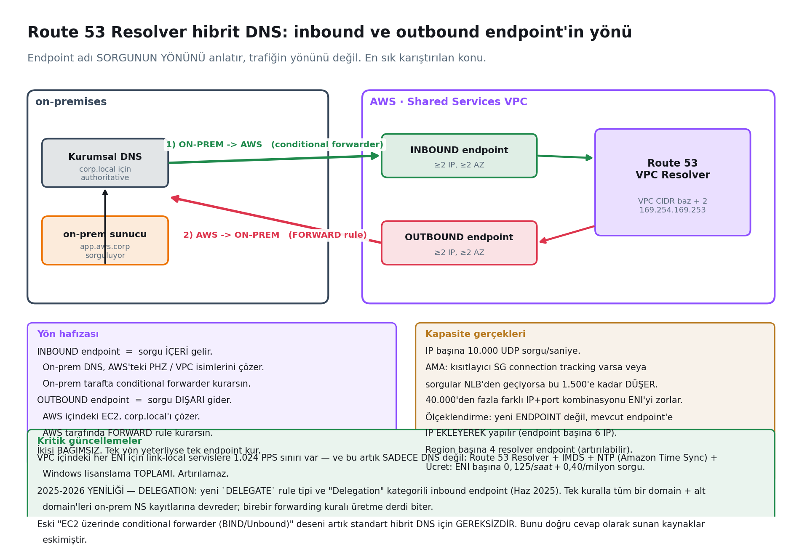
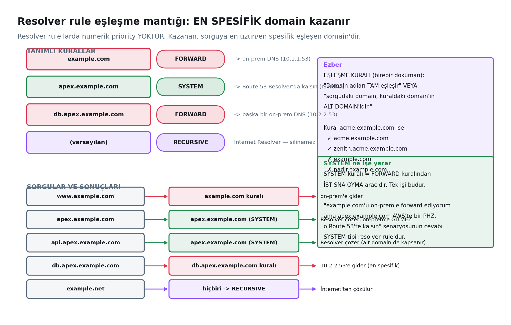
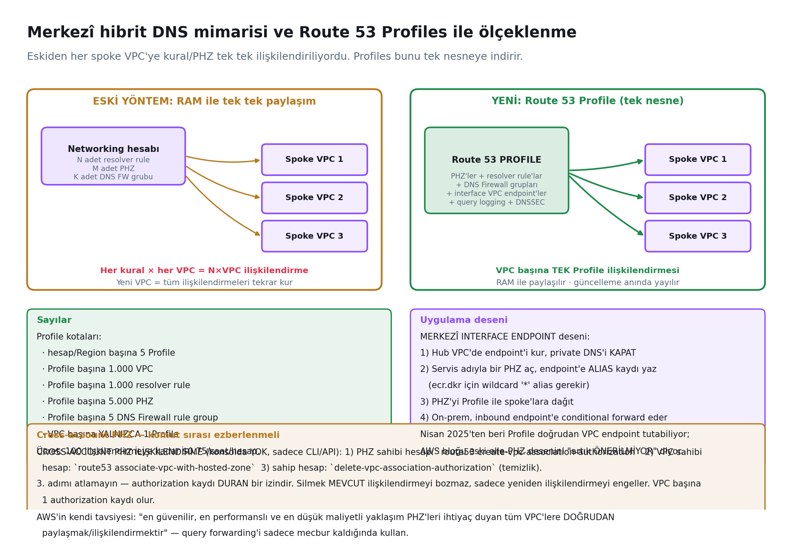

# Bölüm 5 — Route 53 Resolver ve hibrit DNS

> **Bu bölümün sınavdaki ağırlığı:** Hibrit senaryoların gizli belkemiği. "Bağlantı var ama isim çözülmüyor" sorularının tamamı burada. Ayrıca **Route 53 Profiles**, **DELEGATE rule** ve **Global Resolver** hiçbir eski kaynakta yok.

> **Terminoloji uyarısı:** AWS dokümanları VPC içindeki resolver'a artık **"Route 53 VPC Resolver"** diyor — Mart 2026'da GA olan yeni **"Route 53 Global Resolver"**'dan ayırmak için. Eski kaynaklar sadece "Route 53 Resolver" diyor.

---

## 5.1 VPC DNS'in iç işleyişi

| Kalem | Değer |
|---|---|
| Resolver adresi | **VPC birincil IPv4 CIDR'ının taban adresi + 2** (örn. `10.0.0.0/16` → `10.0.0.2`) |
| Link-local adres | **`169.254.169.253`** (IPv4), **`fd00:ec2::253`** (IPv6) |
| `enableDnsSupport` | *"VPC'nin Amazon tarafından sağlanan DNS sunucusu üzerinden DNS çözümlemesini destekleyip desteklemediğini belirler."* **Varsayılan: true** |
| `enableDnsHostnames` | *"VPC'nin public IP'si olan instance'lara public DNS hostname atamayı destekleyip desteklemediğini belirler."* **Varsayılan: false** (default VPC hariç) |

**Kombinasyon semantiği:**
- **İkisi de true** → public IP'li instance'lar public DNS hostname alır **ve** Resolver, Amazon-provided private DNS hostname'lerini çözer.
- **Biri false** → public DNS hostname yok **ve** Resolver Amazon-provided private hostname'leri çözemez.
- **Interface endpoint private DNS** ve **autodefined reverse-DNS SYSTEM rule'ları** için **ikisi de true olmalı**.

### 1.024 PPS limiti — semantiği değişti
> Birebir doküman: *"Link-local adresleri kullanan servislere **1.024 paket/saniye (PPS)** limiti vardır. Bu limit, **Route 53 Resolver DNS sorguları, Instance Metadata Service (IMDS) istekleri, Amazon Time Service NTP istekleri ve Windows Licensing Service isteklerinin TOPLAMINI** içerir. Bu kota artırılamaz."*

**Eski kaynaklar bunu "DNS için 1.024 PPS" diye anlatıyor** — artık **tüm link-local servislerin toplamı**. Yani yoğun IMDS çağrısı yapan bir uygulama DNS'i de aç bırakabilir.

---

## 5.2 Inbound ve Outbound Resolver Endpoint — yön mantığı



**Endpoint adı SORGUNUN yönünü anlatır, trafiğin değil.** Bu tek cümle, bu konuda kaybedilen soruların yarısını kurtarır.

| | **Inbound endpoint** | **Outbound endpoint** |
|---|---|---|
| Sorgu yönü | **on-prem → AWS** | **AWS → on-prem** |
| Ne sağlar | On-prem DNS, AWS'teki PHZ / VPC içi isimleri çözer | AWS içindeki EC2, `corp.local` gibi on-prem isimleri çözer |
| Sizin kurduğunuz | On-prem tarafta **conditional forwarder** | AWS tarafta **FORWARD resolver rule** |

**IP gereksinimi:** *"iki veya daha fazla IP adresi, farklı Availability Zone'larda belirtirsiniz."* → **minimum 2 IP, ≥2 AZ**. Her (AZ, subnet, IP) kombinasyonu bir ENI oluşturur.

### Kapasite gerçekleri
| Kalem | Değer |
|---|---|
| **IP başına QPS** | **10.000 UDP DNS sorgu/saniye** |
| **Ama...** | *"Kısıtlayıcı security group kuralları connection tracking'i zorlarsa veya sorgular Network Load Balancer üzerinden yönlendirilirse, bir inbound endpoint IP'sinin max QPS'i **1.500'e kadar düşebilir**."* |
| ENI zorlanması | *"DNS trafiğini üreten 40.000'den fazla tekil IP+port kombinasyonu varsa ENI kapasitesi etkilenir."* |
| **Ölçeklendirme** | Yeni **endpoint** eklemeyerek değil, **mevcut endpoint'e IP ekleyerek** (endpoint başına 6 IP) |
| Region başına endpoint | **4** (artırılabilir) |
| Kural başına target IP | 6 |
| Region başına rule | 1.000 |
| Rule↔VPC association | 2.000 |
| **Ücret** | **ENI başına $0,125/saat** + iletilen sorgular **$0,40/milyon** (ilk 1 milyar/ay), üstü $0,20/milyon |

### Protokoller ve kategoriler (yeni)
- **Inbound:** Do53, **DoH**, **DoH-FIPS** (tek başına veya Do53+DoH / Do53+DoH-FIPS). **Outbound:** Do53, DoH veya ikisi.
- Do53-only bir endpoint'i doğrudan DoH-only'ye çeviremezsiniz — **ikisini de aç, drain et, sonra Do53'ü kapat**.
- SG'de TCP+UDP **53**, DoH için ayrıca **443**.
- **Endpoint kategorisi (Haz 2025):** inbound endpoint'ler artık **Default** veya **Delegation**. *"Delegation inbound endpoint'lerinde şu an tek kullanılabilir protokol Do53'tür."*

### Basit anlatım — Santral operatörü
İki şirket birleşti: AWS Ltd. ve OnPrem A.Ş. Her birinin kendi telefon rehberi var.

- **Inbound endpoint** = AWS Ltd.'nin santralinde OnPrem çalışanlarının arayabileceği bir **danışma hattı**. "AWS'teki Ahmet'in dahilisi kaç?" diye soruyorlar, santral cevap veriyor.
- **Outbound endpoint** = AWS Ltd. çalışanlarının OnPrem'i aramak için kullandığı **dış hat**. "OnPrem'deki Mehmet'in numarası ne?" sorusunu OnPrem santraline yönlendiriyor.

İkisi bağımsızdır. Sadece bir yöne ihtiyacınız varsa tek endpoint kurun. **Ve santral kapasitesi hat başına 10.000 çağrı/saniyedir — ama güvenlik görevlisi her çağrıyı tek tek kaydediyorsa (SG connection tracking) 1.500'e düşer.**

---

## 5.3 Resolver rule tipleri ve eşleşme mantığı



### Rule tipleri
API `RuleType` geçerli değerleri: **`FORWARD | SYSTEM | RECURSIVE | DELEGATE`**
(**`DELEGATE` Haziran 2025'te eklendi** — eski kaynaklarda yok.)

| Tip | Ne yapar |
|---|---|
| **FORWARD** | Belirtilen domain için sorguları outbound endpoint üzerinden hedef DNS'e iletir |
| **SYSTEM** | Bir FORWARD kuralından **istisna oyar** — o alt domain Route 53 Resolver'da çözülür |
| **RECURSIVE** | Yalnızca Resolver oluşturur. Silinemeyen **Internet Resolver** kuralı bu tiptedir |
| **DELEGATE** *(yeni)* | Tüm bir domain + alt domain'lerini on-prem NS kayıtlarına devreder, recursive çözümleme ile |

### Eşleşme kuralı — birebir doküman
> *"Domain adları **tam eşleştiğinde**"* VEYA *"**sorgudaki domain adı, kuraldaki domain adının bir ALT DOMAIN'i olduğunda**"* eşleşir.

Kural `acme.example.com` ise:
| Sorgu | Eşleşir? |
|---|---|
| `acme.example.com` | ✅ |
| `zenith.acme.example.com` | ✅ |
| `example.com` | ❌ |
| `nadir.example.com` | ❌ |

### Öncelik — birebir doküman
> *"Bir sorgudaki domain adı birden fazla kuraldaki domain adıyla eşleşiyorsa (örn. `example.com` ve `www.example.com`), VPC Resolver outbound DNS sorgularını **en spesifik domain adını içeren kuralı** (`www.example.com`) kullanarak yönlendirir."*

**Resolver rule'larda numerik priority YOKTUR.** (DNS Firewall rule group'larında var — karıştırmayın.)

### SYSTEM ile istisna oyma — birebir doküman
> *"Bir domain için DNS sorgularını ağınıza ileten bir forwarding rule'unuz varsa ve Resolver'ın o domain'in bir alt domain'i için sorguları işlemesini istiyorsanız, `SYSTEM` belirtin. Örneğin `example.com` için DNS sorgularını ağınızdaki resolver'lara iletmek üzere bir kural oluşturup `FORWARD` belirtirsiniz. Sonra Resolver'ın `apex.example.com` sorgularını işlemesi için bir kural oluşturup `SYSTEM` belirtirsiniz."*

### Autodefined SYSTEM rules
`enableDnsHostnames` ve `enableDnsSupport` ikisi de true olduğunda **reverse-DNS (`in-addr.arpa` / `ip6.arpa`)** için otomatik SYSTEM kuralları oluşur. Bunları **kapatabilirsiniz** — o zaman reverse sorgular on-prem'e gider.

### DELEGATE — 2025'in yeni cevabı
Tek bir kuralla tüm bir domain ve alt domain'lerini on-prem NS kayıtlarına devreder. AWS'in ifadesi: **"1'e 1 forwarding rule provision etme ihtiyacını ortadan kaldırır."**

**Inbound delegation endpoint** ise ters yönü çözer: on-prem DNS, bir PHZ alt domain'i için NS kayıtlarını Route 53'e işaret eder — **EC2 DNS sunucusu gerekmeden**. Normal endpoint fiyatlandırması dışında ek ücret yok. GovCloud Nis 2026'da eklendi.

---

## 5.4 RAM ile Resolver rule paylaşımı

- **Kendi oluşturduğunuz** kuralları paylaşırsınız (outbound endpoint'i olan FORWARD tipi kurallar). `route53resolver:PutResolverRulePolicy` izni gerekir.
- Tüketici: *"kuralları, kendi oluşturduğunuz kuralları VPC'lerinizle ilişkilendirdiğiniz şekilde ilişkilendirebilirsiniz."*
- Tüketici kuralı **değiştiremez veya silemez**. Etiketleri yalnızca oluşturan hesap görebilir/ekleyebilir/silebilir.
- **Kota muhasebesi:** *Region başına rule sayısı* **oluşturana** sayılır; *rule↔VPC association* **tüketiciye** sayılır.
- Paylaşımı kaldırmak/silmek, disassociate gibi davranır — VPC Resolver kalan kurallara düşer.
- **OU nüansı (birebir):** *"Bir kural bir Organizational Unit (OU) ile paylaşılmışsa ve OU'daki bir hesap farklı bir OU'ya taşınırsa, o hesaptaki herhangi bir VPC'nin paylaşılan kuralla olan **tüm ilişkilendirmeleri silinir**."*

---

## 5.5 Cross-account private hosted zone association

**Üç adım, YALNIZCA CLI/API:**

```bash
# 1) Hosted zone SAHİBİ hesapta
aws route53 create-vpc-association-authorization \
    --hosted-zone-id Z123456ABCDEF \
    --vpc VPCRegion=eu-central-1,VPCId=vpc-0abc123

# 2) VPC SAHİBİ hesapta
aws route53 associate-vpc-with-hosted-zone \
    --hosted-zone-id Z123456ABCDEF \
    --vpc VPCRegion=eu-central-1,VPCId=vpc-0abc123

# 3) Sahip hesapta — TEMİZLİK (atlamayın!)
aws route53 delete-vpc-association-authorization \
    --hosted-zone-id Z123456ABCDEF \
    --vpc VPCRegion=eu-central-1,VPCId=vpc-0abc123
```

> Birebir doküman: *"Bir VPC'nin private hosted zone ile ilişkilendirilmesini yetkilendirmek veya ilişkilendirmeyi yapmak için **Route 53 konsolunu kullanamazsınız**."*

**Kritik nüanslar:**
- **VPC başına 1 authorization kaydı.**
- PHZ önceden var olmalı.
- Authorization kaydı **bekleyen bir izindir**. 3. adımı atlamak = duran bir yetki bırakmak (güvenlik bulgusu). **Silmek MEVCUT ilişkilendirmeyi BOZMAZ**, sadece yeniden ilişkilendirmeyi engeller.

### AWS'in kendi tavsiyesi (sınavda önemli)
> *"...en güvenilir, en performanslı ve en düşük maliyetli yaklaşım, private hosted zone'ları ihtiyaç duyan **tüm VPC'lere doğrudan paylaşmak ve ilişkilendirmektir**"* — forwarding rule'ları yalnızca mecbur kaldığında kullanın çünkü *"query forwarding, gerçek zamanlı DNS çözümlemesine ek karmaşıklık getirir."*

---

## 5.6 Route 53 Profiles — ölçekleme cevabı



### İçinde ne olur (birebir doküman)
> *"Private hosted zone'lar ve içlerinde belirtilen ayarlar. Resolver rule'lar — hem forwarding hem system. DNS Firewall rule group'ları. **Interface VPC endpoint'ler.** VPC Resolver query logging yapılandırmaları."*

Artı Profile seviyesinde VPC ayarları: **Resolver rule'lar için reverse-DNS lookup yapılandırması, DNS Firewall failure mode, DNSSEC validation.**

### Mekanik
- **AWS RAM** ile paylaşılır, **aynı Region**.
- **VPC başına YALNIZCA 1 Profile.**
- Güncellemeler ilişkili tüm VPC'lere **anında** yayılır.

### Kotalar
| Kalem | Değer |
|---|---|
| Hesap/Region başına Profile | **5** |
| Profile başına VPC | 1.000 |
| Profile başına DNS Firewall rule group | 5 |
| Profile başına resolver rule | 1.000 |
| Profile başına PHZ | 5.000 |
| Profile başına query logging config | 2 |

**Ücret:** **100 Profile-VPC ilişkilendirmesine kadar hesap başına $0,75/saat**, sonrası ilişkilendirme başına $0,0014/saat.

### 2025–2026 güncellemeleri
- Mar 2025: IPv6 servis endpoint'leri.
- **Nis 2025: VPC endpoint desteği.** AWS'in blog yazısı, eski elle "PHZ + her spoke VPC'de her endpoint için alias kaydı" yaklaşımını **"büyük ölçüde basitleştirildi ve artık ÖNERİLMİYOR"** diyor.
- May 2025: 3 ek Region.
- **Kas 2025: Resolver query logging yapılandırmaları Profile'a girdi.**
- Mar 2026: kaynak ve VPC ilişkilendirmeleri için granüler IAM izinleri.

---

## 5.7 Route 53 Resolver DNS Firewall

### Kapsam — birebir doküman
> *"...o VPC içinde başlayan ve VPC DNS'inden geçen DNS sorgularını"* ve *"o aynı VPC'ye on-premises kaynaklardan Resolver endpoint'leri üzerinden geçen DNS sorgularını"* filtreler.

> *"Yalnızca domain adı üzerinde filtreler. O adı bloklanacak bir IP adresine **çözmez**."* ve *"HTTPS, SSH, TLS, FTP gibi diğer uygulama katmanı protokollerini filtrelemez."*

**Bloklayabildikleri:** PHZ isimleri (paylaşılan veya yerel), **VPC endpoint isimleri**, EC2 instance isimleri.

### Sıralama
- Rule group'lar **ilişkilendirmede belirlediğiniz priority sırasına göre, en küçük sayısal değerden başlayarak** değerlendirilir.
- Grup içinde kurallar **tekil pozitif tam sayı priority ile, en küçükten** değerlendirilir.
- **İlk eşleşen kazanır** ve değerlendirme durur.

### Aksiyonlar
**ALLOW / BLOCK / ALERT.** BLOCK yanıtları: **NODATA / NXDOMAIN / OVERRIDE** (özel CNAME).

### Failure mode
> *"Varsayılan olarak, VPC Resolver bir sorgu için DNS Firewall'dan yanıt almazsa **fail closed** yapar ve sorguyu **bloklar**."*

VPC bazında yapılandırılabilir (ve Route 53 Profile ile de ayarlanabilir).

### Kural ayarları
- Bir kural ya **domain list** (müşteri veya AWS-managed) ya **Advanced protection** kullanır — **ikisi birden olmaz**.
- **`Query type`** kural başına bir tane: A, AAAA, CAA, CNAME, DS, MX, NAPTR, NS, PTR, SOA, SPF, SRV, TXT veya `TYPE<1-65334>`; boş bırakılırsa tüm tipler.
- **Domain redirection:** yalnızca ilk domain'i mi inceleyeyim, yoksa tüm CNAME/DNAME zincirini mi (varsayılan: tümü).

### DNS Firewall Advanced — var ve GA
Tespit ettikleri: **DGA (Domain Generation Algorithm)**, **DNS tunneling**, **Dictionary DGA** (Kas 2025'te eklendi).
- **Güven eşikleri:** High / Medium / Low (High = en az yanlış pozitif, Low = en fazla tespit).
- **Ücret:** advanced kural içeren **rule group başına, VPC ilişkilendirmesi başına $0,16/saat**.
- Foundation fiyatı: **$0,60/milyon sorgu** (ilk 1 milyar), üstü $0,40/milyon. Managed/custom domain list: **domain başına $0,0005/ay**.
- **May 2026:** **threat ve content domain kategorileri** eklendi (spam, phishing, adult, social networking, gambling).

### Kotalar
VPC/hesap/Region başına **ilişkilendirilmiş rule group: 5** · hesap/Region başına rule group: 1.000 · **rule group başına kural: 100** · hesap/Region başına domain list: 1.000 · **tüm domain list'lerdeki toplam domain: 100.000** · tek S3 import dosyasında 250.000 domain.

---

## 5.8 Önerilen merkezî hibrit DNS mimarisi (2026)

1. **Merkezî networking / shared-services hesabı + VPC**, hub-and-spoke, **Transit Gateway** üzerinden.
2. Hub'da **inbound + outbound Resolver endpoint**, her biri **≥2 IP, ≥2 AZ**. Ölçekleme = IP ekleme.
3. **On-prem → AWS:** on-prem DNS, AWS-sahipli zone'ları inbound endpoint IP'lerine conditional-forward eder. Yeni seçenek: **inbound delegation endpoint** + on-prem'de NS kayıtları (forwarder yok, EC2 DNS yok).
4. **AWS → on-prem:** hub'da FORWARD rule'lar (veya tek bir **DELEGATE** rule), **AWS RAM ile** spoke hesaplara paylaşılır ve spoke VPC'lerine ilişkilendirilir. AWS'te çözülmesi gereken alt domain'ler için **SYSTEM** rule'ları ile istisna oyulur.
5. **PHZ'ler:** AWS'in tavsiyesi — ihtiyaç duyan **tüm VPC'lere doğrudan paylaş ve ilişkilendir**. Query forwarding'i son çare olarak kullan.
6. **Route 53 Profiles**, per-VPC PHZ/rule/firewall ilişkilendirme fan-out'unu bitirir: VPC başına tek Profile, RAM ile paylaşılmış, içinde PHZ'ler + rule'lar + firewall grupları + **interface VPC endpoint'ler** + query logging + DNSSEC/failure-mode ayarları. **Güncel önerilen kontrol düzlemi budur.**
7. **Merkezî interface endpoint'ler** hub'da: private DNS'i kapat, servis adıyla PHZ + endpoint'e **alias** kaydı (`dkr.ecr` için wildcard `*`), sonra Profiles ile spoke'lara. On-prem inbound endpoint'e conditional forward eder.
8. **DNS Firewall** rule group'ları Profile üzerinden bağlanır; failure mode bilinçli seçilir (varsayılan **fail-closed**).

### Eski "EC2 conditional forwarder" deseni gerekli mi?
**Standart hibrit DNS için pratikte HAYIR.** Resolver endpoint'leri bunu değiştirdi ve **Resolver delegation** (Haz 2025) son yaygın gerekçeyi de ortadan kaldırdı (private delegation zincirine katılmak için kendi authoritative sunucunuza ihtiyaç duymak).

Kalan niş durumlar: Route 53 Resolver'ın uygulamadığı DNS özellikleri (PHZ kapsamının ötesinde DNS views / split-horizon, standart dışı kayıt/zone davranışları, Outposts / izole ortamlarda DNS, özel protokol gerektiren non-AWS resolver'lara forwarding).

> **Hibrit DNS'i EC2 conditional forwarder ile çözen bir kaynak görürseniz o kaynak eskimiştir.**

---

## 5.9 Route 53 Global Resolver (GA Mart 2026) — tamamen yeni

**Ne olduğu:** on-prem / şube / uzak client'lar için **internetten erişilebilen, anycast** yönetilen bir resolver. Public domain'leri **ve Route 53 private hosted zone'larını**, **VPC olmadan, Resolver endpoint olmadan, DX/VPN olmadan** çözer.

| Özellik | Detay |
|---|---|
| Zaman çizelgesi | Preview Kas 2025 (re:Invent) → **GA 9 Mart 2026**, şu an **30 Region**, IPv4 + IPv6 |
| Mekanizma | **Anycast IP'ler** — en yakın Region'a yönlenir |
| Dahili özellikler | DNS filtreleme (managed + custom domain list, DGA, DNS tunneling, dictionary DGA), merkezî query logging |
| **DNS Views** | Client grubu bazında çözümleme politikası (hangi PHZ'ler, hangi firewall kuralları). **Hesaplar arası RAM ile paylaşım Haz 2026'da eklendi** |
| VPC Resolver ile ilişki | **Yerini ALMAZ.** *"Route 53 VPC Resolver yapılandırıldığı gibi çalışmaya devam eder."* Global Resolver **dış/dağıtık client'ları** hedefler |

**Kotalar:** hesap başına **2 global resolver** · global resolver başına 5 DNS view · hesap başına 50 view · view başına 100 firewall kuralı · view başına 1.000 PHZ · global resolver başına 5.000 access token · 1.000 access source.

**Ücret (dikkat — pahalı):** **ilk iki Region için $5,00/saat** (DNS filtreleme olmadan $4,50), **ek Region başına $1,50/saat** ($0,75 filtresiz), 1 milyar sorgu/ay üstü **milyon başına $1,50**. 30 gün ücretsiz deneme.

> **Sınav açısından:** "şubelerde/uzak çalışanlarda DX/VPN yok ama private hosted zone'ları çözmeleri gerekiyor" senaryosunun yeni cevabı. Ama fiyatı yüksek olduğu için "birkaç VPC için hibrit DNS" senaryolarında **yanlış** cevaptır — orada inbound Resolver endpoint doğru cevaptır.

---

## 5.10 Bölüm soruları

### Soru 1
Bir şirketin on-prem DNS'i `corp.internal` için authoritative. AWS'te 30 VPC var ve hepsindeki EC2 instance'ların `corp.internal` isimlerini çözmesi gerekiyor. Ayrıca `aws.corp.internal` alt domain'i AWS'te bir private hosted zone olarak barındırılıyor ve bu **AWS'te çözülmeli**. En doğru yapılandırma nedir?

- **A.** Her VPC'de bir outbound endpoint oluştur, her birine `corp.internal` için FORWARD rule ekle.
- **B.** Hub VPC'de bir outbound endpoint oluştur; `corp.internal` için FORWARD rule ve `aws.corp.internal` için SYSTEM rule tanımla; ikisini RAM ile paylaşıp 30 VPC'ye ilişkilendir.
- **C.** Hub VPC'de bir inbound endpoint oluştur ve `corp.internal` için FORWARD rule tanımla.
- **D.** Her VPC'de bir EC2 conditional forwarder (BIND) kur.

<details>
<summary><b>Cevap ve analiz</b></summary>

**Doğru cevap: B**

İki mekanizma birlikte gerekiyor:
1. **FORWARD rule** `corp.internal` → on-prem DNS (outbound endpoint üzerinden).
2. **SYSTEM rule** `aws.corp.internal` → bu alt domain'i FORWARD kuralından **istisna oyar** ve Route 53 Resolver'ın çözmesini sağlar. Doküman bu senaryoyu birebir örnek olarak veriyor.

Kurallar **RAM ile paylaşılır** ve tüketici hesaplarda VPC'lere ilişkilendirilir. En spesifik domain kazanacağı için `aws.corp.internal` sorguları SYSTEM kuralına, diğer `*.corp.internal` sorguları FORWARD kuralına düşer.

- **A yanlış:** 30 outbound endpoint = 30 × ≥2 ENI × $0,125/saat. Aşırı maliyet ve yönetim. Region başına endpoint kotası da **4**'tür (artırılabilir olsa da bu tasarım yanlış).
- **C yanlış — yön hatası:** **Inbound** endpoint on-prem'in AWS'i sorgulaması içindir. Burada AWS'in on-prem'i sorgulaması gerekiyor → **outbound** endpoint. Ayrıca FORWARD rule bir **outbound** endpoint gerektirir.
- **D yanlış:** Resolver endpoint'leri bu deseni değiştirdi; DELEGATE rule (Haz 2025) son gerekçeyi de kaldırdı. 30 VPC'de EC2 DNS sunucusu işletmek operasyonel yük ve tek nokta hatası demektir.

**Modern alternatif (soru "en az kural" derse):** tek bir **DELEGATE** rule ile tüm `corp.internal` domain'ini on-prem NS kayıtlarına devretmek.
</details>

---

### Soru 2
Bir ekip, hibrit DNS kurulumundan sonra on-prem'den gelen DNS sorgularının **~1.500 QPS'te tavan yaptığını** ve timeout aldığını görüyor. Inbound endpoint'te 2 IP var. Dokümante edilen kapasite IP başına 10.000 QPS. Muhtemel sebep ve doğru çözüm nedir? (İki cevap seçin)

- **A.** Inbound endpoint'in security group kuralları çok kısıtlayıcı olduğu için connection tracking zorlanıyor.
- **B.** Sorgular bir Network Load Balancer üzerinden yönlendiriliyor.
- **C.** Endpoint'e 4 IP daha ekleyerek kapasiteyi artır.
- **D.** İkinci bir inbound endpoint oluştur ve on-prem forwarder'ı ikiye böl.
- **E.** `enableDnsHostnames`'i etkinleştir.

<details>
<summary><b>Cevap ve analiz</b></summary>

**Doğru cevaplar: A ve B** (sebepler) — ve doğru düzeltme yolu **C**.

Soru "sebep ve çözüm" diyorsa iki en doğru seçenek A ve B'dir, çünkü doküman **birebir** bu iki durumu 1.500 QPS düşüşünün nedeni olarak sayıyor:
> *"Kısıtlayıcı security group kuralları connection tracking'i zorlarsa **veya** sorgular Network Load Balancer üzerinden yönlendirilirse, bir inbound endpoint IP'sinin max QPS'i **1.500'e kadar düşebilir**."*

**1.500 sayısı bu problemin imzasıdır** — gördüğünüz anda SG connection tracking veya NLB'yi düşünün.

- **C doğru bir aksiyon:** Ölçeklendirme **mevcut endpoint'e IP eklemekle** yapılır (endpoint başına 6 IP). Ama altta yatan SG/NLB sorunu çözülmezse her IP hâlâ 1.500'de kalır — yani C tek başına yeterli değil, palyatif.
- **D yanlış:** Doküman ölçeklendirmeyi **IP ekleme** olarak tanımlıyor, yeni endpoint olarak değil. Ayrıca Region başına 4 endpoint kotası var.
- **E yanlış:** `enableDnsHostnames` public DNS hostname atamasıyla ilgilidir; QPS kapasitesine etkisi yok.

**Ek kapasite notu:** 40.000'den fazla tekil **IP+port kombinasyonu** DNS trafiği üretiyorsa ENI kapasitesi de etkilenir.
</details>

---

### Soru 3
Bir organizasyonda 200 VPC var. Her VPC'nin 8 private hosted zone'a, 12 resolver rule'a ve 3 DNS Firewall rule group'una erişmesi gerekiyor. Yeni VPC'ler haftalık olarak ekleniyor. En sürdürülebilir yaklaşım nedir?

- **A.** Her PHZ'yi ve kuralı RAM ile paylaşıp her VPC'ye tek tek ilişkilendiren bir otomasyon yaz.
- **B.** Bir Route 53 Profile oluştur, içine PHZ'leri, kuralları ve firewall gruplarını koy, RAM ile paylaş ve her VPC'ye tek Profile ilişkilendir.
- **C.** Tüm PHZ'leri tek bir public hosted zone'a taşı.
- **D.** Her VPC'de bir outbound endpoint kurup merkezî DNS'e forward et.

<details>
<summary><b>Cevap ve analiz</b></summary>

**Doğru cevap: B**

**Route 53 Profiles** tam bu fan-out problemi için var. İçinde: **PHZ'ler, resolver rule'lar (forwarding + system), DNS Firewall rule group'ları, interface VPC endpoint'ler, query logging yapılandırmaları**, artı Profile seviyesinde reverse-DNS, DNS Firewall failure mode ve DNSSEC validation ayarları.

Kotalar bu senaryoyu rahat kaldırıyor: Profile başına **1.000 VPC**, **5.000 PHZ**, **1.000 resolver rule**, **5 DNS Firewall rule group**. **VPC başına yalnızca 1 Profile** olur ve güncellemeler tüm VPC'lere **anında** yayılır.

Mevcut duruma göre: A yaklaşımında 200 × (8 + 12 + 3) = **4.600 ilişkilendirme**; B'de **200 ilişkilendirme**.

- **A yanlış:** Çalışır ama tam olarak Profiles'ın çözmek için yaratıldığı problem. Ayrıca **rule↔VPC association kotası Region başına 2.000** — 200 × 12 = 2.400 ile bu kotayı aşarsınız.
- **C yanlış ve tehlikeli:** Private isimleri public hosted zone'a taşımak iç ağ topolojinizi internete açık hale getirir — ciddi güvenlik açığı.
- **D yanlış:** 200 outbound endpoint = 200 × ≥2 ENI × $0,125/saat ≈ aylık on binlerce dolar. Ayrıca PHZ ve DNS Firewall problemini hiç çözmez.

**Ücret karşılaştırması:** Profile, **100 ilişkilendirmeye kadar hesap başına $0,75/saat**, sonrası ilişkilendirme başına $0,0014/saat.
</details>

---

### Soru 4
Bir güvenlik ekibi, VPC'lerden çıkan DNS sorgularının **DNS tunneling** yoluyla veri sızdırılmasında kullanılmasını engellemek istiyor. Ayrıca bilinen kötü amaçlı domain'lerin bloklanmasını istiyor. Hangi yapılandırma bu gereksinimleri karşılar?

- **A.** Route 53 Resolver DNS Firewall'da AWS-managed domain list kullanan bir rule group ve **DNS Firewall Advanced** ile DNS tunneling koruması ekle.
- **B.** AWS Network Firewall'da stateful domain list rule group kullan.
- **C.** VPC Flow Logs'u etkinleştir ve DNS trafiğini analiz et.
- **D.** Security group'larda UDP 53'ü blokla.

<details>
<summary><b>Cevap ve analiz</b></summary>

**Doğru cevap: A**

**DNS Firewall Advanced** gerçekten var ve GA: **DGA**, **DNS tunneling** ve **Dictionary DGA** (Kas 2025) tespiti yapar; güven eşikleri High/Medium/Low. Bilinen kötü domain'ler için **AWS-managed domain list**'ler kullanılır. May 2026'da **threat ve content kategorileri** de eklendi.

Önemli kısıt: bir kural ya **domain list** ya **Advanced protection** kullanır — **ikisi birden olmaz**. Yani iki ayrı kural (veya rule group) gerekir; sorunun "bir rule group ve Advanced" ifadesi bunu doğru yansıtıyor.

- **B kısmen mantıklı ama yanlış araç:** Network Firewall'un stateful domain list'i **HTTP/TLS SNI** üzerinde çalışır, DNS sorgularını filtrelemez. DNS tunneling tespiti yeteneği yok.
- **C yanlış:** Flow Logs bir **tespit sonrası analiz** aracıdır ve dahası **Amazon DNS sunucusuna giden trafiği hiç yakalamaz** (dokümante edilmiş istisna). Engelleme yapmaz.
- **D yanlış:** UDP 53'ü bloklamak tüm DNS'i bozar; ayrıca VPC Resolver link-local adresle çalışır ve SG bunu bu şekilde engellemez.

**Bilinmesi gereken kısıt:** DNS Firewall *"yalnızca domain adı üzerinde filtreler. O adı bloklanacak bir IP adresine çözmez."* Ve *"HTTPS, SSH, TLS, FTP gibi diğer uygulama katmanı protokollerini filtrelemez."* Ayrıca varsayılan **fail-closed**tır — DNS Firewall'dan yanıt gelmezse sorgu **bloklanır**.
</details>

---

### Soru 5
Bir şirketin 40 şubesi ve 300 uzaktan çalışanı var. Hiçbirinde Direct Connect veya VPN yok. Bu client'ların hem public domain'leri hem şirketin AWS'teki **private hosted zone**'larını çözmesi gerekiyor. Ayrıca DNS seviyesinde tehdit filtreleme isteniyor. 2026'daki doğru servis nedir?

- **A.** Her şubeye Site-to-Site VPN kur ve inbound Resolver endpoint kullan.
- **B.** Route 53 Global Resolver kullan, DNS Views ile client gruplarına farklı politika uygula.
- **C.** Private hosted zone'ları public hosted zone'a dönüştür.
- **D.** Client VPN endpoint kur ve VPC Resolver'ı kullandır.

<details>
<summary><b>Cevap ve analiz</b></summary>

**Doğru cevap: B**

**Route 53 Global Resolver** (GA 9 Mart 2026) tam bu senaryo için: **internetten erişilebilen, anycast** yönetilen resolver; public domain'leri **ve Route 53 private hosted zone'larını** çözer; **VPC, Resolver endpoint, DX veya VPN gerektirmez**. Dahili DNS filtreleme (managed + custom domain list, DGA, DNS tunneling, dictionary DGA) ve merkezî query logging içerir. **DNS Views** ile client grubu bazında hangi PHZ'lerin ve hangi firewall kurallarının uygulanacağını belirlersiniz (view'lar Haz 2026'dan beri RAM ile hesaplar arası paylaşılabiliyor).

- **A çalışır ama aşırı:** 40 şubeye VPN kurmak, sadece DNS için ciddi bir altyapı yatırımı. 300 uzaktan çalışanı da kapsamaz.
- **C yanlış ve tehlikeli:** Private isimleri public'e taşımak iç topolojiyi internete açar.
- **D kısmen çalışır ama yanlış araç:** Client VPN 300 kullanıcıyı kapsar ama 40 şubeyi kapsamaz ve sadece DNS için tam bir VPN altyapısı işletmek gereksizdir.

**Ters soruya dikkat:** Global Resolver **pahalıdır** — ilk iki Region için **$5,00/saat**, ek Region başına $1,50/saat. Senaryo "3 VPC'li küçük bir hibrit kurulum" ise doğru cevap **inbound Resolver endpoint**'tir, Global Resolver değil. Ayrıca Global Resolver **VPC Resolver'ın yerini almaz** — VPC içi DNS aynen çalışmaya devam eder.
</details>

---

## 5.11 Bu bölümün 60 saniyelik özeti

1. **Inbound = sorgu içeri (on-prem→AWS). Outbound = sorgu dışarı (AWS→on-prem).** Endpoint adı sorgunun yönünü anlatır.
2. **≥2 IP, ≥2 AZ.** IP başına **10.000 QPS**, ama **SG connection tracking veya NLB varsa 1.500'e düşer**. Ölçekleme = **IP ekleme**, yeni endpoint değil.
3. **Resolver rule'da numerik priority YOK — en spesifik domain kazanır.** Kural `acme.example.com` ise `example.com` eşleşmez.
4. **SYSTEM rule = FORWARD'dan istisna oyma aracı.** Tek işi bu.
5. **`DELEGATE` (Haz 2025)** tek kuralla tüm domain'i on-prem NS'e devreder; **inbound delegation endpoint** ters yönü çözer.
6. **Cross-account PHZ: 3 adım, sadece CLI.** `create-vpc-association-authorization` → `associate-vpc-with-hosted-zone` → `delete-vpc-association-authorization`. Konsol desteklemez. 3. adımı atlamak duran bir izin bırakır.
7. **Route 53 Profiles = fan-out'un cevabı.** PHZ + rule + DNS FW + **VPC endpoint** + query logging, RAM ile paylaşılır, **VPC başına 1 Profile**.
8. **DNS Firewall:** rule group priority'si var, ilk eşleşen kazanır, **varsayılan fail-closed**, yalnızca **domain adı** üzerinde filtreler. **Advanced** = DGA + DNS tunneling + dictionary DGA.
9. **1.024 PPS link-local limiti artık DNS + IMDS + NTP + Windows lisanslama TOPLAMI.**
10. **EC2 conditional forwarder deseni artık gerekli değil.** Bunu öneren kaynak eskimiştir.
11. **Global Resolver (Mar 2026):** VPN/DX olmayan dış client'lar için anycast resolver — ama pahalı, küçük hibrit senaryolarda yanlış cevap.

---

[← Bölüm 4: PrivateLink](04-privatelink-vpc-endpoints.md) · [Sonraki bölüm: İzleme ve troubleshooting →](06-izleme-ve-troubleshooting.md)
