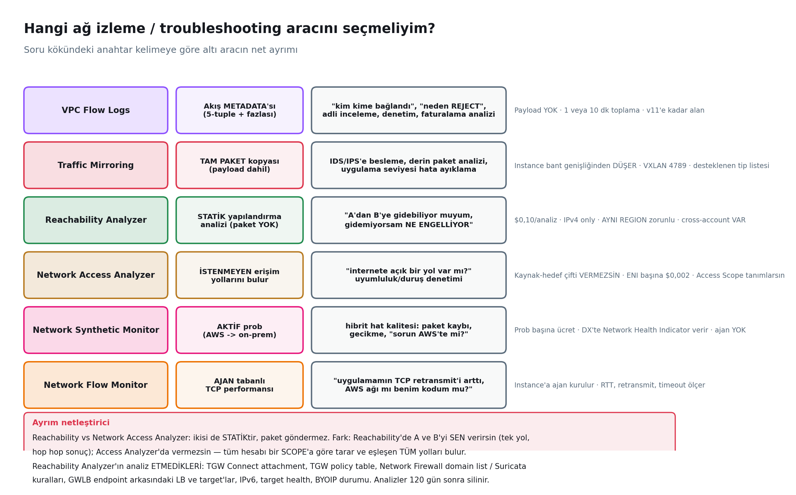
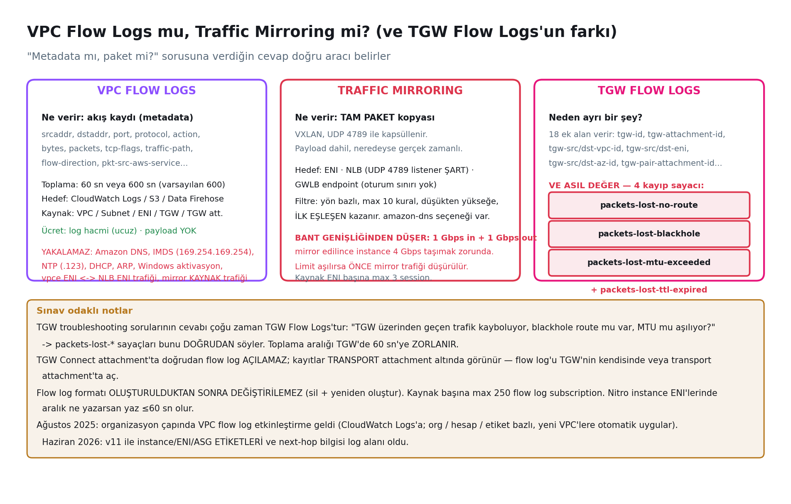

# Bölüm 6 — İzleme ve troubleshooting

> **Bu bölümün sınavdaki ağırlığı:** Doğrudan "hangi aracı kullanırım" sorusu olarak çıkar ve genellikle **iki araç arasında ayrım** yaptırır: Flow Logs mu Traffic Mirroring mi, Reachability Analyzer mı Network Access Analyzer mı. Ayırt edici cümleleri ezberlemek bu soruları garanti kazandırır.

---

## 6.1 Altı aracın tek bakışta ayrımı

| Araç | Ne verir | Soru kökündeki tetikleyici |
|---|---|---|
| **VPC Flow Logs** | Akış **metadata**'sı (5-tuple + fazlası) | "kim kime bağlandı", "neden REJECT", adli inceleme, denetim |
| **Traffic Mirroring** | **Tam paket** kopyası (payload dahil) | "IDS/IPS'e besleme", "derin paket analizi", "payload inceleme" |
| **Reachability Analyzer** | **Statik yapılandırma** analizi, hop-hop yol | "A'dan B'ye gidebiliyor muyum, gidemiyorsam **ne engelliyor**" |
| **Network Access Analyzer** | İstenmeyen erişim **yollarını** bulur | "internete açık bir yol var mı", uyumluluk/duruş denetimi |
| **Network Synthetic Monitor** | **Aktif prob** (AWS → on-prem) | "hibrit hat kalitesi", "paket kaybı/gecikme", "sorun AWS'te mi" |
| **Network Flow Monitor** | **Ajan** tabanlı TCP performansı | "TCP retransmit arttı, AWS ağı mı benim uygulamam mı" |

Ek olarak: **Internet Monitor** = AWS ↔ internet son kullanıcıları (pasif, AWS'in kendi footprint verisi).

---

## 6.2 VPC Flow Logs

### Kayıt formatı sürümleri — v11'e kadar gitti

Eski kaynaklar v5 veya v7'de duruyor. Güncel durum:

| Sürüm | Eklenen alanlar |
|---|---|
| **v2** (varsayılan) | `version, account-id, interface-id, srcaddr, dstaddr, srcport, dstport, protocol, packets, bytes, start, end, action, log-status` (14 alan) |
| **v3** | `vpc-id, subnet-id, instance-id, tcp-flags, type, pkt-srcaddr, pkt-dstaddr` |
| **v4** | `region, az-id, sublocation-type, sublocation-id` |
| **v5** | `pkt-src-aws-service, pkt-dst-aws-service, flow-direction, traffic-path` |
| **v6** | **TGW'ye özel** 18 alan (aşağıda) |
| **v7** | 10 ECS alanı (`ecs-cluster-arn`, `ecs-task-arn`, `ecs-service-name`…) |
| **v8** | `reject-reason` — değerler **`BPA`** (VPC Block Public Access) ve **`EC`** (VPC Endpoint encryption controls) |
| **v9** | `resource-id` — ENI'yi barındıran **regional NAT gateway**'in ID'si |
| **v10** | `encryption-status` — `0` şifresiz, `1` nitro-şifreli, `2` uygulama-şifreli, `3` ikisi |
| **v11** *(10 Haz 2026)* | `instance-tag`, `instance-tag-2`, `interface-tag`, `interface-tag-2`, `asg-tag`, `asg-tag-2` (`TagFieldSpecifications` ile doldurulur), `interface-type`, ve **next-hop** alanları: `next-hop-interface-id`, `next-hop-subnet-id`, `next-hop-az-id`, `next-hop-vpc-id`, `next-hop-interface-type` |

### Ezberlenmesi gereken alan semantikleri

**`traffic-path`** (yalnızca egress) — "paket nereden çıktı":
| Değer | Anlam |
|---|---|
| 1 | Aynı VPC'de başka bir kaynak |
| 2 | Internet gateway veya **gateway VPC endpoint** |
| 3 | **Virtual private gateway** |
| 4 | Intra-Region VPC peering |
| 5 | Inter-Region VPC peering |
| 6 | Local Zone / Wavelength Zone |
| 7 | Gateway VPC endpoint |
| 8 | Internet gateway |

**`tcp-flags`** bit maskesi: FIN=1, SYN=2, RST=4, **SYN-ACK=18**. Kaydedilmemişse `0`.
**`type`:** `IPv4 | IPv6 | EFA`
**`flow-direction`:** `ingress | egress`
**`sublocation-type`:** `wavelength | outpost | localzone`
**`log-status`:** `OK | NODATA | SKIPDATA`
**`interface-type`** (v11): `nat_gateway | network_load_balancer | regional_nat_gateway | transit_gateway | vpc_endpoint`

### Toplama aralığı
- **60 saniye (1 dk)** veya **600 saniye (10 dk)**. **Varsayılan 600.**
- **TGW kaynak tiplerinde 60 saniyeye ZORLANIR.**
- **Nitro tabanlı instance ENI'lerinde ne yazarsanız yazın ≤60 sn olur.**
- Aralık, log **hedefine** bağlı değildir. "S3'te sadece 10 dakika olur" diye bir kısıt **yoktur**.

### Hedefler ve kaynak tipleri
- **`LogDestinationType`:** `cloud-watch-logs | s3 | kinesis-data-firehose`
- **`ResourceType`:** `VPC | Subnet | NetworkInterface | TransitGateway | TransitGatewayAttachment | RegionalNatGateway` (**son madde yeni** — Regional NAT Gateway özelliğiyle geldi)
- **Cross-account:** **S3** ve **Data Firehose** için destekli. **CloudWatch Logs hedefi aynı hesap.**
- **4 Ağu 2025:** organizasyon çapında etkinleştirme (CloudWatch Logs'a). Org / belirli hesaplar / **kaynak etiketi** bazlı; **yeni VPC'lere otomatik uygulanır**.
- Kayıtlar **gerçek zamanlı değildir** — yayına başlaması "birkaç dakika" sürer, start/end damgaları pakete göre 60 sn'ye kadar sonra olabilir.

### YAKALANMAYANLAR — tam liste (sınavda sorulur)
1. **Amazon DNS sunucusuna** giden trafik (*kendi* DNS sunucunuza giden trafik **yakalanır**)
2. **Windows lisans aktivasyonu** trafiği
3. **169.254.169.254** (IMDS) ile trafik
4. **169.254.169.123** (Amazon Time Sync) ile trafik
5. **DHCP** trafiği
6. **Traffic-mirror KAYNAK trafiği** (yalnızca mirror *hedefinin* trafiği görünür)
7. Varsayılan VPC router'ının **rezerve IP'sine** giden trafik
8. **VPC endpoint ENI'si ile NLB ENI'si arasındaki** trafik
9. **ARP** trafiği
10. Oluşturulduktan birkaç dakika sonra silinen **kısa ömürlü regional NAT gateway** trafiği

### Diğer önemli kısıtlar
- **Oluşturulduktan sonra bir flow log'un yapılandırması/formatı DEĞİŞTİRİLEMEZ** — sil + yeniden oluştur.
- Peer VPC için flow log açamazsınız (peer VPC sizin hesabınızda değilse).
- **Kaynak başına max 250 flow log subscription** (hesap başına).
- Dahili kapasite limitleri nedeniyle bazı kayıtlar **SKIPDATA** olabilir.
- VPC BPA flow log'ları `bytes` alanı içermez ve skip kaydı yoktur.

### Transit Gateway Flow Logs — TGW troubleshooting'in cevabı

Ayrı bir özelliktir ve TGW sorularının cevabı genellikle budur.

- Kaynak tipleri: **transit gateway** veya **transit gateway attachment**
- Hedefler: CloudWatch Logs, S3, Data Firehose
- Toplama aralığı **60 sn'ye zorlanır**
- **Connect attachment'ta doğrudan desteklenmez** — kayıtlar **transport attachment** altında görünür; flow log'u TGW'de veya transport attachment'ta açın

**v6'nın 18 TGW alanı:**
`resource-type, tgw-id, tgw-attachment-id, tgw-src-vpc-account-id, tgw-dst-vpc-account-id, tgw-src-vpc-id, tgw-dst-vpc-id, tgw-src-subnet-id, tgw-dst-subnet-id, tgw-src-eni, tgw-dst-eni, tgw-src-az-id, tgw-dst-az-id, tgw-pair-attachment-id, packets-lost-no-route, packets-lost-blackhole, packets-lost-mtu-exceeded, packets-lost-ttl-expired`

**Asıl değer son dört alandır:**

| Sayaç | Ne demek |
|---|---|
| `packets-lost-no-route` | Route table'da eşleşen rota yok |
| `packets-lost-blackhole` | Blackhole route'a düştü |
| `packets-lost-mtu-exceeded` | MTU aşıldı (8500 üstü / PMTUD yokluğu) |
| `packets-lost-ttl-expired` | TTL bitti (routing loop işareti) |

> **Sınav eşlemesi:** "TGW üzerinden geçen trafik kayboluyor, sebebini nasıl bulurum?" → **TGW Flow Logs** ve bu dört sayaç. VPC Flow Logs bu ayrımı yapamaz.

### Basit anlatım — Telefon faturası
VPC Flow Logs, **telefon faturanız** gibidir: kimi aradığınız, kaç dakika konuştuğunuz, aramanın bağlanıp bağlanmadığı yazılıdır — ama **ne konuştuğunuz yazmaz**. Denetim, faturalama analizi ve "bu IP bizimle konuştu mu" sorusu için mükemmel; "ne konuşuldu" sorusu için işe yaramaz.

TGW Flow Logs ise faturanın **santral versiyonu**dur: ek olarak "çağrı neden düştü" der — yanlış numara (no-route), kara liste (blackhole), hat kapasitesi (MTU), sonsuz aktarma (TTL).

---

## 6.3 Traffic Mirroring

### Kaynaklar
- Yalnızca **`interface` tipinde ENI'ler**, desteklenen bir instance tipine bağlı.
- Requester-managed ENI'lerden **yalnızca Amazon RDS ve Amazon ElastiCache** tarafından oluşturulanlar kaynak olabilir.

> **"Sadece Nitro" yanlış bir basitleştirme.** 2021'de seçili non-Nitro (Xen) tipler eklendi: C4, D2, G3, G3s, H1, I3, M4, P2, P3, R4, X1, X1e. 28 Ağu 2025'te **tüm Nitro v4** instance'lara yayıldı. Doğru ifade: bu bir **instance-tipi listesi** gereksinimidir, blanket "Nitro-only" kuralı değil.

### Hedefler
1. **ENI** (`interface` tipinde)
2. **Network Load Balancer** — **UDP 4789 listener'ı ZORUNLU**. Yoksa doküman: *"Traffic Mirroring hatasız bir şekilde başarısız olur"* (hiç hata görmezsiniz, sadece paket gelmez)
3. **Gateway Load Balancer endpoint** — tüm IP paketleri/tüm portlar; **GWLBE başına oturum limiti yok**

- Hedef **farklı bir AWS hesabına** ait olabilir.
- Traffic mirror target'ları **AWS RAM ile paylaşılabilir** (`ec2:TrafficMirrorTarget`).

### Kapsülleme
**VXLAN**, **UDP port 4789**. Hedef security group'unun kaynaktan **UDP/4789**'a izin vermesi gerekir. `VirtualNetworkId` = VXLAN VNI (belirtmezseniz hesap içinde tekil rastgele bir değer).

### Filtreler
- Filtre = **inbound ve outbound ayrı** kural setleri. Kural yoksa hiçbir şey mirror edilmez; outbound kural yoksa outbound mirror edilmez.
- Kurallar **en küçük numaradan büyüğe** değerlendirilir, **ilk eşleşen kazanır**.
- Alanlar: numara, aksiyon (**accept | reject**), protokol, kaynak/hedef port aralığı, kaynak/hedef CIDR (IPv4 veya IPv6).
- **Network services** seçeneği: **`amazon-dns`** → tüm inbound+outbound Amazon DNS trafiğini mirror eder.
- **Filtre başına max 10 kural** (artırılamaz).

### Oturumlar ve kotalar
- `SessionNumber` **1–32766**; **en küçük eşleşen oturum** paketi mirror eder; **her paket yalnızca bir kez** mirror edilir.
- **Kaynak ENI başına max 3 oturum.**
- Hesap başına 10.000 oturum / 10.000 target / 10.000 filtre.
- Hedef başına kaynak sayısı: instance boyutuna göre **10 veya 100**; **NLB ve GWLBE hedeflerinde limit yok**.

### Bant genişliği — en önemli kısıt
> Birebir doküman: *"Mirror edilen trafik instance bant genişliğine sayılır. Örneğin 1 Gbps inbound ve 1 Gbps outbound trafiği olan bir ENI'yi mirror ederseniz, instance **4 Gbps** trafik taşımak zorundadır (1 inbound, 1 mirror-inbound, 1 outbound, 1 mirror-outbound)."*

- **Üretim trafiği önceliklidir:** limitler aşıldığında **önce mirror trafiği düşürülür**; üretim hâlâ aşıyorsa o da düşürülür.
- Placement group'ta olmayan instance'lar için **akış başına 5 Gbps** limiti; mirror edilen akış başına throughput'u **2,5 Gbps altında** tutun.
- Küçük ortalama paket boyutu, mirror düşüşlerini daha düşük bant genişliğinde tetikler.
- GWLBE hedefi: **AZ başına 10 Gbps varsayılan, 100 Gbps'e otomatik ölçeklenir**.

### Cross-VPC / cross-account bağlantı seçenekleri
Kaynak ve hedef aynı VPC'de veya farklı VPC'lerde olabilir; farklı VPC'lerde şunlarla bağlanır:
- **Intra-Region VPC peering** (**inter-Region peering listelenmiyor**)
- **Transit gateway**
- **GWLB endpoint**

| Durum | Gereken |
|---|---|
| Aynı VPC, aynı hesap | Ek bir şey yok |
| Farklı VPC, aynı hesap | Intra-Region peering / TGW / GWLBE |
| Farklı VPC, farklı hesap | Cross-account intra-Region peering / TGW / GWLBE |
| Aynı VPC, farklı hesap | **VPC sharing** |

Mirror trafiği **kaynak VPC'nin route table'ını** izler — kaynak, hedefe route edebilmelidir.

### Truncation / MTU
- `PacketLength` = VXLAN header'ından **sonra** mirror edilecek bayt. Belirtmezseniz tüm paket.
- **NLB hedeflerinde varsayılan `PacketLength` = 8500**, geçerli aralık 1–8500; üstü hata verir.
- Standalone instance hedefi: mirror edilen paket hedef MTU'sundan büyükse **kesilir**.
- Ek yük: **IPv4 +54 bayt, IPv6 +74 bayt**. Kesilmeyi önlemek için kaynak MTU = hedef MTU − 54 (IPv4) / − 74 (IPv6).
- **Kesilmeden max MTU = 8947 bayt.** Paket uzunluğu tabanı: 35 bayt (IPv4) / 55 bayt (IPv6).
- GWLBE hedefi: max MTU 8500 → kesilmeyen max payload **8446 (IPv4) / 8426 (IPv6)**.
- Kesilme yan etkisi: L4 checksum hesaplanmaz; L3 header'ın herhangi bir kısmı kesilirse L3 checksum da hesaplanmaz.

### Mirror EDİLEMEYENLER
**ARP, DHCP, instance metadata servisi, NTP, Windows aktivasyonu.**
Ayrıca: **IPv6-only subnet'lerde Traffic Mirroring desteklenmez.** Kaynakta SG/NACL tarafından düşürülen inbound trafik mirror edilmez.

### Basit anlatım — Kamera vs kayıt defteri
Flow Logs, kapıdaki **ziyaretçi defteri**dir: kim, saat kaçta, ne kadar kaldı. Traffic Mirroring, **güvenlik kamerası**dır: ne söylediklerini de görürsünüz.

Ama kameranın bir maliyeti var: aynı hattı hem gerçek trafik hem kamera görüntüsü paylaşıyor. Hat dolduğunda **önce kamera görüntüsü kesilir** — üretim trafiği korunur. Bu yüzden 1 Gbps çift yönlü bir sunucuyu mirror etmek, o sunucudan **4 Gbps** kapasite ister.

---

## 6.4 Reachability Analyzer

### Ne yapar
> Birebir doküman: *"...ağ yapılandırmasının bir modelini oluşturarak ve sonra yapılandırmaya dayanarak erişilebilirliği kontrol ederek yolu analiz eder."*

**Paket göndermez. Veri düzlemini analiz etmez.** Tamamen **statik yapılandırma** analizidir.

### Desteklenen kaynak/hedef tipleri
EC2 instance'ları, internet gateway'ler, network interface'ler, transit gateway'ler, transit gateway attachment'ları, virtual private gateway'ler, VPC endpoint service'leri, VPC endpoint'ler, VPC peering bağlantıları; **IP adresleri (yalnızca hedef olarak)**.

### Region ve hesap kapsamı
- **Cross-Region: DESTEKLENMİYOR.** Kaynak ve hedef **aynı Region'da** olmak zorunda. (Ağustos 2026'da hâlâ böyle.)
- **Cross-account: DESTEKLENİYOR.** AWS Organizations **trusted access** gerekir; opsiyonel **delegated administrator** kaydı.
  - Management account kullanıcıları org'daki her hesabı analiz edebilir.
  - **Delegated admin, management account HARİÇ** her hesabı analiz edebilir + kendisiyle açıkça paylaşılan management-account kaynaklarını.
  - **us-east-1**'de CloudFormation API çağırma yetkisi gerekir; CloudTrail kayıtları her zaman **us-east-1**'e düşer.
  - **Cross-account analizler için ek ücret yok.**

### Çıktı
- **Başarılıysa:** sanal ağ yolunun **hop-hop** detayı.
- **Başarısızsa:** **engelleyen bileşeni** belirtir (security group, NACL, route table, load balancer). Doküman: *"Yolu engelleyen ek bileşenler olabilir"* — yani bir kombinasyon da bildirebilir.

### Ücret
**Analiz başına $0,10.**

### Analiz EDEMEDİKLERİ — sınavda sorulur
- **Yalnızca IPv4** — IPv6 yok
- **Transit Gateway Connect attachment'ları** desteklenmez (analiz orada durur)
- **TGW policy table'ları** desteklenmez
- **Network Firewall:** resource-group referanslarını, **domain list'leri**, **Suricata kurallarını** ve etiket bazlı resource group'ları **değerlendirmez**
- **GWLB endpoint'leri:** load balancer ve target'ları analizden **hariç tutulur**
- **Target health'i yok sayar**; **BYOIP advertised durumunu** yok sayar
- **Traffic mirroring bağlantı olarak raporlanmaz**
- Paket dönüşümlerini izlemez (NAT vb. nedeniyle header'lar farklı olabilir)
- **Analizler oluşturulduktan 120 gün sonra silinir**

### 2025–2026 değişiklikleri
| Tarih | Değişiklik |
|---|---|
| **8 May 2025** | Analizden bir AWS kaynağını **filtreleme/hariç tutma** seçeneği |
| **10 Haz 2025** | **Amazon Q ağ troubleshooting KALDIRILDI** — artık desteklenmiyor. "Amazon Q + Reachability Analyzer" diyen kaynaklar eskimiştir |
| Eyl–Eki 2025 | 7 ek Region + **GovCloud (US)** |
| 14 Ağu 2026 | İki AWS managed policy'ye read-only izinler eklendi |

---

## 6.5 Network Access Analyzer

### Ne yapar
> Birebir doküman: *"AWS'teki kaynaklarınıza **istenmeyen ağ erişimini** tespit eder."*

Siz ağ erişim **gereksinimlerini** tanımlarsınız, araç bunları **ihlal eden yolları** bulur. Duruş/uyumluluk doğrulamasıdır, tek-yol troubleshooting değil.

### Network Access Scope
İki tür clause:
- **MatchPaths** — analizin döndürmesini istediğiniz yol tipleri (genellikle ihlal saydığınız şeyler)
- **ExcludePaths** — bulgulardan bastırılacak yollar (meşru istisnalar)

**Amazon tarafından sağlanan 4 hazır scope:**
1. IGW-ingress — IGW'lerden ENI'lere gelen yollar
2. IGW-egress — ENI'lerden IGW'lere giden yollar
3. VPC-ingress — IGW / peering / VPC endpoint / VPN / transit gateway'lerden VPC'lere gelen yollar
4. VPC-egress — yukarıdakinin çıkış karşılığı

> Bu scope'ların **tam metin adları** (`AWS-IGW-Ingress` vb.) dokümantasyonda tutarsız görünüyor — konsolda doğrulayın. Sınavda scope adının kendisi sorulmaz, **ne yaptığı** sorulur.

### Ücret
**Analiz edilen ENI başına $0,002** (analiz başına değil).

### Reachability vs Network Access Analyzer — kesin ayrım

| | **Reachability Analyzer** | **Network Access Analyzer** |
|---|---|---|
| Girdi | **Bir kaynak + bir hedef** (siz verirsiniz) | **Sabit çift yok** — bir *scope* verirsiniz |
| Soru | "Bu yol erişilebilir mi, değilse ne engelliyor?" | "İstenmeyen **herhangi bir** yol var mı?" |
| Çıktı | Hop-hop tek yol | Eşleşen **TÜM** yollar (bulgular) |
| Ücret | **$0,10 / analiz** | **$0,002 / ENI** |
| Ortak | İkisi de **statik/yapılandırma** analizi (paket yok), ikisi de **aynı Region** | |

### Basit anlatım — Dedektif vs müfettiş
**Reachability Analyzer** bir **dedektiftir**: "Ahmet'in evinden Ayşe'nin evine gidebilir miyim?" diye sorarsınız, o da yolu adım adım çizer ve "üçüncü sokakta bariyer var" der.

**Network Access Analyzer** bir **müfettiştir**: "Bu binada dışarıya açık, kilitsiz herhangi bir kapı var mı?" diye sorarsınız. Kimden kime diye belirtmezsiniz; o tüm binayı tarar ve bulduğu her açık kapıyı listeler.

---

## 6.6 Yeni gözlemlenebilirlik servisleri

### CloudWatch Network Synthetic Monitor
> **İSİM DEĞİŞİKLİĞİ:** eskiden "CloudWatch Network Monitor" olarak dokümante edilen servis artık **"Network Synthetic Monitor"** adıyla geçiyor.

- **Aktif/sentetik probing:** AWS'te barındırılan bir **kaynak subnet** → on-prem **hedef IP**, protokol/port/paket boyutu ile.
- **Tamamen yönetilen, izlenen kaynaklara ajan kurulmaz.**
- Metrikler: **paket kaybı**, **round-trip time (gecikme)** ve **Network Health Indicator (NHI)** — ikili değer, **AWS Direct Connect kullanıldığında** mevcut; bozulmanın AWS içinde olup olmadığını söyler.
- Kavramlar: **Monitor** (kapsayıcı/pano) + **Probe** (kaynak subnet → hedef). **Prob başına ücretlendirilir.**
- Kısıtlar: monitor subnet'leri monitor ile **aynı hesapta** olmalı; rezerve/AWS-dahili adresler (`169.254.0.0/16`, VPC DNS `.2` adresi) prob edilemez; **otomatik failover yok**.

### CloudWatch Internet Monitor
- **Pasif**; AWS'in kendi **global ağ footprint bağlantı verisini** kullanır (*"AWS'in internet uptime ve erişilebilirliğini izlemek için kullandığı verinin aynısı"*).
- İzlenen kaynak tipleri: **VPC'ler, Network Load Balancer'lar, CloudFront dağıtımları, WorkSpaces directory'leri**.
- Ölçüm birimi: **city-network** (client şehri/lokasyonu + ASN/ISP çifti).
- Sağlık olayları **EventBridge** ve **AWS Health Dashboard**'a yayınlanır.

### CloudWatch Network Flow Monitor
- re:Invent **1 Ara 2024**'te duyuruldu, GA.
- **Ajan tabanlı** (hafif, yönetilen ajanlar instance'lara kurulur) — **gerçek iş yükünüzün TCP** trafiğini analiz eder.
- Metrikler: **TCP round-trip time (RTT)**, **retransmission timeout**, **retransmission**, **transfer edilen bayt**.
- **Network Health Indicator (NHI):** değer **`Degraded`** ise seçili pencerede izlenen en az bir akışı etkileyen AWS ağ sorunu vardı. "AWS mi ben mi" sorusunun cevabı.
- İki kullanım modu: **Workload insights** (tüm akışlar arasında en çok katkıda bulunanlar, monitor gerekmez) ve **Monitors** (iş yükü bazlı derin akış + ağ hop detayı).

### Konumlandırma cheat-sheet
| Araç | Kimden kime | Yöntem |
|---|---|---|
| **Internet Monitor** | AWS ↔ internet son kullanıcıları | Pasif, AWS footprint verisi |
| **Network Synthetic Monitor** | AWS ↔ on-premises (hibrit hatlar) | **Aktif prob**, DX/VPN |
| **Network Flow Monitor** | AWS içi / VPC iş yükü TCP performansı | **Instance'lara ajan** |
| **VPC / TGW Flow Logs** | Akış metadata kayıtları | Pasif log |
| **Traffic Mirroring** | Tam paket yakalama | Pasif kopya |

---

## 6.7 Troubleshooting akış şeması (pratik)

**Semptom: "on-prem'den EC2'ye erişemiyorum"**
1. **Reachability Analyzer** → yol var mı, yoksa hangi bileşen engelliyor? (Statik, saniyeler içinde, $0,10)
2. Yol varmış diyorsa → **VPC Flow Logs**'ta `action = REJECT` var mı? (SG/NACL) `log-status = NODATA` ise paket ENI'ye hiç gelmemiş.
3. Paket ENI'ye gelmiyorsa → **TGW Flow Logs**'ta `packets-lost-no-route` / `packets-lost-blackhole` var mı?
4. Paket geliyor ama uygulama cevap vermiyorsa → **Traffic Mirroring** ile payload'a bak.
5. Bağlantı kuruluyor ama yavaş/kopuyorsa → **Network Flow Monitor** (TCP retransmit, NHI) veya **Network Synthetic Monitor** (hat kalitesi).

**Semptom: "rastgele kopmalar, stateful firewall'da unknown flow"**
→ **appliance mode** (Bölüm 1.4). Flow log'da gidiş bir AZ, dönüş başka AZ görünür.

**Semptom: "büyük dosya transferi takılıyor, küçük istekler çalışıyor"**
→ **MTU / PMTUD**. TGW Flow Logs'ta `packets-lost-mtu-exceeded`. TGW peering, VPN ve DX'te PMTUD yoktur.

**Semptom: "isim çözülmüyor ama IP ile çalışıyor"**
→ Bölüm 5. Flow Logs **Amazon DNS trafiğini yakalamaz** — DNS'i flow log'la debug edemezsiniz; **Resolver query logging** kullanın.

---

## 6.8 Bölüm soruları

### Soru 1
Bir güvenlik ekibi, bir EC2 instance'ının şüpheli davranışını incelemek için **paket payload'larını** bir üçüncü parti IDS'e yönlendirmek istiyor. IDS, farklı bir hesaptaki bir VPC'de çalışıyor ve bir NLB arkasında. Hangi yapılandırma gereklidir? (İki cevap seçin)

- **A.** NLB'de **UDP 4789** listener'ı oluştur.
- **B.** VPC Flow Logs'u v5 formatında etkinleştirip Firehose ile IDS'e gönder.
- **C.** Kaynak ve hedef VPC'ler arasında intra-Region VPC peering veya transit gateway bağlantısı kur.
- **D.** NLB'de TCP 4789 listener'ı oluştur.
- **E.** Kaynak ENI'de 4'ten fazla mirror session tanımla.

<b>Cevap ve analiz</b>

**Doğru cevaplar: A ve C**

- **A doğru:** NLB hedefi için **UDP 4789 listener'ı ZORUNLUDUR**. Doküman uyarısı çok önemli: yoksa *"Traffic Mirroring hatasız bir şekilde başarısız olur"* — hiç hata mesajı görmezsiniz, sadece paket gelmez. Bu, gerçek hayatta saatler kaybettiren bir detaydır.
- **C doğru:** Kaynak ve hedef farklı VPC'lerde olduğunda **intra-Region VPC peering, transit gateway veya GWLB endpoint** gerekir. Dikkat: **inter-Region peering listelenmiyor.** Ayrıca mirror trafiği **kaynak VPC'nin route table'ını** izler.
- **B yanlış:** Flow Logs **payload içermez** — yalnızca metadata. Soru açıkça "paket payload'ları" diyor. Ayrıca Flow Logs, **mirror kaynak trafiğini de yakalamaz**.
- **D yanlış:** VXLAN **UDP** kullanır, TCP değil.
- **E yanlış:** **Kaynak ENI başına max 3 oturum** — 4 tanımlanamaz. Ayrıca her paket yalnızca bir kez mirror edilir; en küçük numaralı eşleşen oturum kazanır.

**Bonus:** Hedef farklı hesapta olabilir ve traffic mirror target'ları **AWS RAM ile paylaşılabilir**.

---

### Soru 2
Bir mimar, `us-east-1`'deki bir EC2 instance'ından `eu-west-1`'deki bir RDS örneğine (TGW inter-Region peering üzerinden) bağlantı olup olmadığını doğrulamak istiyor. VPC Reachability Analyzer kullanmayı planlıyor. Hangi ifade doğrudur?

- **A.** Reachability Analyzer bu analizi yapabilir; TGW peering attachment'ları desteklenir.
- **B.** Reachability Analyzer cross-Region analizi desteklemez; kaynak ve hedef aynı Region'da olmalıdır.
- **C.** Reachability Analyzer paket göndererek yolu test eder, bu yüzden cross-Region çalışır.
- **D.** Reachability Analyzer yalnızca aynı VPC içinde çalışır.

<b>Cevap ve analiz</b>

**Doğru cevap: B**

**Cross-Region desteklenmiyor** — kaynak ve hedef **aynı Region'da** olmak zorunda. Bu, Ağustos 2026 itibarıyla hâlâ geçerli. **Cross-account** ise destekleniyor (Organizations trusted access ile).

- **A yanlış:** Region kısıtı nedeniyle. (Not: TGW ve TGW attachment'ları desteklenen kaynak/hedef tipleridir, ama **TGW Connect attachment'ı** ve **TGW policy table'ı** desteklenmez.)
- **C yanlış — kavramsal hata:** Reachability Analyzer **paket GÖNDERMEZ.** Doküman: *"ağ yapılandırmasının bir modelini oluşturarak"* analiz eder. **Veri düzlemini analiz etmez.** Bu, en sık test edilen kavramsal ayrımdır.
- **D yanlış:** Aynı Region içinde VPC'ler arası, peering üzerinden, TGW üzerinden analiz yapabilir.

**Alternatif çözüm (soru bunu takip sorusu yapabilir):** cross-Region yolu doğrulamak için her Region'da ayrı analiz yapıp TGW attachment'ını ara nokta olarak kullanmak, veya gerçek bağlantıyı **Network Flow Monitor / Synthetic Monitor** ile veri düzleminde ölçmek.

---

### Soru 3
Bir uyumluluk denetimi, organizasyondaki **hiçbir EC2 instance'ının internet gateway üzerinden doğrudan erişilebilir olmaması** gerektiğini belirtiyor. Ekip 200 hesapta bu durumu sürekli doğrulamak istiyor. Hangi araç ve yaklaşım doğrudur?

- **A.** Her hesapta Reachability Analyzer ile her instance için IGW'den analiz çalıştır.
- **B.** Network Access Analyzer ile IGW-ingress scope'u kullanarak eşleşen tüm yolları bulgu olarak topla.
- **C.** VPC Flow Logs'ta `traffic-path = 8` olan kayıtları filtrele.
- **D.** AWS Config ile security group kurallarını denetle.

<b>Cevap ve analiz</b>

**Doğru cevap: B**

**Network Access Analyzer** tam bunun için: bir **Network Access Scope** tanımlarsınız (burada Amazon-provided **IGW-ingress** scope'u — IGW'lerden ENI'lere gelen yollar) ve araç **kaynak-hedef çifti vermenize gerek kalmadan** tüm hesabı/Region'ı tarayıp **eşleşen tüm yolları bulgu** olarak döndürür. Ücret **ENI başına $0,002** olduğu için geniş taramada Reachability Analyzer'dan çok daha ekonomiktir.

- **A yanlış ve pahalı:** Reachability Analyzer **analiz başına $0,10** ve her analiz **tek bir kaynak-hedef çifti** içindir. 200 hesap × N instance = binlerce analiz. Yanlış araç: Reachability "bu yol açık mı" sorusu için, Access Analyzer "açık **herhangi bir** yol var mı" sorusu için.
- **C yanlış:** Flow Logs **gerçekleşmiş trafiği** gösterir — henüz kimse denemediyse hiçbir kayıt olmaz. Uyumluluk, *potansiyel* erişimi sorar, gerçekleşmiş erişimi değil. Ayrıca `traffic-path` yalnızca egress alanıdır.
- **D kısmen faydalı ama eksik:** AWS Config SG kurallarını denetler ama **route table + NACL + IGW + ENI kombinasyonunun** yarattığı gerçek yolu değerlendirmez. Bir instance'ın SG'si `0.0.0.0/0` açık olabilir ama route table'da IGW rotası yoksa erişilebilir değildir — ve tersi.

**Not:** Her iki analyzer da **aynı Region** kapsamındadır; 200 hesap için Organizations trusted access ve delegated administrator kurulumu gerekir.

---

### Soru 4
Bir ekip, TGW üzerinden geçen trafiğin bir kısmının kaybolduğunu bildiriyor. VPC Flow Logs'ta kaynak tarafta paketler görünüyor, hedef tarafta hiç kayıt yok. En hızlı kök neden tespiti nasıl yapılır?

- **A.** Her iki VPC'de Traffic Mirroring etkinleştir ve paketleri karşılaştır.
- **B.** TGW veya TGW attachment üzerinde flow log etkinleştir ve `packets-lost-*` sayaçlarını incele.
- **C.** VPC Flow Logs formatını v11'e yükselt ve `next-hop-interface-id` alanına bak.
- **D.** CloudWatch Network Flow Monitor ajanlarını her instance'a kur.

<b>Cevap ve analiz</b>

**Doğru cevap: B**

**TGW Flow Logs** bu senaryo için özel olarak dört sayaç sunar:

| Sayaç | Kök neden |
|---|---|
| `packets-lost-no-route` | Route table'da eşleşen rota yok |
| `packets-lost-blackhole` | Blackhole route'a düştü |
| `packets-lost-mtu-exceeded` | MTU aşıldı |
| `packets-lost-ttl-expired` | Routing loop |

Bu dört alan **VPC Flow Logs'ta yoktur** ve TGW troubleshooting'in ayırt edici değeridir. Kaynak tipi `TransitGateway` veya `TransitGatewayAttachment` olur, toplama aralığı **60 sn'ye zorlanır**.

- **A yanlış:** Traffic Mirroring **payload** verir, "paket TGW'de neden düştü" sorusuna cevap vermez. Ayrıca instance bant genişliğinden düşer ve kurulumu yavaştır.
- **C kısmen faydalı ama yetersiz:** v11'in next-hop alanları paketin nereye yönlendirildiğini gösterir ama **TGW'nin içinde neden düştüğünü** söylemez. Ayrıca **flow log formatı sonradan değiştirilemez** — sil + yeniden oluşturmak gerekir, bu da "en hızlı" olmaz.
- **D yanlış:** Network Flow Monitor **TCP performansı** (RTT, retransmit) için; routing/blackhole teşhisi için değil. Ayrıca 'her instance'a ajan kurmak' hızlı bir teşhis yolu değil.

**Hatırla:** TGW **Connect attachment'ında** doğrudan flow log açılamaz — kayıtlar **transport attachment** altında görünür.

---

### Soru 5
Bir şirket Direct Connect üzerinden hibrit bir uygulama çalıştırıyor. Kullanıcılar aralıklı yavaşlık bildiriyor. Ekip, sorunun AWS ağında mı yoksa kendi veri merkezinde mi olduğunu **kesin olarak** ayırt etmek istiyor. Hangi araç bu ayrımı en doğru yapar?

- **A.** VPC Flow Logs — `bytes` ve `packets` alanlarını zaman serisi olarak analiz et.
- **B.** CloudWatch Network Synthetic Monitor — AWS subnet'inden on-prem hedefe prob kur; Network Health Indicator'ı izle.
- **C.** CloudWatch Internet Monitor — hibrit bağlantı performansını izle.
- **D.** Reachability Analyzer — yolu düzenli aralıklarla analiz et.

<b>Cevap ve analiz</b>

**Doğru cevap: B**

**Network Synthetic Monitor** (eskiden "Network Monitor") tam bu iş için: AWS'te barındırılan bir **kaynak subnet**'ten on-prem **hedef IP**'ye **aktif prob** gönderir, **paket kaybı** ve **RTT** ölçer. Ve kritik olarak: **Direct Connect kullanıldığında Network Health Indicator (NHI)** üretir — ikili bir değer olarak **bozulmanın AWS içinde olup olmadığını** söyler. Tam olarak "AWS mi ben mi" sorusunun cevabı. Ajan kurulumu gerektirmez.

- **A yanlış:** Flow Logs **gecikme ve paket kaybı ölçmez.** `bytes`/`packets` hacim bilgisidir; performans bozulmasının nerede olduğunu söylemez.
- **C yanlış — yanlış araç:** Internet Monitor **AWS ↔ internet son kullanıcıları** içindir (izlenen kaynaklar: VPC, NLB, CloudFront, WorkSpaces; ölçüm birimi **city-network**). Hibrit DX/VPN hatları için değil.
- **D yanlış:** Reachability Analyzer **statik** bir yapılandırma analizidir — yol açık/kapalı der, **performans ölçmez**. Aralıklı yavaşlık, yapılandırma değil veri düzlemi problemidir.

**Alternatif/tamamlayıcı:** Uygulama içi TCP davranışı (retransmit, RTT) için **Network Flow Monitor** (ajan tabanlı) da NHI verir — ama o AWS-içi/VPC iş yükü performansını hedefler, hibrit hattın kendisini değil. En doğru ayrım aracı hibrit hat için Synthetic Monitor'dur.

---

## 6.9 Bu bölümün 60 saniyelik özeti

1. **Flow Logs = metadata, Mirroring = payload.** Flow Logs **Amazon DNS, IMDS, NTP, DHCP, ARP, Windows aktivasyon ve vpce↔NLB trafiğini yakalamaz.**
2. **Flow Logs formatı v11'e kadar gitti** (Haz 2026: ENI/instance/ASG **etiketleri** + **next-hop** alanları). Toplama **60 veya 600 sn**, varsayılan 600, **TGW'de 60'a zorlanır**, Nitro'da ≤60.
3. **Flow log formatı sonradan DEĞİŞTİRİLEMEZ** — sil + yeniden oluştur.
4. **TGW Flow Logs'un asıl değeri 4 sayaç:** `packets-lost-no-route / blackhole / mtu-exceeded / ttl-expired`.
5. **Mirroring instance bant genişliğinden düşer** (1+1 Gbps → 4 Gbps gerekir) ve limit aşımında **önce mirror trafiği düşürülür**. NLB hedefi **UDP 4789 listener'ı ZORUNLU**. Kaynak ENI başına **3 oturum**, filtre başına **10 kural**. **Inter-Region peering desteklenmiyor.**
6. **Reachability Analyzer paket GÖNDERMEZ**, **cross-Region YOK**, cross-account VAR, **IPv4 only**, **$0,10/analiz**, 120 gün sonra silinir. NFW domain list/Suricata kurallarını ve GWLBE arkasını **değerlendirmez**.
7. **Network Access Analyzer:** kaynak-hedef çifti vermezsin, **scope** verirsin; **ENI başına $0,002**; "istenmeyen herhangi bir yol var mı".
8. **Amazon Q ağ troubleshooting Haz 2025'te KALDIRILDI.**
9. **Synthetic Monitor** = AWS↔on-prem aktif prob + **NHI** (DX ile). **Flow Monitor** = instance'a ajan, TCP RTT/retransmit + NHI. **Internet Monitor** = AWS↔internet kullanıcıları, pasif, city-network.

---

[← Bölüm 5: Route 53 Resolver](05-route53-resolver-hibrit-dns.md) · [Sonraki bölüm: GWLB, Network Firewall, Firewall Manager →](07-gwlb-network-firewall-firewall-manager.md)
