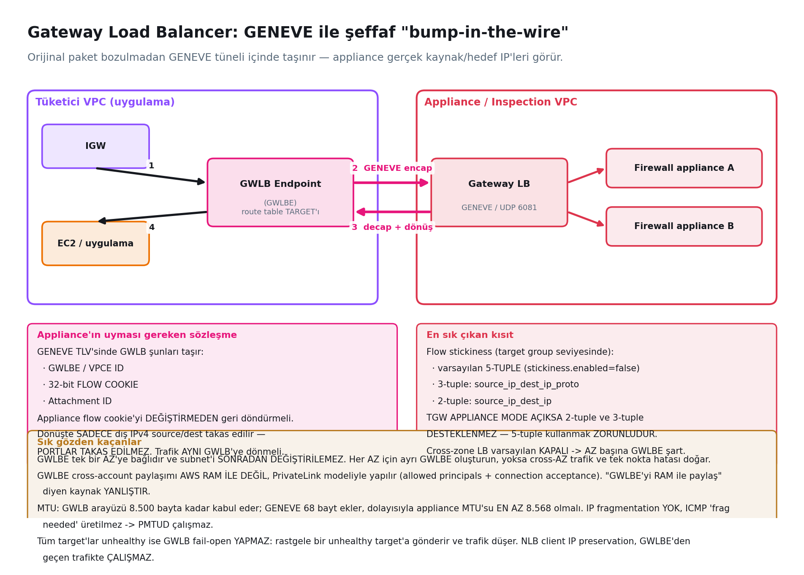
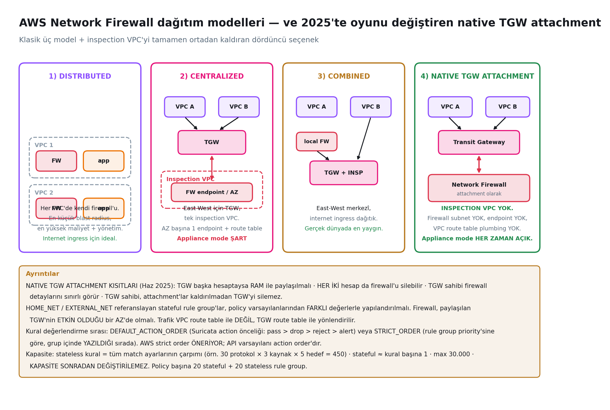
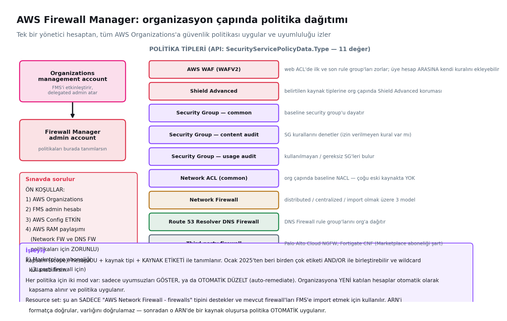

# Bölüm 7 — Gateway Load Balancer, Network Firewall, Firewall Manager

> **Bu bölümün sınavdaki ağırlığı:** "Merkezi trafik inspection" mimarisi sorularının tamamı burada. 2025'te gelen **native TGW attachment** bu alanın klasik cevabını değiştirdi — eski kaynakların en tehlikeli şekilde eskidiği konu.

---

## 7.1 Gateway Load Balancer

### Neden var
Klasik load balancer'lar (ALB/NLB) trafiği **sonlandırır** ve yeni bir bağlantı açar. Bir firewall/IDS appliance'ının ise paketi **olduğu gibi** görmesi gerekir — kaynak IP, hedef IP, portlar, hepsi orijinal. GWLB bu problemi çözer: **şeffaf bir "bump-in-the-wire"**.



### GENEVE
> Birebir doküman: *"Gateway Load Balancer ve kayıtlı sanal appliance instance'ları, uygulama trafiğini **GENEVE protokolü ile port 6081** üzerinde alışverişte bulunur."*

**Kaynak ve hedef IP'ler KORUNUR.** Orijinal paket GENEVE tünelinin içinde bozulmadan taşınır. Appliance gerçek client/server IP'lerini görür.

**GWLB'nin GENEVE TLV'sinde taşıdıkları:**
- **GWLBE / VPCE ID**
- **32-bit Flow Cookie**
- **Attachment ID**

### Appliance'ın uyması gereken sözleşme
1. Orijinal paketi **GENEVE ile yeniden kapsülle**.
2. **Yalnızca dış IPv4 source/destination'ı takas et** (source = appliance IP, destination = GWLB IP).
3. **PORTLARI TAKAS ETME.**
4. **Flow Cookie'yi DEĞİŞTİRMEDEN** geri döndür — GWLB doğrular, uyuşmazsa **düşürür**.
5. Trafik **aynı GWLB'ye** dönmeli.

### Flow stickiness
Target group seviyesinde yapılandırılır ve gruptaki tüm trafiğe uygulanır.

| Mod | Alan | Attribute |
|---|---|---|
| **5-tuple** (varsayılan) | src IP, src port, dst IP, dst port, protokol | `stickiness.enabled = false` |
| **3-tuple** | src IP, dst IP, protokol | `stickiness.type = source_ip_dest_ip_proto` |
| **2-tuple** | src IP, dst IP | `stickiness.type = source_ip_dest_ip` |

> ### Kritik kısıt — sınavda çıkar
> Birebir doküman: *"2-tuple ve 3-tuple flow stickiness, **AWS Transit Gateway appliance mode açıkken desteklenmez**. Transit gateway'inizde appliance mode kullanmak için **5-tuple flow stickiness** kullanın."*

**Target failover attribute'ları:** `target_failover.on_deregistration` ve `target_failover.on_unhealthy`; değerler **`rebalance | no_rebalance`**, varsayılan **`no_rebalance`**; **ikisi de aynı değere ayarlanmalıdır**.

### GWLB Endpoint (GWLBE)
> *"AWS PrivateLink ile güçlendirilmiş bir VPC endpoint'i"* — seçtiğiniz subnet'te bir endpoint ENI oluşturur ve tüketici VPC'de **route table target'ı** olarak kullanılır.

| Kural | Detay |
|---|---|
| AZ | **Tam olarak bir AZ.** Subnet oluşturmada seçilir ve **DEĞİŞTİRİLEMEZ** |
| Sayı | Endpoint service başına **AZ başına 1 GWLBE**. Trafiği AZ-yerel tutmak için **her AZ'ye birer tane** kurun |
| **Cross-account** | **PrivateLink modeli, AWS RAM DEĞİL** — sağlayıcı **allowed principals** ekler ve opsiyonel olarak bağlantı isteklerini **manuel kabul** eder |
| Bant genişliği | **AZ başına 10 Gbps varsayılan, otomatik 100 Gbps'e** ölçeklenir |
| Ücret | Saatlik + veri işleme |

> **DÜZELTME:** GWLB ve GWLB endpoint service'leri **AWS RAM shareable-resource listesinde YOKTUR.** (Paylaşılabilir tek ELB kaynağı `elasticloadbalancing:TrustStore`.) "GWLBE'yi RAM ile paylaş" diyen kaynak **yanlıştır**.

**Diğer GWLBE kısıtları:**
- **NLB client IP preservation, GWLBE'den geçen trafikte desteklenmez.**
- App sunucuları ile GWLBE aynı subnet'teyse **aralarında NACL'ler değerlendirilir**.
- **Egress-only internet gateway ile IPv6 trafiği DÜŞÜRÜLÜR** — IGW + inbound firewall kuralları kullanın.
- Route'lar hâlâ ona işaret ederken GWLBE **silinemez**.

### Target tipleri
| Tip | Kısıt |
|---|---|
| **`instance`** | Instance ID ile |
| **`ip`** | Yalnızca **target group'un VPC'sinin subnet'leri**, `10.0.0.0/8`, `100.64.0.0/10`, `172.16.0.0/12`, `192.168.0.0/16`. **Public routable IP belirtilemez.** |

**Pratik okuma:** farklı VPC'deki veya on-prem'deki appliance'lar yalnızca **`ip` tipi** ile ve yalnızca **RFC1918 / RFC6598** alanından kaydedilebilir; routable bağlantı da kurulmuş olmalı.

### Health check
| Parametre | Varsayılan | Aralık |
|---|---|---|
| Protokol | **TCP** | HTTP, HTTPS, TCP |
| Port | 80 | 1–65535 |
| Timeout | 5 sn | 2–120 |
| Interval | 10 sn | 5–300 |
| Healthy threshold | 5 | 2–10 |
| Unhealthy threshold | 2 | 2–10 |

> **Tüm target'lar unhealthy ise:** GWLB *"rastgele bir target seçer ve akışın ömrü boyunca — reset veya timeout olana kadar — trafiği ona yönlendirir. Trafik unhealthy bir target'a yönlendirildiği için, o target healthy olana kadar trafik düşürülür."*
> **Yani fail-open bypass YOKTUR.** Bu, "tüm firewall'lar düşerse trafik akmaya devam eder mi?" sorusunun cevabıdır: **hayır**.

### MTU / jumbo
- GWLB arayüzü **8.500 bayta kadar** paket kabul eder; büyükleri **düşürür**.
- GENEVE kapsülleme **68 bayt** ekler → **appliance MTU'su en az 8.568** olmalı.
- **IP fragmentation YOK** ve GWLB **ICMP "fragmentation needed / DF set" ÜRETMEZ** → **PMTUD desteklenmez.**
- Subnet'lerin her birinde **en az 8 kullanılabilir IP** olmalı; subnet'ler oluşturulduktan sonra **kaldırılamaz** (LB'yi yeniden oluşturmak gerekir).

### Cross-zone load balancing
- GWLB (ve NLB) için **varsayılan KAPALI** (`load_balancing.cross_zone.enabled = false`). Sonradan açılıp kapatılabilir.
- **Tasarım sonucu:** cross-zone kapalıyken **her AZ'ye GWLBE + appliance** koymalısınız; healthy appliance'ı olmayan bir AZ trafiği **blackhole eder**.

### Basit anlatım — Havalimanı X-ray bandı
ALB/NLB bir **resepsiyon görevlisi**dir: sizi karşılar, kimliğinizi alır, sizin adına içeriye yeni bir talep açar. İçerideki kişi sizi değil, resepsiyonu görür.

GWLB ise **koridora yerleştirilmiş bir X-ray bandı**dır. Siz bavulunuzla birlikte bandın üstünden geçersiniz; banttan çıktığınızda hâlâ aynı kişisiniz, aynı bavulla. Görevli (appliance) sizi olduğunuz gibi görür.

Ama bandın bir sözleşmesi var: bavulunuza taktığı **etiketi (flow cookie) değiştirmemeli** ve bandın **aynı ucundan** geri koymalı. Etiket değişirse güvenlik bavulu imha eder.

---

## 7.2 AWS Network Firewall

### İki motor

| | **Stateless motor** | **Stateful motor** |
|---|---|---|
| Görüş | Tek paket, akış bağlamı yok, **yön farkındalığı yok** | Akış bağlamında paket |
| Kural dili | 5-tuple match ayarları | **Suricata uyumlu kurallar** |
| Yetenek | Hızlı, basit eleme | **Stateful protokol tespiti** (porta bakmadan HTTPS filtreleme), **deep packet inspection** |
| Aksiyonlar | pass / drop / forward-to-stateful | pass / drop / reject / alert |

Bileşen hiyerarşisi: **rule group → firewall policy → firewall**, artı **VPC endpoint association** (28 May 2025).

### Endpoint ve AZ
- Firewall endpoint'leri **AZ başına** kurulur; her AZ için **primary** endpoint'i barındıracak bir subnet seçersiniz.
- *"Bir firewall endpoint'i, VPC'nizdeki — kendi bulunduğu subnet HARİÇ — herhangi bir subnet'i koruyabilir."*
- **28 May 2025 — klasik "AZ başına bir endpoint" kuralını gevşetir:** **VPC endpoint association**'lar ile *"bir firewall'ı birden çok VPC'ye dağıtabilir ve tek bir Availability Zone'da birden fazla firewall endpoint provision edebilirsiniz."*
  - Kota: firewall başına AZ başına **sabit 50** VPC endpoint association; hesap/Region başına **300** (artırılabilir).
- **2025-26:** `network-firewall:Firewall` artık **RAM ile paylaşılabilir** — *"diğer AWS hesaplarıyla paylaşarak firewall endpoint'i oluşturmalarını sağlayın"* (`FirewallPolicy`, `StatefulRuleGroup`, `StatelessRuleGroup` ile birlikte).

### Kural değerlendirme sırası — iki mod

**`DEFAULT_ACTION_ORDER` (action order):**
Suricata **aksiyonu** her şeyin önündedir; aynı aksiyon grubu içinde `priority` keyword'ü sıralar.
Aksiyon önceliği: **`pass` → `drop` → `reject` → `alert`**
Protokol katmanı sıralamayı etkilemez.

**`STRICT_ORDER`:**
1. **Rule group'lar priority numarasına göre, en küçükten** değerlendirilir; grup içinde kurallar **yazıldığı sırada**.
2. **Policy seviyesinde yapılandırılabilir stateful default action**'ları açar.

Strict order default action'ları: **Drop all**, **Drop established**, **Alert all**, **Alert established**, artı **(25 Eyl 2025)** `Application Layer drop/alert established` ve **(18 Haz 2026)** `Application drop/alert established (server-directed only)`.

> **AWS strict order ÖNERİYOR**, ama **API varsayılanı action order'dır.** "STRICT_ORDER varsayılandır" diyen bir seçenek **yanlıştır**.
> Ayrıca managed rule group'ların `...StrictOrder` / `...ActionOrder` varyantı policy'nizin moduyla **eşleşmelidir**.

### Kapasite birimleri (capacity units)

**Stateless:** bir kuralın kapasitesi = **tüm match ayarlarının karmaşıklık değerlerinin ÇARPIMI**. Kriteri olmayan ayar **1** sayılır, aksi halde **belirtim sayısı** kadar.
| Örnek | Hesap |
|---|---|
| 2 protokol × 3 kaynak | **6** |
| 30 protokol × 3 kaynak | **90** |
| 30 protokol × 3 kaynak × 5 hedef | **450** |

**Stateful:** ≈ **kural başına 1 kapasite birimi**. Rule group'un ömrü boyunca bekleyeceğiniz kural sayısını yazın.

| Limit | Değer |
|---|---|
| Max stateless rule group kapasitesi | **30.000** |
| Max stateful rule group kapasitesi | **30.000** |
| Policy başına stateful rule group | **20** |
| Policy başına stateless rule group | **20** |
| Policy başına toplam stateful kural | 30.000 |
| Policy başına toplam stateless kural | 30.000 |

> **KAPASİTE DEĞİŞTİRİLEMEZ:** *"Bir rule group'un kapasitesini değişiklik yaparken değiştiremez veya aşamazsınız, bu yüzden kapasiteyi ayarlarken büyümesi için yer bırakın."*

### Stateful kural tipleri
1. **Standard / 5-tuple stateful kurallar** — aksiyonlar `pass`, `drop`, `reject`, `alert`.
2. **Domain list** rule group'ları — **26 Eyl 2025'ten beri `REJECT` ve `ALERT`** de destekliyor (eskiden yalnızca allow/deny).
3. **Suricata uyumlu kural stringleri** — tam IPS imza sözdizimi.

**Yenilikler:**
- **16 Oca 2026:** **`aws_url_category`** ve **`aws_domain_category`** keyword'leri → **URL ve domain kategori filtreleme** (web içerik kategorileri).
- **27 Mar 2025:** **JA4 fingerprinting** kurallarda kullanılabilir; **pass kurallarına uyan trafikte de alert** üretilebilir.
- **20 Mar 2025:** **Flow operations** — firewall'un state tablosunu **flush veya capture** etme.
- **19 Şub 2025:** **Traffic analysis reports** — stateful domain list rule group'larını otomatik üretebiliyor.

### Geo-IP filtreleme — VAR
Suricata **`geoip`** keyword'ü, örn. `geoip:dst,CN,US;`
- Yön seçiciler: **`src`**, **`dst`**, **`both`** (AND), **`any`** (OR).
- **ISO 3166 alpha-2** ülke kodları; geçersiz kodlar kaydetme anında reddedilir.
- **MaxMind GeoIP** veritabanı; **IPv4 ve IPv6** (AWS'in stock Suricata'ya eklentisi).
- AWS uyarısı: IP→ülke eşlemeleri DB güncellemeleri arasında değişir; geo allow kuralı kullanırken **default action'ı Drop** yapın ve daha yüksek priority'li açık deny kuralları ekleyin.

### TLS inspection — iki yön de destekli
> Birebir doküman: *"Firewall'ınızın **inbound trafiğinin, outbound trafiğinin veya her ikisinin** inspection'ını etkinleştirebilirsiniz."*

Akış: sertifikaları **ACM'ye import/provision et** → TLS inspection configuration oluştur → firewall policy'ye ekle → policy'yi firewall'a ilişkilendir.

Tarihçe: **ingress TLS inspection Mar 2023**, **egress TLS inspection tüm Region'larda Ara 2023**.

**Kısıtlar:**
- **17 Eyl 2025:** TLS inspection config'i olan policy'lerde **session holding** desteklendi — ama **varsayılan "application established" kurallarıyla UYUMSUZ**.
- **26 Mar 2026:** TLS inspection altında HTTP/2 iş yükleri için **HTTP'ye ek olarak HTTP2 kuralları** eklenmeli; **HTTP/2 overloading desteklenmiyor**.

### IPv6
IPv6 desteği Oca 2023, **IPv6-only subnet** desteği Nis 2023. Servis API endpoint'leri dual-stack (`network-firewall.<region>.api.aws`).

### Logging
- **Üç log tipi: FLOW, ALERT, TLS.** ALERT logları, aksiyonu **DROP, ALERT veya REJECT** olan stateful kurallara uyan trafiği raporlar. TLS logları için TLS inspection config gerekir.
- > **KRİTİK:** *"Firewall logging yalnızca **stateful rules engine'e forward ettiğiniz** trafik için mevcuttur."* → **Stateless-only düşüşler LOGLANMAZ.**
- Hedefler: CloudWatch Logs, S3, Data Firehose. Log tipi başına aynı veya farklı hedef kullanabilirsiniz.
- **4 Haz + 17 Eyl 2025:** konsol içi dashboard'lar (PrivateLink endpoint analizi, IP/protokol filtreleme); logging metriklerini render etmek için yeni CloudWatch + S3 izinleri gerekir.

### Dağıtım modelleri



| Model | Açıklama | Ne zaman |
|---|---|---|
| **Distributed** | Her VPC'de kendi firewall'u | En küçük blast radius, bağımsız politikalar, **internet ingress için ideal**; en yüksek maliyet |
| **Centralized** | Tek inspection VPC + TGW (East-West ve/veya North-South) | Merkezî kontrol, tek politika; **appliance mode ŞART** |
| **Combined** | East-West merkezî + internet ingress dağıtık | **Gerçek dünyada en yaygın** |
| **Native TGW attachment** *(Haz 2025)* | Firewall doğrudan TGW attachment'ı | **Inspection VPC YOK** |

### Native Transit Gateway attachment — oyun değiştirici (Haz 2025)

Firewall doğrudan bir **transit gateway attachment**'ı olur. AWS altyapıyı kendisi sağlar:
> *"birden fazla firewall endpoint provision etmeye gerek kalmadan koruma kapsamını oluşturun ve merkezî yönetin"* / *"Native attachment bu servisleri bağlamayı basitleştirir; karmaşık VPC yapılandırmaları olmadan merkezî güvenlik kontrolü sağlar."*

**Ortadan kalkan şeyler:** inspection VPC, firewall subnet'leri, firewall VPC endpoint'leri, VPC route table plumbing'i.

**Kısıtlar (ezberlenmeli):**
1. Üç servis birlikte: Network Firewall + Transit Gateway + AWS RAM.
2. Cross-account: NFW sahibi, TGW sahibinin TGW'yi paylaşmasına bağımlıdır; **her iki hesap da** TGW-attached firewall'u silebilir; TGW sahibi firewall detaylarını **sınırlı görür**; TGW sahibi, tüm attachment'lar (TGW-attached firewall'lar dahil) kaldırılmadan **TGW'yi silemez**.
3. **`HOME_NET` / `EXTERNAL_NET`** referanslayan stateful rule group'lar, **policy varsayılanlarından FARKLI** değerlerle yapılandırılmalıdır.
4. Firewall, paylaşılan TGW'nin **etkin olduğu bir AZ'de** olmalı.
5. Trafik **TGW route table'ları** ile yönlendirilir, **VPC route table'ları ile DEĞİL**.
6. **Appliance mode HER ZAMAN açıktır** (akış simetrisi otomatik).

**21 Kas 2025 — Flexible cost allocation:** TGW native attachment'lar üzerinden **metering policy** ile veri işleme ücretlerini, firewall sahibinin hesabında biriktirmek yerine tüketen hesaplara dağıtabilirsiniz.

### Managed rule group'lar ve Active Threat Defense
Üç kategori: **active threat defense**, **domain and IP** (malware/bot domain'leri), **threat signature**.
- **AWS managed rule group'ların çoğu ek ücretsizdir**; Marketplace rule group'ları ayrı/ücretli.
- Her managed rule group seti, policy'nin stateful rule group limitine **bir rule group** olarak sayılır.

**Active threat defense (17 Haz 2025):**
> *"AWS bu kuralları, aktif tehditlere ve buluta özgü saldırı desenlerine karşı korumak için Amazon tehdit istihbaratına dayanarak sürekli güncellenir."*

**MadPot** (AWS'in dahili tehdit istihbaratı ve kesintiye uğratma servisi) tarafından besleniyor.
- Rule group: **`AttackInfrastructure`**, **`AttackInfrastructureStrictOrder`** ve **`AttackInfrastructureActionOrder`** varyantlarında (policy modunuzla eşleşmeli).
- Blokladıkları: **malware staging URL'leri, botnet C2 sunucuları, crypto-mining pool'ları**. Tehdit aktivitesi durduğunda göstergeler otomatik kaldırılır.
- **Max rule kapasitesi 15.000.** İlişkili **deep threat inspection** yeteneği var.

### Diğer 2025–2026 değişiklikleri
| Tarih | Değişiklik |
|---|---|
| **3 Ağu 2026 (PUBLIC PREVIEW)** | **No-source-preservation (proxy) modu:** firewall bir **explicit forward proxy** gibi davranır — client bağlantılarını sonlandırır ve bağlı bir **NAT gateway'in IP'si** ile hedefe yeniden kurar. **Yalnızca us-east-2.** Klasik davranışın adı artık **source-preservation mode**. **GA DEĞİL** — sınavda "GA" olarak sunulan bir seçenek yanlıştır |
| **30 Haz 2026** | **Container associations** — **Amazon ECS ve EKS** cluster'larından container IP'lerini dinamik takip. Kota: hesap/Region başına 100 (artırılabilir); container association başına 5 monitoring config; rule group başına 30 container association referansı (değiştirilemez) |
| **16 Nis 2026** | **Otomatik ölçeklenme** davranışı dokümante edildi; Marketplace kaynak tipi `stateful-domain-list` → `stateful-domain-rulegroup` |
| **15 Nis 2026** | Desteklenmeyen Suricata özellikleri genişledi: host/IP seviyesinde takipli `xbits`/`hostbits` ve `tag:host` |
| **12 Şub 2025** | Fragmented paketler için stateless default action dokümantasyonu |

---

## 7.3 AWS Firewall Manager



### Politika tipleri — otoriter liste (API `SecurityServicePolicyData.Type`, 11 değer)
```
WAF | WAFV2 | SHIELD_ADVANCED | SECURITY_GROUPS_COMMON |
SECURITY_GROUPS_CONTENT_AUDIT | SECURITY_GROUPS_USAGE_AUDIT |
NETWORK_FIREWALL | DNS_FIREWALL | THIRD_PARTY_FIREWALL |
IMPORT_NETWORK_FIREWALL | NETWORK_ACL_COMMON
```

| Politika | Ne yapar |
|---|---|
| **AWS WAF** | Web ACL'de **ilk ve son** çalışacak rule group setlerini dayatır; üye hesap sahibi **aradaki** kuralları kendisi ekler |
| AWS WAF Classic | Web ACL'de tek bir rule group |
| **Shield Advanced** | Belirtilen kaynak tiplerine org çapında Shield Advanced koruması |
| **Security group — common** | Baseline SG uygular |
| **Security group — content audit** | SG kurallarını denetler |
| **Security group — usage audit** | Kullanılmayan/gereksiz SG'leri bulur |
| **Network ACL (`NETWORK_ACL_COMMON`)** | Org çapında baseline NACL — **çoğu eski kaynakta YOK** |
| **Network Firewall** | Org VPC'leri için NFW dağıtır/yönetir |
| **Route 53 Resolver DNS Firewall** | DNS Firewall rule group'larını org'a dağıtır |
| **Third-party firewall** | **Palo Alto Networks Cloud NGFW** ve **Fortigate CNF** (Marketplace aboneliği şart) |
| **Import Network Firewall** | Mevcut firewall'ları **resource set** ile yönetime alır |

### Ön koşullar
1. **AWS Organizations**'a katılma/yapılandırma (FMS bir organizasyon gerektirir).
2. **Firewall Manager default administrator hesabı** oluşturma — bir admin hesap tüm org FMS politikalarını yönetir. Organizations üzerinden kaydedilen **delegated administrator** hesapları da desteklenir.
3. **AWS Config'i etkinleştirme** (FMS kaynak uyumluluğunu Config ile değerlendirir).
4. **AWS RAM resource sharing'i etkinleştirme** — özellikle **Network Firewall ve DNS Firewall** politikaları için **ZORUNLU** (rule group'ları üye hesaplara paylaşırlar).
5. Third-party firewall için **Marketplace aboneliği + ayarlar**.
6. Varsayılan olarak kapalı Region'ları kullanıyorsanız FMS'i o Region'larda **etkinleştirme**.

> Shield Advanced **aboneliği** pratikte gereklidir ama FMS ön koşul sayfasında **listelenmemiştir**.

### Resource set
> *"Bir FMS politikasında yönetim için gruplanan kaynak koleksiyonu"* — org üyelerine bir politikanın neyi yöneteceği konusunda granüler kontrol verir.

- **Şu an desteklenen TEK kaynak tipi: `AWS Network Firewall - firewalls`** — Network Firewall politika tipinin **mevcut firewall'ları import etmesi** için kullanılır.
- Konsolda veya **`PutResourceSet`** ile oluşturulur; bir **ARN referansı** eklersiniz — FMS ARN'in yalnızca **formatını** doğrular, varlığını doğrulamaz. O ARN'de sonradan bir kaynak oluşursa FMS politikanın rule group'larını **otomatik uygular**.
- Bir resource set birden fazla politikaya bağlanabilir; silinen kaynak referansları FMS admin kaldırana kadar sette kalır.

### FMS ile Network Firewall dağıtımı — üç model
1. **Distributed** — kapsamdaki her hesap+VPC için FMS bir firewall oluşturur ve VPC subnet'lerine firewall endpoint'leri dağıtır.
2. **Centralized** — FMS **tek bir VPC'de tek bir firewall** oluşturur (inspection VPC).
3. **Import existing firewalls** — FMS mevcut firewall'ları (resource set ile) tek politikaya alır ve standartları zorlamak için üzerine ek kurallar bindirebilir.

**Gereksinimler:** **AWS RAM resource sharing etkin olmalı** ve **rule group'lar politikadan ÖNCE Firewall Manager admin hesabında var olmalı.**
FMS üzerinden NFW, *"VPC'lerinizdeki **public subnet'ler** için ağ trafiği filtreleme koruması sağlar."* FMS ayrıca politika için **VPC route table'larını yönetir ve izler**.

### Kapsam ve remediation
- Kapsam: **hesaplar/OU'lar + kaynak tipleri + kaynak etiketleri**.
- Her politika için: **uyumsuz hesapları/kaynakları yalnızca görüntüle** veya **otomatik düzelt**.
- **Organizasyona yeni eklenen hesaplar otomatik olarak kapsama alınır** ve politika uygulanır.
- **9 Oca 2025:** kaynak-etiketi kapsamı artık **birden fazla etiketi AND/OR** ile birleştirebilir + **wildcard** operatörü (herhangi bir key veya value).

### 2025–2026 notları
- Kılavuzun adı artık *"AWS WAF, AWS Firewall Manager, AWS Shield Advanced ve **AWS Shield network security director**"* — doküman setine yeni bir Shield bileşeni girdi.
- **Shield Advanced, AWS WAF Anti-DDoS managed rule group'una taşınıyor** — Shield Advanced FMS politikalarını etkiler.
- 1 May 2026 (WAF, komşu konu): API Gateway REST API, Cognito user pool, AppSync GraphQL API, App Runner, Verified Access ve Amplify için **web ACL başına 100 association** varsayılan kotası.

### Basit anlatım — Bina yönetmeliği
Firewall Manager, bir **site yönetimi yönetmeliği**dir. Her daire (hesap) kendi iç dekorasyonunu yapabilir, ama yönetmelik der ki: "her dairenin giriş kapısında şu marka kilit olacak (baseline SG), her katta yangın söndürücü olacak (Network Firewall), ve bunları biz denetleyeceğiz (AWS Config)."

Yeni bir daire satın alan biri, **taşındığı anda yönetmeliğe otomatik tabi olur** — kimsenin ona gidip kilidi takması gerekmez. Ve yönetim iki mod arasında seçim yapar: "kuralı ihlal edenleri listele" (görüntüle) ya da "gidip kendim düzeltirim" (auto-remediate).

---

## 7.4 Bölüm soruları

### Soru 1
Bir şirket, merkezi bir inspection VPC'sinde GWLB arkasında üçüncü parti firewall appliance'ları çalıştırıyor. Spoke VPC'ler TGW ile bağlı ve **appliance mode etkin**. Ekip, appliance'ların CPU kullanımını dengelemek için GWLB target group'ta **2-tuple flow stickiness** yapılandırmak istiyor. Sonuç ne olur?

- **A.** Trafik daha iyi dengelenir çünkü 2-tuple daha az alan hash'ler.
- **B.** Yapılandırma desteklenmez; appliance mode açıkken 5-tuple kullanılmalıdır.
- **C.** Appliance mode otomatik olarak devre dışı kalır.
- **D.** GWLB cross-zone load balancing'i otomatik etkinleştirir.

<details>
<summary><b>Cevap ve analiz</b></summary>

**Doğru cevap: B**

Birebir doküman: *"2-tuple ve 3-tuple flow stickiness, **AWS Transit Gateway appliance mode açıkken desteklenmez**. Transit gateway'inizde appliance mode kullanmak için **5-tuple flow stickiness** kullanın."*

Mantığı şu: appliance mode akışı 5-tuple ile hash'leyip aynı AZ/ENI'ye sabitler. GWLB tarafında daha kaba bir hash (2-tuple) kullanmak, TGW'nin sağladığı simetriyi bozar ve stateful appliance'da yine "unknown flow" düşüşleri doğurur.

- **A yanlış:** Dengeleme iyileşse bile yapılandırma **desteklenmiyor**.
- **C yanlış:** Böyle bir otomatik davranış yok; appliance mode VPC attachment'ında sizin ayarladığınız bir bayraktır.
- **D yanlış:** Cross-zone LB **varsayılan kapalıdır** ve otomatik açılmaz. (Zaten cross-zone'u açmak AZ-yerelliği bozar; GWLB tasarımında **AZ başına GWLBE + appliance** doğru yoldur.)

**CPU dengesizliği için doğru yaklaşım:** appliance sayısını artırmak, target failover attribute'larını (`rebalance`) yapılandırmak veya appliance'ları daha küçük/daha çok instance'a bölmek.
</details>

---

### Soru 2
Bir organizasyon, 60 VPC'de East-West trafiğini AWS Network Firewall ile incelemek istiyor. Ekip klasik "inspection VPC + TGW + firewall endpoint per AZ + VPC route table" mimarisini planlıyor. 2026'da operasyonel yükü en çok azaltan alternatif nedir ve hangi kısıtı kabul etmek gerekir?

- **A.** Her VPC'de distributed firewall; kısıt: maliyet artışı.
- **B.** Network Firewall'ı native TGW attachment olarak dağıt; kısıt: trafik TGW route table ile yönlendirilir, VPC route table ile değil.
- **C.** GWLB + GWLBE kullan; kısıt: RAM ile paylaşım gerekir.
- **D.** Firewall Manager centralized policy; kısıt: AWS Config gerekmez.

<details>
<summary><b>Cevap ve analiz</b></summary>

**Doğru cevap: B**

**Native TGW attachment** (Haz 2025) tam olarak bu mimariyi basitleştirmek için var: **inspection VPC yok, firewall subnet'i yok, firewall VPC endpoint'i yok, VPC route table plumbing'i yok.** Appliance mode da **her zaman açık** olduğu için akış simetrisi otomatik sağlanır.

Kabul edilmesi gereken kısıtlar:
- **Trafik TGW route table'ları ile yönlendirilir, VPC route table'ları ile DEĞİL** (seçenekteki ifade doğru).
- TGW farklı hesaptaysa **RAM ile paylaşılmalı**; **her iki hesap da** firewall'u silebilir; TGW sahibi detayları sınırlı görür.
- **`HOME_NET`/`EXTERNAL_NET`** referanslayan stateful rule group'lar policy varsayılanlarından **farklı** değerlerle yapılandırılmalı.
- Firewall, paylaşılan TGW'nin **etkin olduğu bir AZ**'de olmalı.

- **A yanlış:** 60 VPC × firewall = en yüksek maliyet ve en yüksek yönetim yükü. Distributed model internet **ingress** için doğrudur, East-West için değil.
- **C yanlış:** GWLB doğru bir mimari ama Network Firewall'ın kendisi zaten yönetilen bir servistir — GWLB üçüncü parti appliance'lar içindir. Ayrıca **GWLBE cross-account paylaşımı RAM ile DEĞİL, PrivateLink modeliyle** yapılır — seçenekteki kısıt ifadesi de yanlıştır.
- **D yanlış:** FMS centralized policy gerçekten var, ama seçenekteki kısıt ifadesi yanlış: **AWS Config, FMS'in dokümante edilmiş bir ön koşuludur.** Ayrıca FMS bir dağıtım/yönetim katmanıdır; inspection VPC ihtiyacını ortadan kaldırmaz.
</details>

---

### Soru 3
Bir güvenlik ekibi, Network Firewall policy'sinde kuralların **kesin bir sırada** değerlendirilmesini ve policy seviyesinde "tüm established trafiği drop et" default action'ını yapılandırmak istiyor. Ayrıca AWS managed `AttackInfrastructure` rule group'unu eklemek istiyor. Hangi kombinasyon doğrudur?

- **A.** `DEFAULT_ACTION_ORDER` kullan ve `AttackInfrastructureActionOrder` varyantını ekle.
- **B.** `STRICT_ORDER` kullan ve `AttackInfrastructureStrictOrder` varyantını ekle.
- **C.** `STRICT_ORDER` kullan ve `AttackInfrastructureActionOrder` varyantını ekle.
- **D.** Herhangi bir mod kullanılabilir; managed rule group varyantı önemsizdir.

<details>
<summary><b>Cevap ve analiz</b></summary>

**Doğru cevap: B**

İki gereksinim de **`STRICT_ORDER`**'ı zorunlu kılıyor:
1. **Kesin sıra:** strict order'da rule group'lar **priority numarasına göre en küçükten** değerlendirilir ve grup içinde kurallar **yazıldığı sırada** çalışır. Action order'da ise Suricata **aksiyonu** her şeyin önündedir (`pass → drop → reject → alert`) — sıra sizin kontrolünüzde değildir.
2. **Policy seviyesinde stateful default action:** **yalnızca strict order** bunu açar. "Drop established" tam olarak bu seçeneklerden biridir (Drop all / Drop established / Alert all / Alert established, artı 2025-2026'da eklenen application-layer varyantları).

Ve managed rule group varyantı **policy'nizin moduyla eşleşmelidir** → `AttackInfrastructureStrictOrder`.

- **A yanlış:** Action order policy seviyesinde default action yapılandırmasına izin vermez.
- **C yanlış:** Mod doğru ama **varyant uyuşmuyor**. Bu, gerçek hayatta da sık yapılan bir hatadır.
- **D yanlış:** Varyant eşleşmesi **zorunludur**.

**Bonus:** AWS strict order'ı **önerir**, ama **API varsayılanı action order'dır** — "strict order varsayılandır" diyen bir seçenek yanlıştır.
</details>

---

### Soru 4
Bir ekip Network Firewall'da yalnızca **stateless** kurallarla belirli bir IP aralığını drop ediyor. Güvenlik ekibi, bu düşüşlerin log'larda görünmediğini bildiriyor. Sebep nedir?

- **A.** Logging etkinleştirilmemiş.
- **B.** Firewall logging yalnızca stateful engine'e forward edilen trafik için mevcuttur; stateless-only düşüşler loglanmaz.
- **C.** FLOW log tipi yerine ALERT log tipi seçilmiş.
- **D.** Stateless kuralların kapasitesi aşılmış.

<details>
<summary><b>Cevap ve analiz</b></summary>

**Doğru cevap: B**

Birebir doküman: *"Firewall logging yalnızca **stateful rules engine'e forward ettiğiniz** trafik için mevcuttur."*

Bu, gerçek hayatta çok kafa karıştıran bir davranıştır: stateless motorda `drop` aksiyonuyla düşürülen paketler hiçbir log tipinde görünmez. Görünürlük istiyorsanız stateless kuralı `forward_to_stateful` yapıp düşürme kararını **stateful** motora bırakmalısınız — orada `drop`/`alert`/`reject` aksiyonları **ALERT** loglarına yazılır.

- **A yanlış (bu senaryoda):** Soru zaten stateful trafiğin loglandığını ima ediyor; sorun yapılandırma değil, mimari bir kısıt.
- **C yanlış:** ALERT log tipi doğru seçim olurdu — ama stateless düşüşler **hiçbir** log tipine yazılmaz. Log tipi seçimi problemi çözmez.
- **D yanlış:** Kapasite aşımı rule group oluşturma/güncelleme anında hata verir, sessizce log kaybına yol açmaz. (Ayrıca **kapasite sonradan değiştirilemez** — oluştururken büyüme payı bırakın.)

**Üç log tipini hatırla:** **FLOW**, **ALERT** (aksiyonu DROP/ALERT/REJECT olan stateful kurallar), **TLS** (TLS inspection config gerektirir).
</details>

---

### Soru 5
Bir organizasyon 300 hesapta baseline security group'lar, baseline network ACL'ler ve Network Firewall dağıtımını merkezî olarak zorlamak istiyor. Ayrıca organizasyona **yeni katılan hesapların otomatik olarak kapsama girmesi** gerekiyor. Hangi ön koşullar gereklidir? (Üç cevap seçin)

- **A.** AWS Organizations ve bir Firewall Manager administrator hesabı.
- **B.** AWS Config'in etkinleştirilmesi.
- **C.** AWS RAM resource sharing'in etkinleştirilmesi.
- **D.** Her üye hesapta AWS Control Tower'ın kurulması.
- **E.** Her üye hesapta Network Firewall rule group'larının önceden oluşturulması.

<details>
<summary><b>Cevap ve analiz</b></summary>

**Doğru cevaplar: A, B ve C**

FMS'in dokümante edilmiş ön koşulları:
1. **AWS Organizations**'a katılma + **Firewall Manager administrator hesabı** oluşturma (delegated administrator da desteklenir). → **A**
2. **AWS Config'i etkinleştirme** — FMS kaynak uyumluluğunu Config ile değerlendirir. → **B**
3. **AWS RAM resource sharing'i etkinleştirme** — **Network Firewall ve DNS Firewall politikaları için ZORUNLU** (rule group'ları üye hesaplara paylaşırlar). → **C**

Ve sorunun "yeni hesaplar otomatik kapsama girsin" şartı FMS'in doğal davranışıdır: *"Organizasyona yeni eklenen hesaplar otomatik olarak kapsama alınır ve politika kapsamdaki kaynaklarına uygulanır."*

Not: **Network ACL politikası (`NETWORK_ACL_COMMON`)** gerçekten mevcuttur ve çoğu eski kaynakta yoktur — bu senaryonun karşılanabilmesinin sebebi o.

- **D yanlış:** Control Tower FMS için bir ön koşul değildir. Organizations yeterlidir.
- **E yanlış — ama dikkatli okuyun:** Rule group'lar önceden var olmalıdır, ama **her üye hesapta değil — Firewall Manager ADMIN hesabında.** Seçenek konumu yanlış verdiği için elenir. Bu, AWS'in sevdiği "doğru bilgi, yanlış yer" tuzağıdır.
</details>

---

## 7.5 Bu bölümün 60 saniyelik özeti

1. **GWLB = GENEVE / UDP 6081, şeffaf, kaynak-hedef IP KORUNUR.** Appliance **flow cookie'yi değiştirmemeli**, dönüşte **yalnızca dış IP'leri takas etmeli, portları TAKAS ETMEMELİ**.
2. **Appliance mode açıksa GWLB'de 5-tuple stickiness ZORUNLU** (2/3-tuple desteklenmez).
3. **GWLBE tek AZ'ye bağlı, subnet'i değiştirilemez.** Cross-account paylaşım **RAM ile DEĞİL, PrivateLink modeliyle**. Cross-zone LB **varsayılan kapalı** → **AZ başına GWLBE**.
4. **Tüm target'lar unhealthy ise GWLB fail-open YAPMAZ** — trafik düşer. NLB **client IP preservation GWLBE'den geçen trafikte çalışmaz**.
5. **GWLB MTU 8500; GENEVE +68 bayt → appliance MTU ≥ 8568. PMTUD yok.**
6. **NFW: stateless (5-tuple, yön farkındalığı yok) + stateful (Suricata).** Kural sırası **DEFAULT_ACTION_ORDER** (aksiyon önceliği: pass>drop>reject>alert) veya **STRICT_ORDER** (rule group priority + yazım sırası, policy default action'ları açar). **API varsayılanı action order.**
7. **Kapasite: stateless = match ayarlarının ÇARPIMI, stateful ≈ kural sayısı, max 30.000, DEĞİŞTİRİLEMEZ.** Policy başına 20+20 rule group.
8. **Logging yalnızca stateful engine'e forward edilen trafik için** — stateless-only düşüşler loglanmaz. Üç tip: FLOW, ALERT, TLS.
9. **TLS inspection iki yönde de var** (ingress 2023, egress tüm Region'lar 2023). **Geo-IP filtreleme VAR** (`geoip` keyword, MaxMind, ISO alpha-2).
10. **Native TGW attachment (Haz 2025): inspection VPC YOK, appliance mode HER ZAMAN AÇIK, trafik TGW route table ile yönlendirilir.**
11. **FMS: 11 politika tipi** (Network ACL dahil!). Ön koşullar: **Organizations + admin hesap + AWS Config + AWS RAM** (+Marketplace, 3. parti için). Rule group'lar **admin hesapta** önceden var olmalı. **Resource set şu an yalnızca Network Firewall firewall'larını** destekler.

---

[← Bölüm 6: İzleme ve troubleshooting](06-izleme-ve-troubleshooting.md) · [Sonraki bölüm: Karar matrisleri →](08-karar-matrisleri.md)
