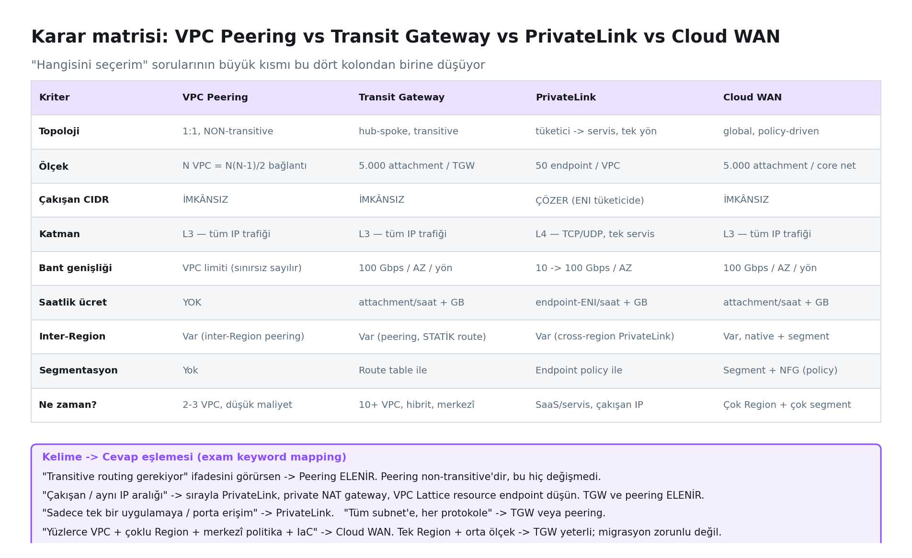
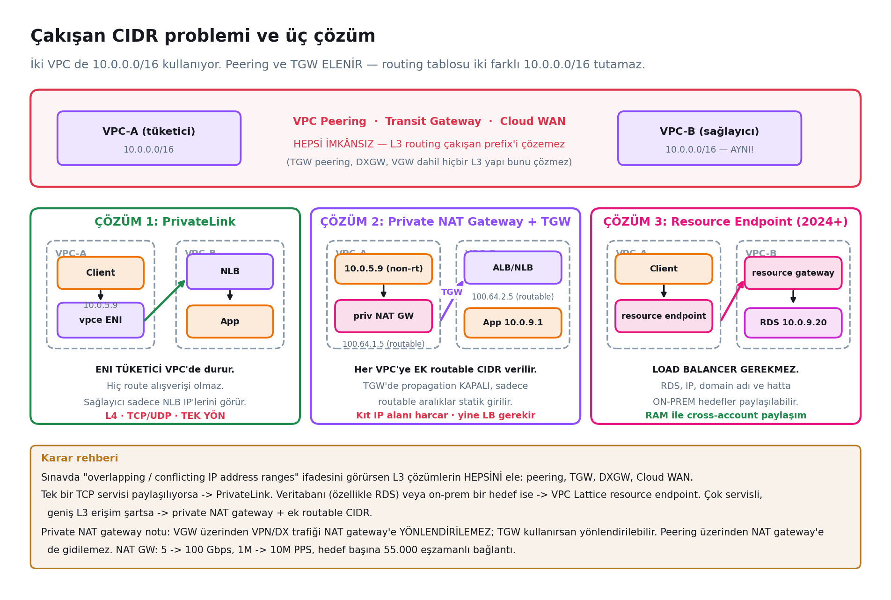
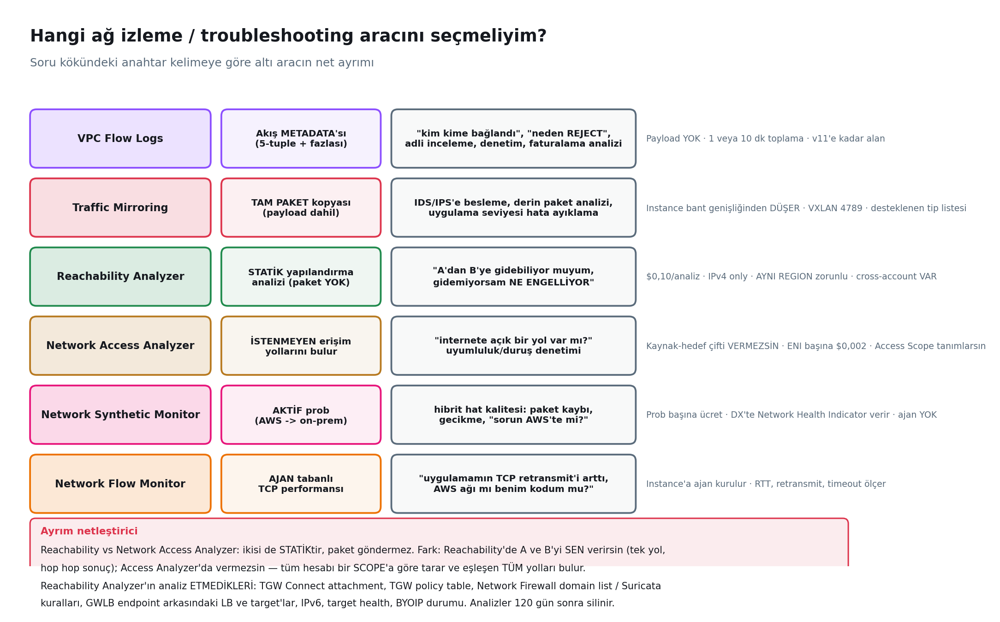
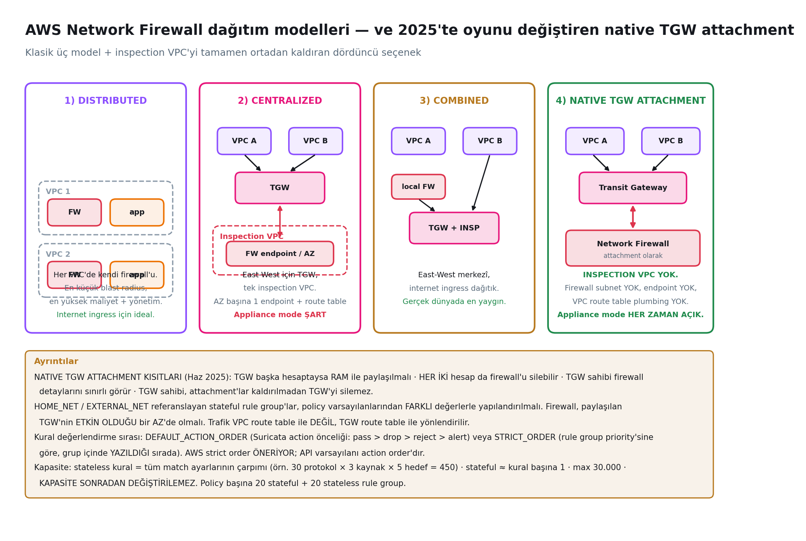

# Bölüm 8 — Karar matrisleri ve anahtar kelime → cevap haritası

> Bu bölüm yeni bilgi öğretmez. Öğrendiklerinizi **sınav anında 30 saniyede karar verebileceğiniz** forma sokar. Sınavdan önceki son iki gün bu bölümü ve Bölüm 10'u okuyun.

---

## 8.1 Bağlantı seçimi: hangi servis?



| Kriter | VPC Peering | Transit Gateway | PrivateLink | Cloud WAN |
|---|---|---|---|---|
| Topoloji | 1:1, **NON-transitive** | Hub-spoke, transitive | Tüketici → servis, tek yön | Global, policy-driven |
| Ölçek | N VPC = N(N–1)/2 | 5.000 attachment | 50 endpoint/VPC | 5.000 attachment |
| **Çakışan CIDR** | **İMKÂNSIZ** | **İMKÂNSIZ** | **ÇÖZER** | **İMKÂNSIZ** |
| Katman | L3, tüm IP | L3, tüm IP | L4, TCP/UDP, tek servis | L3, tüm IP |
| Bant genişliği | VPC limiti | 100 Gbps/AZ/yön | 10 → 100 Gbps/AZ | 100 Gbps/AZ/yön |
| Saatlik ücret | **YOK** | attachment/saat + GB | endpoint-ENI/saat + GB | attachment/saat + GB |
| Inter-Region | Var | Var (**statik route**) | Var (2024/2025) | Var, native |
| Segmentasyon | Yok | Route table | Endpoint policy | Segment + NFG |
| Şifreleme | AWS backbone | Inter-Region peering AES-256; **TGW Encryption Support** | TLS (uygulama) | AWS backbone |

### Karar cümleleri
- **2–3 VPC, statik, düşük maliyet, transitive gerekmez** → **VPC Peering** (saatlik ücret yok!)
- **10+ VPC, hibrit, merkezî kontrol, segmentasyon** → **Transit Gateway**
- **Tek bir TCP servisi, çakışan IP, tek yön** → **PrivateLink**
- **Çoklu Region + çok segment + IaC politika + servis zinciri** → **Cloud WAN**

---

## 8.2 On-prem bağlantısı: hangi yol?

| Gereksinim | Cevap |
|---|---|
| Öngörülebilir gecikme + yüksek bant genişliği | **Direct Connect** |
| Hızlı kurulum, düşük maliyet, şifreleme dahil | **Site-to-Site VPN** |
| DX var, yedek gerekiyor | **DX + VPN (BGP, aynı/daha geniş prefix, BFD, on-prem local-pref)** |
| Tek VPC'ye erişim | Private VIF → **VGW** |
| Çok VPC / çok Region'a erişim | Private VIF → **DXGW** → VGW'ler |
| TGW'ye erişim | **Transit VIF** → DXGW → TGW |
| AWS public servislerine (S3, DDB public endpoint) DX üzerinden | **Public VIF** |
| DX lokasyonları arası, Region bypass | **SiteLink** |
| DX üzerinde L2 line-rate şifreleme, dedicated 10/100/400G | **MACsec** |
| DX üzerinde şifreleme, **hosted connection** | **Private IP VPN over DX** (MACsec hosted'da yok) |
| Tünel uç noktaları public IP olmasın | **Private IP VPN over DX** |
| Gecikme/jitter iyileştirme, uzak şube → uzak Region | **Accelerated VPN** (yalnız TGW) |
| Bant genişliği artırma | **LBT (5 Gbps) + ECMP** |
| 25+ düşük bantlı şube | **VPN Concentrator** |
| SD-WAN appliance entegrasyonu | **TGW Connect** (GRE + BGP) |
| Şubeler AWS üzerinden birbirini görsün, VGW topolojisi | **VPN CloudHub** |

---

## 8.3 Çakışan CIDR karar ağacı



```
Çakışan / aynı IP aralığı var mı?
│
├─ HAYIR → TGW / Peering / Cloud WAN normal şekilde
│
└─ EVET → L3 çözümlerin HEPSİ elenir
   │        (peering, TGW, DXGW, VGW, Cloud WAN)
   │
   ├─ Paylaşılan şey TEK bir TCP/UDP servisi mi?
   │  └─ EVET → PrivateLink (NLB + endpoint service)
   │
   ├─ Paylaşılan şey bir RDS veritabanı, bir IP, bir domain adı
   │  veya ON-PREM bir hedef mi?
   │  └─ EVET → VPC Lattice RESOURCE ENDPOINT
   │            (load balancer GEREKMEZ, RAM ile paylaşılır)
   │
   ├─ Çok servisli, geniş L3 erişim şart mı?
   │  └─ EVET → Private NAT gateway + ek ROUTABLE CIDR + TGW
   │            (propagation KAPALI, statik route)
   │
   └─ Trafik inspection cihazına yönlendirilecek mi?
      └─ EVET → GWLB endpoint (route table target)
```

---

## 8.4 Endpoint seçimi

```
Erişilecek servis nedir?
│
├─ S3 veya DynamoDB
│  ├─ Yalnızca VPC içinden → GATEWAY ENDPOINT (ücretsiz)
│  ├─ On-prem'den de gerekiyor → INTERFACE ENDPOINT
│  └─ İkisi de + maliyet optimizasyonu
│     → İKİSİ BİRLİKTE, interface'te
│       "private DNS only for inbound endpoint"  ← S3'e özel!
│
├─ Diğer AWS servisleri (200+) → INTERFACE ENDPOINT
│
├─ Kendi/partner servisi (TCP/UDP, NLB arkası) → ENDPOINT SERVICE + interface endpoint
│
├─ Trafik inspection appliance'ı → GWLB ENDPOINT
│
├─ RDS / IP / domain adı / on-prem hedef → RESOURCE ENDPOINT
│
└─ Birden çok VPC Lattice servisi/kaynağı → SERVICE NETWORK ENDPOINT
```

---

## 8.5 Hibrit DNS karar ağacı

```
Sorgu hangi yönde?
│
├─ on-prem → AWS  (on-prem, AWS isimlerini çözecek)
│  ├─ Klasik → INBOUND Resolver endpoint + on-prem conditional forwarder
│  └─ 2025+ → INBOUND DELEGATION endpoint + on-prem'de NS kayıtları
│
├─ AWS → on-prem  (EC2, on-prem isimlerini çözecek)
│  ├─ Domain bazında → OUTBOUND endpoint + FORWARD rule
│  ├─ Bir alt domain AWS'te kalacak → + SYSTEM rule (istisna oy)
│  └─ Tüm domain + alt domain'ler devredilecek → DELEGATE rule (tek kural)
│
├─ VPC'ler arası PHZ paylaşımı
│  ├─ Aynı hesap → PHZ'yi VPC'lere associate et
│  ├─ Farklı hesap → 3 adımlı CLI (authorization → associate → delete-auth)
│  └─ Çok VPC / çok kural / çok PHZ → ROUTE 53 PROFILE (VPC başına 1)
│
└─ VPN/DX'i OLMAYAN dış client'lar (şube, uzaktan çalışan)
   └─ ROUTE 53 GLOBAL RESOLVER + DNS Views  (ama pahalı!)
```

---

## 8.6 İzleme aracı karar ağacı



```
Ne öğrenmek istiyorsun?
│
├─ "Bu yol AÇIK MI, değilse NE ENGELLİYOR?"
│  └─ REACHABILITY ANALYZER (statik, $0,10/analiz, aynı Region)
│
├─ "İstenmeyen HERHANGİ bir açık yol var mı?" (uyumluluk)
│  └─ NETWORK ACCESS ANALYZER (scope, $0,002/ENI)
│
├─ "Kim kime bağlandı / neden REJECT?"
│  └─ VPC FLOW LOGS
│
├─ "TGW'de paket neden kayboluyor?"
│  └─ TGW FLOW LOGS → packets-lost-{no-route|blackhole|mtu-exceeded|ttl-expired}
│
├─ "Paketin İÇİNDE ne var?" (IDS/IPS, DPI)
│  └─ TRAFFIC MIRRORING (bant genişliğinden düşer!)
│
├─ "Hibrit hattımın kalitesi ne, sorun AWS'te mi?"
│  └─ NETWORK SYNTHETIC MONITOR (aktif prob + NHI)
│
├─ "Uygulamamın TCP performansı bozuldu, AWS mi ben mi?"
│  └─ NETWORK FLOW MONITOR (ajan, RTT/retransmit + NHI)
│
└─ "İnternetteki kullanıcılarım nasıl deneyim yaşıyor?"
   └─ INTERNET MONITOR (pasif, city-network)
```

---

## 8.7 Inspection mimarisi seçimi



| Senaryo | Model |
|---|---|
| Az sayıda VPC, bağımsız politikalar, en küçük blast radius | **Distributed** (her VPC'de firewall) |
| Internet **ingress** filtreleme | **Distributed** (ingress noktasına yakın) |
| Çok VPC, East-West merkezî kontrol, tek politika | **Centralized** (inspection VPC + TGW, **appliance mode ŞART**) |
| Gerçek dünyada en yaygın | **Combined** (East-West merkezî + ingress dağıtık) |
| **2025+: en az operasyonel yük, çok VPC, East-West** | **Native TGW attachment** (inspection VPC YOK) |
| Üçüncü parti appliance (Palo Alto, Fortinet, Check Point…) | **GWLB + GWLBE** |
| Org çapında politika dayatma ve uyumluluk | **Firewall Manager** (Config + RAM ön koşul) |

---

## 8.8 Şifreleme seçimi

| Senaryo | Cevap |
|---|---|
| DX fiziksel linkte, dedicated 10/100/400G | **MACsec** (noktadan noktaya, hosted'da yok) |
| DX üzerinde uçtan uca IPsec, hosted connection | **Private IP VPN over DX** |
| DX + public servis erişimi + şifreleme | **Public VIF + klasik S2S VPN** |
| İnternet üzerinden on-prem ↔ AWS | **Site-to-Site VPN** |
| VPC ↔ VPC TGW trafiği zorunlu şifreli | **TGW Encryption Support** (Kas 2025) |
| TGW inter-Region peering | Zaten **AES-256 çift şifreli** (ek iş yok) |
| Uygulama seviyesi | **TLS** + ACM |
| Post-quantum | Site-to-Site VPN'de **YOK**; TLS tabanlı servislerde var |

---

## 8.9 Anahtar kelime → cevap haritası (en değerli tablo)

Sınav soruları belirli ifadeleri tekrar tekrar kullanır. Bu tabloyu ezberlemek okuma hızınızı ikiye katlar.

| Soru kökündeki ifade | Refleks cevap / eleme |
|---|---|
| "transitive routing gerekli" | **Peering ELENİR** (ve DXGW elenir) |
| "overlapping / conflicting IP ranges" | **Tüm L3 çözümler ELENİR** → PrivateLink / resource endpoint / private NAT GW |
| "least operational overhead" | Yönetilen servis; en az bileşen sayısı; otomatik olan |
| "most cost-effective" | Gateway endpoint (ücretsiz), peering (saatlik yok), tek NAT GW, VPN Concentrator |
| "without traversing the internet" | PrivateLink / DX / VPC endpoint |
| "without using public IP addresses" | **Private IP VPN over DX** / interface endpoint |
| "rastgele kopan bağlantılar" + "unknown flow" | **Appliance mode** |
| "asymmetric routing" / "stateful firewall drops" | **Appliance mode** veya **on-prem local preference** |
| "failover 90 saniye sürüyor" | **BFD** (300 ms × 3 ≈ 900 ms) |
| "AS_PATH prepend ile DX yerine VPN" | **YANLIŞ** — attachment tipi sırası sabittir |
| "tek bir akış X Gbps olmuyor" | **ECMP çözmez** → LBT / paralel akış / DX |
| "99,99% Direct Connect SLA" | **4 bağlantı + 2 lokasyon + lokasyon başına 2 + Enterprise Support + WA Review** |
| "LAG ile yedeklilik" | **YANLIŞ** — LAG aynı cihazda sonlanır |
| "25+ / yüzlerce şube, düşük bant" | **VPN Concentrator** |
| "SD-WAN appliance" | **TGW Connect** (GRE + BGP) |
| "on-prem'den S3'e private, maliyet optimize" | **Gateway + interface endpoint** (private DNS only for inbound) |
| "gerçek client IP'sini logla" (PrivateLink) | **Proxy Protocol v2** |
| "ALB'yi PrivateLink ile sun" | **ALB'yi NLB'ye ALB-type target yap** |
| "paketin içeriğini incele" / "IDS'e besle" | **Traffic Mirroring** |
| "kim kime bağlandı" / "neden reject" | **VPC Flow Logs** |
| "TGW'de paket kayboluyor" | **TGW Flow Logs** + `packets-lost-*` |
| "ne engelliyor" (tek yol) | **Reachability Analyzer** |
| "internete açık yol var mı" (tarama) | **Network Access Analyzer** |
| "sorun AWS'te mi bizde mi" (hibrit hat) | **Network Synthetic Monitor** + NHI |
| "TCP retransmit arttı" | **Network Flow Monitor** |
| "DNS tunneling / veri sızması" | **DNS Firewall Advanced** |
| "isim çözülmüyor ama IP çalışıyor" | Bölüm 5 — Resolver rule / endpoint yönü |
| "on-prem AWS isimlerini çözemiyor" | **INBOUND** endpoint |
| "EC2 on-prem isimlerini çözemiyor" | **OUTBOUND** endpoint + FORWARD rule |
| "bir alt domain AWS'te kalsın" | **SYSTEM rule** |
| "yüzlerce VPC'ye PHZ + rule dağıtımı" | **Route 53 Profiles** |
| "VPN/DX'i olmayan şubeler PHZ çözsün" | **Route 53 Global Resolver** |
| "inspection VPC istemiyorum" | **Native TGW attachment** (Haz 2025) |
| "kural sırası kesin olsun + policy default action" | **STRICT_ORDER** |
| "stateless drop loglanmıyor" | Doğru — logging **yalnızca stateful** engine için |
| "org çapında baseline SG / NACL" | **Firewall Manager** (+ Config + RAM) |
| "yeni hesaplar otomatik kapsama girsin" | **Firewall Manager** doğal davranışı |
| "veri işleme ücretini tüketiciye yaz" | **TGW Flexible Cost Allocation** (metering policy) |
| "appliance sağlığına göre route table değişsin" | **VPC Route Server** |

---

## 8.10 "Bunu yapamazsın" listesi — hızlı eleme

Bir seçenek aşağıdakilerden birini iddia ediyorsa **kesinlikle yanlıştır**:

| İddia | Gerçek |
|---|---|
| Peering transitive'dir | Değil, hiç olmadı |
| DXGW, VPC↔VPC trafiği taşır | Taşımaz — transitive değil |
| TGW peering'de BGP var | Yok — **sadece statik route** |
| TGW peering transitive'dir | Değil — TGW iki peering arasında röle etmez |
| TGW peering'de ECMP / multicast var | Yok |
| Transit VIF VGW'ye bağlanır | Bağlanmaz — **yalnızca DXGW** |
| Public VIF ile VGW/DXGW kullanılır | Kullanılmaz — gateway yok |
| Gateway endpoint on-prem'den erişilir | Erişilmez |
| Gateway endpoint peering/TGW üzerinden erişilir | Erişilmez |
| Gateway endpoint S3 dışında X servisini destekler | Yalnızca **S3 ve DynamoDB** |
| ALB doğrudan endpoint service olur | Olmaz — NLB/GWLB gerekir |
| MACsec hosted connection'da var | Yok |
| MACsec uçtan uca şifreler | Şifrelemez — noktadan noktaya |
| Accelerated VPN VGW ile çalışır | Çalışmaz — **yalnızca TGW** |
| Accelerated VPN mevcut bağlantıda açılır | Açılmaz — yeni connection |
| Accelerated VPN DX public VIF ile çalışır | Çalışmaz |
| Statik routing'li VPN'de ECMP var | Yok |
| VGW'de ECMP veya LBT var | Yok |
| LAG dayanıklılık sağlar | Sağlamaz — aynı cihaz |
| AS_PATH ile VPN'i DX'in önüne alırım | Alınmaz — tip sırası sabit |
| Appliance mode VPN/peering attachment'ında açılır | Açılmaz — **yalnızca VPC attachment** |
| Appliance mode + 2/3-tuple GWLB stickiness | Desteklenmez — **5-tuple zorunlu** |
| GWLBE'yi RAM ile paylaşırım | Paylaşılmaz — **PrivateLink modeli** |
| GWLBE'nin subnet'ini değiştiririm | Değiştirilemez |
| Tüm target unhealthy ise GWLB fail-open olur | Olmaz — trafik düşer |
| Reachability Analyzer paket gönderir | Göndermez — statik |
| Reachability Analyzer cross-Region çalışır | Çalışmaz |
| Reachability Analyzer IPv6'yı analiz eder | Etmez |
| Flow Logs Amazon DNS trafiğini yakalar | Yakalamaz |
| Flow Logs payload içerir | İçermez |
| Flow log formatını sonradan değiştiririm | Değiştirilemez — sil + oluştur |
| Traffic Mirroring bant genişliğinden düşmez | Düşer |
| Traffic Mirroring inter-Region peering üzerinden çalışır | Listelenmemiş — intra-Region |
| Resolver rule'da numerik priority var | Yok — **en spesifik domain kazanır** |
| Cross-account PHZ association konsoldan yapılır | Yapılmaz — **sadece CLI/API** |
| Network Firewall rule group kapasitesini artırırım | Artırılamaz |
| STRICT_ORDER API varsayılanıdır | Değil — action order |
| Stateless drop'lar loglanır | Loglanmaz |
| NFW forward proxy modu GA'dır | Değil — **public preview, us-east-2** |
| FMS için AWS Config gerekmez | Gerekir |
| Amazon Q ile ağ troubleshooting yaparım | **Haz 2025'te kaldırıldı** |

---

## 8.11 Sayısal ayrım tablosu — birbirine benzeyen sayılar

Sınavda sayıları karıştırmak en kolay kayıptır. Benzer olanları yan yana koyalım:

| Konu | Sayı | Karıştırılan |
|---|---|---|
| DXGW başına **VGW** | **20** | DXGW başına **TGW: 6** |
| DXGW başına VIF | **30** | Dedicated connection başına VIF: **51** |
| Dedicated başına **transit** VIF | **4** | private/public VIF: **50** |
| **VPC** başına TGW | **5** | TGW başına attachment: **5.000** |
| TGW başına route table | **20** | TGW başına **toplam route: 10.000** |
| TGW başına CIDR block | **5** | TGW başına peering: **50** |
| Connect peer / attachment | **4** | GRE tünel başına 5 Gbps → attachment **20 Gbps** |
| Interface + GWLB endpoint / VPC | **50 (birlikte)** | Endpoint policy: **20.480 karakter** |
| Resolver endpoint / Region | **4** | Endpoint başına IP: **6** |
| Resolver IP başına QPS | **10.000** | SG tracking/NLB varsa: **1.500** |
| Link-local PPS | **1.024** | (DNS+IMDS+NTP+Windows **toplamı**) |
| Route 53 Profile / hesap-Region | **5** | Profile başına VPC: **1.000** |
| DNS FW rule group / VPC | **5** | Rule group başına kural: **100** |
| Mirror session / kaynak ENI | **3** | Filtre başına kural: **10** |
| Mirror session numarası | **1–32766** | Hesap başına session: **10.000** |
| NFW rule group max kapasite | **30.000** | Policy başına rule group: **20 + 20** |
| NFW VPC endpoint assoc. / firewall / AZ | **50** | Hesap/Region: **300** |
| VPN connection / Region | **50** | Accelerated VPN: **10**, LBT: **50** |
| VPN Concentrator / TGW | **5** | Concentrator başına site: **100** |
| DX prefix (private/transit) | **1.000** (eski: 100) | Public VIF: **1.000 sabit** |
| DXGW TGW allowed prefix | **200** | Cloud WAN DXGW → on-prem: **5.000** |
| VPN route (TGW) | içeri **1.000** / dışarı **5.000** | VGW: içeri **100** / dışarı **1.000** |
| Flow log subscription / kaynak | **250** | Toplama: **60 veya 600 sn** |
| NAT GW hedef başına bağlantı | **55.000** | NAT GW başına IPv4: **8** |

---

## 8.12 MTU özet tablosu

| Yol | MTU | PMTUD |
|---|---|---|
| VPC içi (jumbo) | 9001 | ✅ |
| **DX private VIF** | 1500 veya **9001** | — |
| **DX transit VIF** | 1500 veya **8500** | — |
| **DX public VIF** | **yalnızca 1500** | — |
| TGW VPC attachment | **8500** | ✅ |
| TGW Connect attachment | **8500** | ✅ |
| TGW DX attachment | **8500** | ❌ |
| **TGW peering** (intra/inter-Region, Cloud WAN) | **8500** | ❌ |
| TGW Site-to-Site VPN | **1500** (kota sayfası) | ❌ |
| Site-to-Site VPN payload | max **1446** / MSS **1406** | — |
| VPC interface endpoint | **8500** | ❌ |
| **GWLB** | **8500** (GENEVE +68 → appliance ≥ **8568**) | ❌ |
| AWS Local Zones | **1468** (LA hariç) | — |
| Traffic Mirroring kesilmesiz max | **8947** | — |

**Jumbo frame kaybı tuzağı:** iki private VIF aynı rotayı farklı MTU ile duyurursa **veya** aynı rotayı bir S2S VPN de duyurursa → **1500'e düşer**.

---

## 8.13 Ücret refleksleri (maliyet sorularında)

| Ücretsiz olan | Ücretli olan |
|---|---|
| **Gateway endpoint** (saatlik + GB yok) | Interface endpoint: **$0,01/saat/ENI + $0,01/GB** |
| **VPC Peering saatlik ücreti** (cross-AZ veri var) | TGW: **attachment/saat + GB başı** |
| **MACsec** (ek ücret yok) | SiteLink: **$0,50/saat/VIF + GB matrisi** |
| Security group referencing (TGW) | Reachability Analyzer: **$0,10/analiz** |
| AWS managed NFW rule group'larının çoğu | Network Access Analyzer: **$0,002/ENI** |
| Reachability Analyzer cross-account ek ücreti | Resolver endpoint: **$0,125/saat/ENI + $0,40/M sorgu** |
| | Route 53 Profile: **$0,75/saat** (≤100 assoc.) |
| | DNS Firewall: **$0,60/M sorgu**; Advanced: **$0,16/saat/VPC** |
| | Resource endpoint: **$0,02/saat/kaynak** |
| | Global Resolver: **$5,00/saat** (ilk 2 Region) |
| | Cross-Region PrivateLink: sağlayıcı **+$0,05/saat/Region** |

---

[← Bölüm 7: GWLB / NFW / FMS](07-gwlb-network-firewall-firewall-manager.md) · [Sonraki bölüm: Sınav soru bankası →](09-sinav-soru-bankasi.md)
